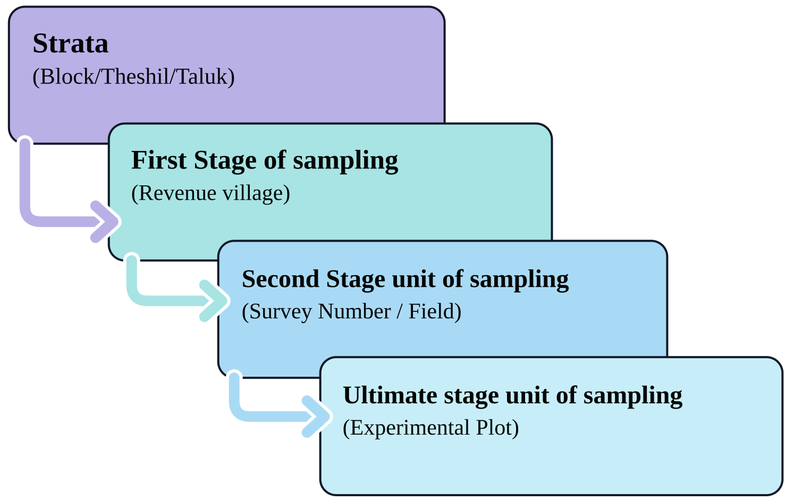

# Official agricultural statistics

Agriculture makes a substantial contribution to India’s economy and employment. Its share depends on the reference year and on whether agriculture alone or agriculture and allied activities are included. Reliable and timely information is vital for planners and policymakers to develop effective agricultural policies and make informed decisions on procurement, storage, public distribution, imports, exports, and other related matters. As such, the collection and management of agricultural statistics hold significant importance.

This chapter provides an overview of the system for collecting agricultural statistics in India. Agriculture is a state subject, but agricultural statistics fall under the concurrent list, which results in a decentralised system involving both the states and the centre. State Governments, through their State Agricultural Statistics Authorities (SASAs), play a central role in collecting and compiling agricultural statistics at the state level. At the national level, the **Economics, Statistics and Evaluation (ES&E) Division** of the Department of Agriculture and Farmers Welfare compiles crop production estimates. Older publications refer to the Directorate of Economics and Statistics (DES) [@CropEstimates2026]. Other key agencies involved include the National Statistical Office (NSO) and the State Directorates of Economics and Statistics (DESs).

## Compiling crop statistics

Crop statistics comprise two key components: the area sown and the average yield.\
While area estimates are derived from land revenue systems, yield estimates are obtained through crop estimation surveys.

### Area statistics

The system for collecting area statistics across states and Union Territories (UTs) can be broadly classified into three categories. The approximate reporting-area shares below refer to the official ICS report for 2018–19, not to a fixed current division [@ICS201819]:

1.  **States with complete enumeration systems**\
    These are the temporarily settled states, covering 18 states and the UT of Puducherry in the 2018–19 report with cadastrally surveyed land records. Area statistics from this group account for about 86% of the country’s reporting area.

2.  **States using sample surveys**\
    These are the permanently settled states, such as Kerala, Odisha, and West Bengal, which have no land revenue agency at the village level. This group accounts for about 9% of the country’s reporting area.

3.  **States with no developed system for area statistics**\
    These mainly include hill states, north-eastern states, and certain UTs, where the collection is still based on conventional methods such as personal assessment. This group accounts for the remaining 5% of the country’s reporting area.

### Crop yield estimation

Crop yields are estimated through **Crop Cutting Experiments (CCE)**, which are conducted extensively across the country. The General Crop Estimation Survey (GCES) provides yield estimates for principal crops through a large programme of CCEs. The crop coverage and number of experiments vary by year and should be read from the corresponding official programme, rather than treated as fixed constants. These experiments are conducted systematically to ensure accurate and reliable yield data for principal crops.

{#fig-gces-stages fig-height="4" fig-alt="Sampling Design under General Crop Estimation Survey" fig-align="center" width="590" style="text-align:center;"}

In @fig-gces-stages, villages are selected within strata, fields are selected within villages, and crop-cutting plots are located within fields. These are successive sampling stages. The actual selection probabilities and operative instructions must be followed at each stage; multistage sampling is explained in the sample-survey chapter.

#### Crop cutting experiment technique

In a Crop Cutting Experiment, a small, carefully chosen portion of the crop field is harvested and weighed, and the result is used to estimate the yield for the whole field. A CCE is conducted in a step-by-step manner, as described below.

**Step 1. Selection of the field**\
The field growing the crop chosen for the experiment must be large enough to accommodate at least one CCE plot. In other words, the total area of the field should be greater than the size of the plot marked for harvesting.

**Step 2. Locating and marking the experimental plot**  

Once the field is selected, the experimental plot is located and marked from the south-west (SW) corner of the field. The distance from the SW corner to the experimental plot is measured using steps. In this illustration, the random coordinates are 58 and 51 steps; in an actual CCE they must be selected according to the prescribed sampling procedure. First, measure 58 steps along the horizontal direction from the SW corner and mark the point corresponding to the left side of the plot. From this point, measure 51 steps vertically towards the interior of the field to locate the lower-left corner, A, of the experimental plot.

For a 5 m × 5 m square CCE plot, mark the four corners as A, B, C, and D, as shown in @fig-cceplot. The sides AB, BC, CD, and DA should each measure 5 m. The diagonals AC and BD should each measure approximately 7.07 m, since

$AC = BD = \sqrt{5^2 + 5^2} = \sqrt{50} = 7.07$ m.

The equality of the two diagonals, together with the side measurements, can be used to verify that the marked plot is a true square. Thus, the figure illustrates how a 5 m × 5 m experimental plot is located at a specified distance from the SW corner of a field measuring 120 steps in the horizontal direction and 70 steps in the vertical direction.

The size and shape of the CCE plot may vary according to the crop and the state-specific CCE procedure. Common shapes include a 5 m × 5 m square, 10 m × 10 m square, or 10 m × 5 m rectangle. A published CCE methodology study describes 10 m equilateral triangular plots for most crops in Uttar Pradesh and circular plots of radius approximately 1.7145 m in West Bengal [@CCEpilot]. These are documented examples; the operative crop- and state-specific instructions should be checked for the survey concerned.

{#fig-cceplot fig-alt="Demarcation of CCE plot of 5 m by 5 m size from SW corner" fig-align="center" width="80%" style="text-align:center;"}  

@fig-cceplot illustrates the location and marking of a 5 m × 5 m CCE plot from the south-west (SW) corner of a field. The lower-left corner of the plot, $A$, is located 58 steps horizontally and 51 steps vertically from the SW corner. The field measures 120 steps horizontally and 70 steps vertically. The four sides of the experimental plot are each 5 m long, and the diagonals $AC$ and $BD$ are each approximately 7.07 m. The diagonal measurements provide a check that the four marked corners form a true square.

**Step 3. Harvesting the experimental plot**\
A string is tied around the boundary pegs to clearly mark the edges of the plot. Harvest plants rooted within the marked plot. For plants exactly on the boundary, follow the inclusion rule prescribed for the crop and survey, applying it consistently on every plot. All the harvested plants are then collected together.

**Step 4. Threshing the harvested plants**\
The harvested plants are spread on a clean cloth or mat and threshed carefully. After threshing, the grain is allowed to dry properly.

**Step 5. Winnowing and weighing the produce**\
*Winnowing* is the process of removing the chaff, or light waste material, from the grain by blowing air over it. After winnowing, only clean grains remain. These are put into a gunny bag (jute sack) and weighed using a checked weighing instrument. Subtract the weight of the empty bag to obtain the net grain weight, and record any drying or moisture adjustment prescribed by the survey.

If the net grain weight is $w$ kg from a plot of area $a$ m², the plot yield is $10\,000w/a$ kg per hectare. For example, 12.5 kg from a 25 m² plot gives $10\,000(12.5)/25=5000$ kg per hectare. The survey yield estimate combines the sampled plots according to its design; a single plot does not represent the whole region.

::: {.callout-important title="Note"}
The plot size and shape used for a CCE can affect the accuracy of the yield estimate. Smaller or irregularly shaped plots tend to give more variable yield estimates, which is why the shape and size are standardised for each crop and state under the GCES.
:::

Final estimates of crop production are calculated using crop area estimates and yield rates derived from crop-cutting experiments. The area estimates may come from complete enumeration or sample surveys, according to the state system. These estimates become available only after the harvest. However, to support timely decision-making, the Government requires advance production estimates.

The ES&E Division releases advance and final crop production estimates. The current departmental description distinguishes the following releases [@CropEstimates2026]:

1. **First Advance Estimates**: generally in September, covering Kharif production.
2. **Second Advance Estimates**: generally in February, covering Kharif and Rabi production.
3. **Third Advance Estimates**: generally in May, incorporating updated area and yield information.
4. **Final Estimates**: generally in September or October.

Release dates and coverage should be checked for the agricultural year concerned. Older accounts describe four advance forecasts followed by separate final and revised estimates; those historical schedules should not be confused with the current series.

Additionally, information on the structure and characteristics of the agricultural sector is gathered through the Agricultural Census.

## Agricultural Census

The Agricultural Census is a comprehensive exercise conducted to gather and analyse data on the structure of the agricultural sector in India. It provides essential information about operational holdings, including their number, area, land use, cropping patterns, and input usage, down to the lowest geographical levels such as villages, tehsils (sub-districts), and districts. This census serves as a statistical framework for planning and conducting future agricultural surveys.

Initiated in **1970-71**, the Agricultural Census is conducted on a quinquennial (five-yearly) basis by the Department of Agriculture and Farmers Welfare in collaboration with State and Union Territory administrations. In states with land records, the number and area of operational holdings are collected through **complete enumeration**, while detailed data on the characteristics of operational holdings are gathered on a **sample basis**.

Ten Agricultural Censuses preceded the eleventh census, whose reference year is **2021-22**. The eleventh census was launched on 28 July 2022; its launch should not be confused with completion and publication of all phases [@AgricultureCensus2022]. The reference period is the agricultural year, spanning **July to June**.

The data derived from the Agricultural Census plays a crucial role in policy formulation, resource allocation, and the overall development of the agricultural sector in India.

Additional data pertaining to various sectors can be obtained from the sources listed in the @sec-appendix-1.  

## Chapter Summary

### Fill in the blanks {.unnumbered}

Answers are given at the end of the chapter.

1. Crop production is estimated by multiplying crop area by average crop __________.

2. The field procedure used to estimate crop yield is called a crop __________ experiment.

3. The full form of CCE is __________.

4. The full form of GCES is __________.

5. Crop yield per hectare is obtained by dividing crop production by crop __________.

6. The Agricultural Census provides information on the number and area of operational __________.

7. In land-record states, the number and area of operational holdings are collected by complete __________.

8. The Agricultural Census in India is normally conducted at intervals of __________ years.

### Short-answer questions {.unnumbered}

1. Why are agricultural statistics important for India?

2. Explain the system of collection and compilation of agricultural statistics in India.

3. What are the two main components of crop statistics?

4. Explain the three categories of area statistics systems in India.

5. What is a Crop Cutting Experiment (CCE)?

6. Explain the General Crop Estimation Survey (GCES).

7. Describe the steps involved in conducting a Crop Cutting Experiment.

8. Explain how the experimental plot is located and marked in a CCE.

9. What are the different sizes and shapes of CCE plots used in India?

10. Why is the size and shape of a CCE plot standardised?

11. Explain the harvesting, threshing, winnowing, and weighing stages of a CCE.

12. What are advance estimates of crop production? Why are they required?

13. Distinguish the three Advance Estimates from the Final Estimates in the current crop production series, and state their usual release periods.

14. Why must the reference year and release status be stated when quoting an official crop production estimate?

15. What is the Agricultural Census? What information does it provide?

16. When was the Agricultural Census initiated and how frequently is it conducted?

17. Explain the methods used for collecting data in the Agricultural Census.

18. What is the reference period of the Agricultural Census?

19. Write a short note on the contribution of Prasanta Chandra Mahalanobis to statistics in India.

### Numerical and conceptual questions {.unnumbered}

Answers are given at the end of the chapter.

1. A crop-cutting plot of 25 m² gives 8.5 kg of clean grain on the specified reporting basis. Find the yield in kg per hectare.

2. A crop occupies 10 ha and its estimated yield is 3 tonnes per hectare. Find its estimated production.

3. A bag of produce weighs 5.2 kg, including a bag weighing 0.2 kg. Find the net produce weight.

4. Find the diagonal of a square CCE plot having a side of 6 m.

5. A survey first selects villages, then fields within the selected villages, and finally crop-cutting plots within those fields. Identify the sampling method and its stages.

### Important formulae {.unnumbered}

Diagonal of a square CCE plot:

$$
AC=BD=\sqrt{5^2+5^2}=7.07\text{ m}
$$

Diagonal of a square of side $a$:

$$
d=a\sqrt{2}
$$

### Quick revision {.unnumbered}

* Crop production combines an area estimate and a corresponding yield estimate.
* CCE plots must be selected by the prescribed sampling procedure, not by convenience.
* Plot yield requires the net produce weight and the actual harvested area.
* Villages, fields and experimental plots can form successive sampling stages.
* Official estimates should be quoted with their reference year and release status.
* The Agricultural Census describes operational holdings.

### Answers to fill in the blanks {.unnumbered}

::: {.answer-key}

`1.` Yield `2.` Cutting `3.` Crop Cutting Experiment `4.` General Crop Estimation Survey `5.` Area `6.` Holdings `7.` Enumeration `8.` Five
:::

### Solutions to numerical and conceptual questions {.unnumbered}

1. Yield $=10000(8.5)/25=3400$ kg per hectare.

2. Production $=10\times3=30$ tonnes. The area and yield must refer to the same crop, region and reporting period.

3. Net weight $=5.2-0.2=5.0$ kg. The bag weight must be excluded.

4. The diagonal is $6\sqrt2=8.49$ m, approximately.

5. It is multistage sampling: villages are first-stage units, fields are second-stage units and the crop-cutting plots are ultimate units. Selection must follow the prescribed probability design at each stage.

::: {.callout-caution title="Historical Insights"}
**“Mahalanobis and statistical planning in India”**

In 1931, a young physicist-turned-statistician named *Prasanta Chandra Mahalanobis* founded the Indian Statistical Institute (ISI) in Kolkata, in a room at Presidency College, with little more than a handful of enthusiastic collaborators and a conviction that data, properly collected and analysed, could transform how a nation was run. Five years later, he introduced the *Mahalanobis Distance*, a measure still used across statistics and machine learning to compare multivariate observations, developed originally from his work on anthropometric measurements of different castes and tribes in India.

Mahalanobis’ greatest impact, however, came after independence. In 1950, he established the National Sample Survey, one of the largest continuing household survey programmes in the world, which for the first time gave India reliable, regular estimates of consumption, employment, and agricultural output at a national scale. As a member of the Planning Commission, he went on to design the statistical framework behind India’s *Second Five-Year Plan (1956-1961)*, developing what came to be known as the *Mahalanobis Model*, a growth strategy that prioritised investment in heavy industries and capital goods to build long-term self-reliance. For these contributions, he was awarded the Padma Vibhushan in 1968 and is remembered today as the ‘Father of Indian Statistics’. His career remains one of the clearest illustrations of how statistical thinking, applied with rigour, can shape the destiny of an entire nation, an example particularly relevant to agricultural statistics, a field built on exactly the kind of large-scale, sample-based data collection that Mahalanobis pioneered.
:::

::: {.callout-tip title="Quotes to Inspire"}
**“Statistics is the art of never having to say you’re certain.”**\
**- W. Edwards Deming**
:::  