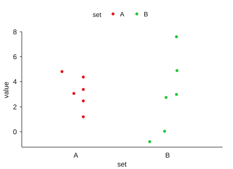

# Measures of dispersion

In the previous chapters, we have seen how a set of data can be summarized by a single representative value that describes the central tendency of the data. Consider the two sets of data, A and B, in @tbl-dsp1.

|       |     |     |     |     |     |     |
|:-----:|:---:|:---:|:---:|:---:|:---:|:---:|
| **A** | 1   | 2   | 3   | 3   | 4   | 5   |
| **B** | -1  | 0   | 3   | 3   | 5   | 8   |

: Model dataset to demonstrate dispersion {#tbl-dsp1 .bordered}

You can see mean, median and mode for both the sets **A** & **B** in @tbl-dsp1 is 3.

The plot of values of **A** and **B** in @tbl-dsp1 can be seen in @fig-scatterab. The figure is known as dot plot.

{#fig-scatterab fig-align="center" width="50%" style="text-align:center;"}

It can be seen in @fig-scatterab that, while values of data set **A** are grouped close to their mean, while the values of data set **B** are more spread out. We say that values of data set **B** are more dispersed (or scattered) than those of data set **A.** This example shows that the measures of central tendency are not enough in describing a set of data. In addition to using these measures, we need numerical measures of dispersion (or variation) of a set of data.

::: {.callout-important title="Note"}
**Dispersion** refers to the extent to which numerical data values deviate from an average or central value. The statistical measures calculated from the data to quantify this dispersion are known as measures of dispersion.
:::

## Characteristics of a good measure of dispersion

An ideal measure of dispersion is expected to possess the following properties

1.  It should be rigidly defined.

2.  It should be based on all the items.

3.  It should not be unduly affected by extreme items.

4.  It should lend itself for algebraic manipulation.

5.  It should be simple to understand and easy to calculate.

The most important measures of dispersion are **range**, **quartile deviation**, **variance**, **inter-quartile range**, **mean absolute deviation** and **standard deviation**.

## The range

This is the simplest possible measure of dispersion. The range of a set of data is defined as the difference between the largest observation and the smallest observation in the set of data.

Thus,

**Range = largest observation - smallest observation.**

It can be denoted as, Range = L - S.

where, L = Largest value; S = Smallest value.

::: {#exm-ct24}
The marks obtained by 8 students in mathematics and physics examinations are as follows:

| Student | Mathematics | Physics |
|:-------:|:-----------:|:-------:|
|    1    |     35      |   50    |
|    2    |     60      |   55    |
|    3    |     70      |   70    |
|    4    |     40      |   65    |
|    5    |     85      |   89    |
|    6    |     96      |   68    |
|    7    |     55      |   72    |
|    8    |     65      |   80    |

: Model dataset of marks obtained in two subjects {#tbl-markrange .bordered}

Find the ranges of the two sets of data. Are the physics marks more dispersed than the mathematics marks?

**Solution**

For mathematics,

Highest mark = 96, lowest mark = 35, range = 96 - 35 = 61

For physics,

Highest mark = 89, lowest mark = 50, range = 89 - 50 = 39.

The mathematics marks have a wider range than the physics marks. The mathematics marks are therefore more dispersed than the physics marks.
:::

In individual observations and discrete series, L and S are easily identified. In case of grouped frequency distribution, the following method is employed.

L = Upper boundary of the highest class

S = Lower boundary of the lowest class.

$$Range = L - S$$ {#eq-range}

::: {#exm-ct25}
Calculate range from the following distribution

|        |        |        |        |        |        |
|:------:|:------:|:------:|:------:|:------:|:------:|
| Size   | 60--63 | 63--66 | 66--69 | 69--72 | 72--75 |
| Number | 5      | 18     | 42     | 27     | 8      |

: Model frequency distribution table for range calculation {#tbl-rangemodel .bordered}

**Solution**

L = Upper boundary of the highest class = 75

S = Lower boundary of the lowest class = 60

Using the outer class boundaries gives an approximate range of $75-60=15$. The exact range of the original observations is not recoverable from the grouped table.
:::

**Merits and demerits of range**

[**Merits**]{.underline}

1.  It is simple to understand.

2.  It is easy to calculate.

3.  It is useful as a quick summary in applications such as quality control and the reporting of daily temperature ranges.

[**Demerits**]{.underline}

1.  It is very much affected by the extreme items.

2.  It is based on only two extreme observations.

3.  It cannot be calculated from open-end class intervals.

4.  It is not suitable for mathematical treatment.

5.  It is a very rarely used measure.

## The inter-quartile range (IQR)

The range is a simple and quick measure to calculate. However, because it relies solely on the maximum and minimum values in a data set, it does not provide information about how the data is distributed between these two values. As a result, the range may not be an effective measure of dispersion, especially if one or both of these values are significantly different from the rest of the data. To address this limitation, the interquartile range is often used. The interquartile range is a more robust measure of dispersion, defined as the difference between the upper and lower quartiles of the data. IQR is also known as midspread. Thus,

$$IQR = Q_3 - Q_1$$ {#eq-iqr}

Half the interquartile range is the **quartile deviation**, $QD=(Q_3-Q_1)/2$.

The inter-quartile range of a set of data is therefore not affected by values of the data outside *Q*~1~ and *Q*~3~ making it a more reliable measure of spread for skewed or non-normal distributions.

::: {#exm-ct26}
Consider the two sets of data A & B below, find IQR

|     |     |     |     |     |     |     |     |     |     |
|:---:|:---:|:---:|:---:|:---:|:---:|:---:|:---:|:---:|:---:|
| A   | 3   | 4   | 5   | 6   | 8   | 9   | 10  | 12  | 15  |
| B   | 3   | 8   | 8   | 9   | 9   | 9   | 10  | 10  | 15  |

: Model dataset for IQR calculation {#tbl-modeldatiqr .bordered}

**Solution**

For data set A, *Q*~1~ = 4.5, *Q*~3~ = 11; so Inter-Quartile Range = 11 - 4.5 = 6.5

For data set B, *Q*~1~ = 8, *Q*~3~ = 10; so Inter-Quartile Range = 10 - 8 = 2

Since the interquartile range (IQR) of data set A is greater than that of data set B, these results indicate that data set A is more dispersed than data set B. It is also noticeable that the range is the same for both sets.
:::

**Merits and demerits of IQR**

[**Merits**]{.underline}

1.  It is simple to calculate and easy to understand.

2.  It is not affected by extreme values (outliers) in the data, making it a more reliable measure of spread than the range.

3.  IQR provides a clear measure of the spread of the middle 50% of the data, giving a better representation of variability when data is skewed.

4.  It can be used for skewed distributions, where the range and standard deviation may not be as useful.

5.  IQR is particularly useful in identifying outliers, as data points outside 1.5 times the IQR from the quartiles are often considered outliers.

[**Demerits**]{.underline}

1.  The IQR does not use all the data points, which means it may not represent the variability of the entire dataset.

2.  It may not be as intuitive as the range or standard deviation for some users, particularly in more complex datasets.

3.  The IQR is less sensitive to variations in the data outside of the interquartile range, meaning it might not fully reflect extreme values or trends.

4.  It is not as effective when comparing datasets with significantly different shapes or distributions.

## Mean absolute deviation (MAD)

The mean absolute deviation (MAD) is a measure of variability that indicates the average distance between observations and their mean. MAD uses the original units of the data, which simplifies interpretation. Larger values signify that the data points spread out further from the average. Conversely, lower values correspond to data points bunching closer to it. The mean absolute deviation is also known as the mean deviation and average absolute deviation.

Here is how to calculate the mean absolute deviation.

1.  Calculate the mean.

2.  Calculate the difference of each observation from mean and take absolute value *i*.*e*. ignore the sign. This difference is known as absolute deviation.

3.  Add those deviations together.

4.  Divide the sum by the number of data points.

$$MAD = \frac{\sum_{i = 1}^{n}\left| x_{i} - \overline{x} \right|}{n}$$ {#eq-mad}

::: {#exm-ct27}
Find the mean absolute deviation of the following 10, 15, 15, 17, 18, 21

| $$x_{i}$$ | $$x_{i} - \overline{x}$$ | $$\left| x_{i} - \overline{x}\right|$$ |
|:----------------------:|:----------------------:|:----------------------:|
| 10 | -6 | 6 |
| 15 | -1 | 1 |
| 15 | -1 | 1 |
| 17 | 1 | 1 |
| 18 | 2 | 2 |
| 21 | 5 | 5 |
| $\overline{x} =$ 16 |  | $\sum_{i = 1}^{n}\left| x_{i} - \overline{x} \right|$ = 16 |

: Calculation of mean absolute deviation {#tbl-mad1 .bordered}

**Solution**

Here *n* = 6 and $\sum_{i = 1}^{n}\left| x_{i} - \overline{x} \right|$ = 16 therefore MAD = $\frac{16}{6} = 2.67$
:::

**Merits and demerits of MAD**

[**Merits**]{.underline}

1.  Mean deviation is simple and easy.

2.  Different items of observations can be easily compared with mean deviation.

3.  Mean deviation uses all observations, whereas range and quartile deviation summarize selected features of the distribution. The preferred measure depends on the purpose.

4.  Mean deviation is less affected by the extreme values in the series while comparing to standard deviation.

5.  Mean deviation is rigidly defined. So, it has fixed value.

6.  Mean deviation about median will be least.

[**Demerits**]{.underline}

1.  Calculations by hand can become tedious when the observations contain many decimal places.

2.  It is not applicable for algebraic calculations.

3.  It cannot be calculated from open-end class intervals.

4.  Taking absolute deviations avoids cancellation, but makes some algebraic calculations less convenient than with squared deviations.

## The variance and standard deviation

The most important measures of variability are the sample variance and the sample standard deviation. If *x*~1~, *x*~2~, ...,*x*~n~ is a sample of *n* observations, then the **sample variance** is denoted by *s*² and is defined by the equation.

$$
\mathbf{\text{sample variance}},\mathit{s}^{2} = \frac{\sum_{i = 1}^{n} (x_{i} - \overline{x})^{2}}{n - 1}
$$ {#eq-samplevariance}

The sample variance requires $n>1$. The divisor $n-1$ accounts for estimating the mean from the same sample: the deviations sum to zero, leaving $n-1$ independent deviations. For independent observations from a population with finite variance, this makes $s^2$ an unbiased estimator of the population variance. The square root $s$ is not generally an unbiased estimator of the population standard deviation.

The sample **standard deviation**, *s*, is the non-negative square root of the sample variance.

$$\mathbf{\text{standard deviation} ,\mathit{s} = \ }\sqrt{\frac{\sum_{i = 1}^{n} (x_{i} - \overline{x})^{2}}{n - 1}}$$ {#eq-samplesd}

::: {.callout-important title="Note"}
**Why standard deviation?**

While both variance and standard deviation measure data dispersion, standard deviation is preferred for practical interpretation. Variance is expressed in squared units, making it harder to interpret. For example, if the data represents lengths in meters, the variance is in square meters (m²), which complicates understanding variability. In contrast, standard deviation is the square root of variance, preserving the original unit (e.g., meters), making it more intuitive. Thus, standard deviation is preferred for its clarity and ease of interpretation, especially when analysing how data points deviate from the mean.
:::

If the standard deviation of data set A is greater than that of data set B, it indicates that data set A is more dispersed than data set B. A higher standard deviation means that the values in data set A are more spread out from the mean compared to the values in data set B. It’s important to note that the standard deviation of any data set is always a non-negative number, as it represents the square root of the variance, which is always non-negative. Variance and standard deviation can never be negative values.

::: {#exm-ct28}
Consider the @tbl-dsp1 discussed earlier, find the standard deviation?

**Solution**

|  |  |  |  |
|:----------------:|:----------------:|:----------------:|:----------------:|
| Set A | $$x_{i}$$ | $$x_{i} - \overline{x}$$ | $$
\left( x_{i} - \overline{x} \right)^{2}
$$ |
|  | 1 | -2 | 4 |
|  | 2 | -1 | 1 |
|  | 3 | 0 | 0 |
|  | 3 | 0 | 0 |
|  | 4 | 1 | 1 |
|  | 5 | 2 | 4 |
| **Sum** | **18** | **0** | **10** |

: Calculation of standard deviation of set A {#tbl-stdsetA .bordered}

Mean ($\overline{x}$) =$\ \frac{18}{6} = 3$

$${Sample\ variance,\ s}_{A}^{2} = \frac{\sum_{i = 1}^{n}\left( x_{i} - \overline{x} \right)^{2}}{n - 1} = \frac{10}{5} = 2$$

$$\text{Sample standard deviation,}\ s_{A} = \ \sqrt{s_{A}^{2}} = \ \sqrt{2} = 1.414$$

|  |  |  |  |
|:----------------:|:----------------:|:----------------:|:----------------:|
| Set B | $$x_{i}$$ | $$x_{i} - \overline{x}$$ | $$
\left( x_{i} - \overline{x} \right)^{2}
$$ |
|  | -1 | -4 | 16 |
|  | 0 | -3 | 9 |
|  | 3 | 0 | 0 |
|  | 3 | 0 | 0 |
|  | 5 | 2 | 4 |
|  | 8 | 5 | 25 |
| **Sum** | **18** | **0** | **54** |

: Calculation of standard deviation of set B {#tbl-stdsetB .bordered}

Mean ($\overline{x}$) =$\ \frac{18}{6} = 3$

$${Sample\ variance,\ s}_{B}^{2} = \frac{\sum_{i = 1}^{n}\left( x_{i} - \overline{x} \right)^{2}}{n - 1} = \frac{54}{5} = 10.8$$

$$Sample\ standard\ deviation,\ s_{B} = \ \sqrt{s_{B}^{2}} = \ \sqrt{10.8} = 3.29$$

It can be seen that $s_{B} > s_{A}$, confirming that data set B is more dispersed than data set A as shown in @fig-scatterab.
:::

If the observations are the entire finite population and the aim is to describe their spread, the population variance is

$$\sigma^2=\frac{1}{N}\sum_{i=1}^N(x_i-\mu)^2.$$

This descriptive divisor $N$ differs from the sample divisor $n-1$. In finite-population sampling theory, another useful quantity is $S^2=\sum_{i=1}^N(x_i-\mu)^2/(N-1)$; the sampling formulas must be used with the variance convention under which they were derived.

### An alternative formula for computing the variance

The computation of *s*² requires calculations of $\overline{x}$, *n* subtractions and *n* squaring and adding operations. If the original observations or the deviations $\left( x_{i} - \overline{x} \right)$ are not integers, the deviations $\left( x_{i} - \overline{x} \right)$ may be difficult to work with, and several decimals may have to be carried to ensure numerical accuracy. A more efficient computational formula for *s*² is given by

$$s^2=\frac{\sum_{i=1}^n x_i^2-(\sum_{i=1}^n x_i)^2/n}{n-1}$$ {#eq-alternatevar}

::: {#exm-ct29}
Consider the data set below; find standard deviation?

|     |     |     |     |     |     |     |     |     |
|:---:|:---:|:---:|:---:|:---:|:---:|:---:|:---:|:---:|
|  3  |  4  |  5  |  6  |  8  |  9  | 10  | 12  | 15  |

: Model dataset for standard deviation calculation {#tbl-alternatesd .bordered}

**Solution**

|            $$x_{i}$$            |            $$x_{i}^{2}$$             |
|:-------------------------------:|:------------------------------------:|
|                3                |                  9                   |
|                4                |                  16                  |
|                5                |                  25                  |
|                6                |                  36                  |
|                8                |                  64                  |
|                9                |                  81                  |
|               10                |                 100                  |
|               12                |                 144                  |
|               15                |                 225                  |
| $\sum_{i=1}^{9} x_{i}$ **= 72** | $\sum_{i=1}^{9} x_{i}^{2}$ = **700** |

: Calculation of sd using alternate formula {#tbl-alternatesd2 .bordered}

using @eq-alternatevar ; here *n* = 9

$s^{2} = \frac{1}{8}\left(700-\frac{72^2}{9}\right)=15.5$

$s = \ \sqrt{15.5} = 3.94$
:::

### Standard deviation for frequency table

#### Discrete frequency table

$$s^2=\frac{\sum_{i=1}^k f_i x_i^2-(\sum_{i=1}^k f_i x_i)^2/n}{n-1}$$ {#eq-sdfreq}

where, $x_i$ is the *i*^th^ observation and $f_{i}$ is the corresponding frequency

::: {#exm-ct30}
The frequency distributions of seed yield of 50 sesamum plants are given below. Find the standard deviation.

|                         |     |     |     |     |     |
|:-----------------------:|:---:|:---:|:---:|:---:|:---:|
| Seed yield in g (*x*) |  3  |  4  |  5  |  6  |  7  |
|     Frequency (*f*)     |  4  |  6  | 15  | 15  | 10  |

: A model frequency distributions of seed yield {#tbl-seedyld .bordered}

**Solution**

|           |         |               |                   |
|:---------:|:-------:|:-------------:|:-----------------:|
|  $x_{i}$  | $f_{i}$ | $f_{i}.x_{i}$ | $f_{i}.x_{i}^{2}$ |
|     3     |    4    |      12       |        36         |
|     4     |    6    |      24       |        96         |
|     5     |   15    |      75       |        375        |
|     6     |   15    |      90       |        540        |
|     7     |   10    |      70       |        490        |
| **Total** | **50**  |    **271**    |     **1537**      |

: Calculation of standard deviation for frequency table {#tbl-seedyldsolution .bordered}

using @eq-sdfreq

$${sample\ variance,\ s}^{2} = \frac{1}{50 - 1}\left\{ 1537 - \frac{271^{2}}{50} \right\} = 1.3914$$

$standard\ deviation,\ s = \sqrt{1.3914}$ = 1.18
:::

#### Grouped frequency table

$$s^2=\frac{c^2}{n-1}\left[\sum_{i=1}^k f_i d_i^2-\frac{(\sum_{i=1}^k f_i d_i)^2}{n}\right]$$ {#eq-sdgrp}

This calculation replaces observations by their class marks and therefore gives an approximate variance. The coding form assumes equal class widths.

where, $f_{i}$ is the frequency of *i*^th^ class, $d_{i} = \frac{x_{i} - A}{c}$, where $x_{i}$ is the class mark, $A$ is the class mark with the highest frequency and *c* is the class interval.

::: {#exm-ct31}
The frequency distributions of seed yield of 50 sesamum plants are given below. Find the standard deviation

|                         |          |          |          |          |         |
|:-----------------------:|:--------:|:--------:|:--------:|:--------:|:-------:|
| Seed yield in g (*x*) | 2.5--3.5 | 3.5--4.5 | 4.5--5.5 | 5.5--6.5 | 6.5-7.5 |
| Frequency (*f*)         |    4     |    6     |    15    |    15    |   10    |

: A model grouped frequency distribution of seed yield {#tbl-grpseedyld .bordered}

**Solution**

Here *n* = 50; *c* = 1

| **Seed yield** | $f_{i}$ | $x_{i}$ | $d_{i} = \frac{x_{i} - A}{c}$ | $f_{i}.d_{i}$ | $f_{i}.d_{i}^{2}$ |
|:----------:|:----------:|:----------:|:----------:|:----------:|:----------:|
| 2.5--3.5 | 4 | 3 | -2 | -8 | 16 |
| 3.5--4.5 | 6 | 4 | -1 | -6 | 6 |
| 4.5--5.5 | 15 | 5 | 0 | 0 | 0 |
| 5.5--6.5 | 15 | 6 | 1 | 15 | 15 |
| 6.5--7.5 | 10 | 7 | 2 | 20 | 40 |
| **Total** | **50** | — | — | **21** | **77** |

: Calculation of sd for grouped frequency distribution {#tbl-grpfreqsd .bordered}

*A* = 5

using @eq-sdgrp

$${sample\ variance,\ s}^{2} = \frac{1}{49}\left( 77 - \frac{\left( 21 \right)^{2}}{50} \right) = \ 1.3914$$

$standard\ deviation,\ s = \sqrt{1.3914}$ = 1.18
:::

**Merits and demerits of standard deviation**

[**Merits**]{.underline}

1.  It is rigidly defined and its value is always definite and based on all the observations.

2.  As it is based on arithmetic mean, it has all the merits of arithmetic mean.

3.  It is the most important and widely used measure of dispersion.

4.  It is possible for further algebraic treatment.

5.  It is less affected by the fluctuations of sampling and hence stable.

6.  It is the basis for measuring the coefficient of correlation and other measures.

[**Demerits**]{.underline}

1.  It is not easy to understand and it is difficult to calculate.

2.  It gives more weight to extreme values because the values are squared up.

3.  As an absolute measure, it should not be compared directly across different units or unrelated measurement scales. It can be compared for measurements on the same scale.

## Coefficient of variation

The standard deviation is an absolute measure of dispersion. It is expressed in terms of units in which the original figures are collected and stated. The standard deviation of heights of plants cannot be compared with the standard deviation of weights of the grains, as both are expressed in different units, *i*.*e*. heights in centimetre and weights in kilograms.

Therefore, the standard deviation must be converted into a relative measure of dispersion for the purpose of comparison. The relative measure is known as the **coefficient of variation**. The coefficient of variation is obtained by dividing the standard deviation by the mean and expressing the result as a percentage. It is meaningful for ratio-scale measurements with a positive mean. It is unstable near zero and is generally unsuitable when the mean is zero or negative, or when the scale has an arbitrary zero such as Celsius temperature.

$$\text{Coefficient of variation} \, (C.V) = \frac{\text{standard deviation}}{\text{mean}} \times 100$$ {#eq-cv}

A higher C.V. indicates greater variability in the dataset, meaning the data values are more dispersed relative to the mean. In contrast, a lower C.V. signifies lower variability, indicating that the data values are more closely clustered around the mean. This measure is particularly useful when comparing datasets with different units or scales.

::: {#exm-ct32}
Consider the measurement on yield and plant height of a paddy variety. The mean and standard deviation for yield are 50 kg and 10 kg respectively. The mean and standard deviation for plant height are 55 cm and 5 cm respectively. Compare the variability.

**Solution**

Here, the measurements for yield and plant height are in different units. Hence the variability can be compared only by using coefficient of variation.

For yield, CV = $\ \frac{10}{50} \times 100 =$ 20%

For plant height, CV = $\frac{5}{55} \times 100 =$ 9.1%

The yield is subject to more variation than the plant height.
:::

 \
 \

## Relative measures and properties of dispersion

Relative measures have no measurement unit. For positive observations with nonzero denominators, the coefficient of range is $(x_{\max}-x_{\min})/(x_{\max}+x_{\min})$, and the coefficient of quartile deviation is $(Q_3-Q_1)/(Q_3+Q_1)$. A mean-deviation coefficient divides the mean deviation by the same centre about which it was calculated. State that centre; a zero or unsuitable denominator makes such a ratio uninformative.

Mean absolute deviation can be calculated about any chosen centre $a$ as $\sum|x_i-a|/n$. It is smallest when $a$ is a median. This should not be confused with the **median absolute deviation**, $\operatorname{median}|x_i-\operatorname{median}(x)|$, which is also often abbreviated MAD. In this chapter, MAD denotes the mean absolute deviation unless stated otherwise.

Adding a constant does not change variance. If $y_i=a+bx_i$, then $s_y^2=b^2s_x^2$ and $s_y=|b|s_x$. Variance therefore has squared measurement units, whereas SD has the original units.

### Combining groups

Suppose groups have sizes $n_j$, means $\bar x_j$ and sample variances $s_j^2$. Put $N=\sum_jn_j$ and $\bar x=\sum_jn_j\bar x_j/N$. The combined sample variance is

$$s^2=\frac{\sum_j(n_j-1)s_j^2+\sum_jn_j(\bar x_j-\bar x)^2}{N-1}.$$ {#eq-combined-variance}

The first sum is variation within groups; the second is variation between their means. Averaging the group SDs does not give the combined SD.

::: {#exm-combined-sd}
Two samples have $(n_1,\bar x_1,s_1)=(3,4,1)$ and $(n_2,\bar x_2,s_2)=(2,6,2)$. Find their combined mean and SD.

**Solution**

The combined mean is $(3\times4+2\times6)/5=4.8$. From @eq-combined-variance,

$$s^2=\frac{2(1)^2+1(2)^2+3(4-4.8)^2+2(6-4.8)^2}{4}=2.7.$$

Therefore, the combined SD is $\sqrt{2.7}=1.64$, approximately.
:::

## Chapter Summary

### Fill in the blanks {.unnumbered}

Answers are given at the end of the chapter.

1. The spread of observations is called __________.

2. The difference between the largest and smallest observations is the __________.

3. The difference between the third and first quartiles is the __________ range.

4. Half the interquartile range is called the quartile __________.

5. The average of absolute deviations from a specified central value is the mean __________ deviation.

6. The mean absolute deviation is minimized when deviations are taken from the __________.

7. The non-negative square root of variance is the standard __________.

8. Variance is expressed in the __________ of the original measurement units.

9. Standard deviation is expressed in the __________ units as the observations.

10. The standard deviation of identical observations is __________.

11. The usual unbiased sample variance uses the divisor __________.

12. The standard deviation expressed as a percentage of a positive mean is the coefficient of __________.

### Short-answer questions {.unnumbered}

1. Define dispersion and explain its importance.

2. What are the characteristics of a good measure of dispersion?

3. Name the important measures of dispersion.

4. Define range and explain its calculation.

5. Explain how range is calculated for a grouped frequency distribution.

6. State the merits and demerits of range.

7. Define interquartile range and explain its importance.

8. Why is interquartile range considered a more robust measure than range?

9. State the merits and demerits of interquartile range.

10. Define mean absolute deviation and explain how it is calculated.

11. State the merits and demerits of mean absolute deviation.

12. Define sample variance and sample standard deviation.

13. Explain why standard deviation is preferred over variance for practical interpretation.

14. Explain the difference between variance and standard deviation.

15. Explain how standard deviation is calculated for individual observations.

16. Explain the alternative formula for calculating sample variance.

17. Explain how standard deviation is calculated for a discrete frequency distribution.

18. Explain how standard deviation is calculated for a grouped frequency distribution.

19. State the merits and demerits of standard deviation.

20. What is coefficient of variation? Why is it used?

21. Distinguish between absolute and relative measures of dispersion.

22. Explain how coefficient of variation can be used to compare the variability of two datasets.

23. What does a higher coefficient of variation indicate?

24. What does a lower coefficient of variation indicate?

25. Why cannot standard deviations expressed in different units be directly compared?

26. Explain the difference between range, interquartile range, mean absolute deviation, variance, and standard deviation.

### Numerical and conceptual questions {.unnumbered}

Answers are given at the end of the chapter.

1. Find the range of the following observations: 35, 60, 70, 40, 85, 96, 55, and 65.

2. The range of a dataset is 40 and the smallest observation is 15. Find the largest observation.

3. Calculate the range of the following grouped frequency distribution.

| Size | 60--63 | 63--66 | 66--69 | 69--72 | 72--75 |
|:---:|:---:|:---:|:---:|:---:|:---:|
| Frequency | 5 | 18 | 42 | 27 | 8 |

4. For the data 3, 4, 5, 6, 8, 9, 10, 12, and 15, find the interquartile range.

5. Two datasets have the same range, but their interquartile ranges are 6.5 and 2. Which dataset is more dispersed according to IQR? Explain.

6. Find the mean absolute deviation of 10, 15, 15, 17, 18, and 21 about the mean.

7. Find the sample variance and sample standard deviation of the dataset 1, 2, 3, 3, 4, and 5.

8. Find the sample variance and sample standard deviation of the dataset -1, 0, 3, 3, 5, and 8.

9. Calculate the standard deviation of the following dataset using the alternative formula: 3, 4, 5, 6, 8, 9, 10, 12, and 15.

10. Calculate the sample variance and standard deviation for the following frequency distribution.

| $x$ | 3 | 4 | 5 | 6 | 7 |
|:---:|:---:|:---:|:---:|:---:|:---:|
| $f$ | 4 | 6 | 15 | 15 | 10 |

11. Calculate the standard deviation for the following grouped frequency distribution.

| Seed yield | 2.5--3.5 | 3.5--4.5 | 4.5--5.5 | 5.5--6.5 | 6.5--7.5 |
|:---:|:---:|:---:|:---:|:---:|:---:|
| Frequency | 4 | 6 | 15 | 15 | 10 |

12. The mean yield of a crop is 50 kg and its standard deviation is 10 kg. Calculate the coefficient of variation.

13. The mean plant height is 55 cm and the standard deviation is 5 cm. Calculate the coefficient of variation.

14. The mean yield is 50 kg with a standard deviation of 10 kg, while the mean plant height is 55 cm with a standard deviation of 5 cm. Which variable has greater relative variability?

15. If the standard deviation of dataset A is greater than that of dataset B, what does this indicate about their dispersion, assuming they are measured on the same scale?

16. If a dataset has standard deviation zero, what can be concluded about its observations?

17. Why is coefficient of variation preferred when comparing the variability of measurements expressed in different units?

### Important formulae {.unnumbered}

Range:

$$
R=L-S
$$

where $L$ is the largest observation and $S$ is the smallest observation.

Interquartile range:

$$
IQR=Q_3-Q_1
$$

Mean absolute deviation:

$$
MAD=\frac{\sum_{i=1}^{n}|x_i-\bar{x}|}{n}
$$

Sample variance:

$$
s^2=\frac{\sum_{i=1}^{n}(x_i-\bar{x})^2}{n-1}
$$

Sample standard deviation:

$$
s=\sqrt{\frac{\sum_{i=1}^{n}(x_i-\bar{x})^2}{n-1}}
$$

Alternative formula for sample variance:

$$
s^2=\frac{1}{n-1}\left\{\sum_{i=1}^{n}x_i^2-\frac{1}{n}\left(\sum_{i=1}^{n}x_i\right)^2\right\}
$$

Variance for a discrete frequency distribution:

$$
s^2=\frac{1}{n-1}\left\{\sum_{i=1}^{k}f_ix_i^2-\frac{1}{n}\left(\sum_{i=1}^{k}f_ix_i\right)^2\right\}
$$

Standard deviation for a discrete frequency distribution:

$$
s=\sqrt{\frac{1}{n-1}\left\{\sum_{i=1}^{k}f_ix_i^2-\frac{1}{n}\left(\sum_{i=1}^{k}f_ix_i\right)^2\right\}}
$$

For grouped frequency data:

$$
d_i=\frac{x_i-A}{c}
$$

where $x_i$ is the class mark, $A$ is the class mark with the highest frequency, and $c$ is the class interval.

Sample variance for grouped frequency data:

$$
s^2=\frac{1}{n-1}\left\{\sum_{i=1}^{k}f_id_i^2-\frac{1}{n}\left(\sum_{i=1}^{k}f_id_i\right)^2\right\}c^2
$$

Sample standard deviation for grouped frequency data:

$$
s=c\sqrt{\frac{1}{n-1}\left\{\sum_{i=1}^{k}f_id_i^2-\frac{1}{n}\left(\sum_{i=1}^{k}f_id_i\right)^2\right\}}
$$

Coefficient of variation:

$$
CV=\frac{s}{\bar{x}}\times100
$$

### Quick revision {.unnumbered}

- Dispersion → extent to which observations deviate from a central value.
- Range → difference between largest and smallest observations.
- Range → simplest measure of dispersion.
- IQR → spread of the middle 50% of observations.
- IQR → $Q_3-Q_1$.
- IQR is less affected by extreme values than range.
- MAD → average absolute deviation from a central value.
- MAD about the median is the least.
- Variance → average squared deviation, using $n-1$ for sample variance.
- Standard deviation → non-negative square root of sample variance.
- Variance is expressed in squared units.
- Standard deviation is expressed in the original units.
- Standard deviation is always non-negative.
- Standard deviation = 0 → all observations are identical.
- Larger standard deviation → greater dispersion, when datasets are measured on the same scale.
- Standard deviation is an absolute measure of dispersion.
- Coefficient of variation is a relative measure of dispersion.
- Higher CV → greater relative variability.
- Lower CV → lower relative variability.
- CV is useful for comparing datasets measured in different units or scales.
- Range uses only the two extreme observations.
- IQR uses the middle 50% of the observations.
- MAD uses all observations but ignores the signs of deviations.
- Standard deviation uses all observations and gives greater weight to extreme deviations because deviations are squared.

### Answers to fill in the blanks {.unnumbered}

::: {.answer-key}

`1.` Dispersion `2.` Range `3.` Interquartile `4.` Deviation `5.` Absolute `6.` Median `7.` Deviation `8.` Square `9.` Same `10.` Zero `11.` $n-1$ `12.` Variation
:::

### Solutions to numerical and conceptual questions {.unnumbered}

1.  Using @eq-range, $R=L-S=96-35=61$.

2.  Using @eq-range, $40=L-15\Rightarrow L=55$; the largest observation is 55.

3.  The outer class boundaries give an approximate range of $75-60=15$; the exact range of the original data is unknown.

4.  Using @eq-iqr, $IQR=Q_3-Q_1=11-4.5=6.5$.

5.  $IQR_A=6.5$ and $IQR_B=2$; since $IQR_A>IQR_B$, dataset A is more dispersed according to the interquartile range.

6.  Using @eq-mad, $\bar{x}=16$ and $\sum|x_i-\bar{x}|=16$, so $MAD=\frac{16}{6}=2.67$.

7.  Using @eq-samplevariance and @eq-samplesd, $\bar{x}=3$ and $\sum(x_i-\bar{x})^2=10$, so $s^2=\frac{10}{5}=2$ and $s=\sqrt{2}=1.414$.

8.  Similarly, $\bar{x}=3$ and $\sum(x_i-\bar{x})^2=54$, so $s^2=\frac{54}{5}=10.8$ and $s=\sqrt{10.8}=3.29$. Since $3.29>1.414$, dataset B is more dispersed than dataset A.

9.  Using @eq-alternatevar with $\sum x_i=72$, $\sum x_i^2=700$, $n=9$: $s^2=\frac{1}{8}\left(700-\frac{72^2}{9}\right)=15.5$, so $s=\sqrt{15.5}=3.94$.

10. Using @eq-sdfreq with $n=50$, $\sum f_ix_i=271$, $\sum f_ix_i^2=1537$: $s^2=\frac{1}{49}\left(1537-\frac{271^2}{50}\right)=1.3914$, so $s=1.18$.

11. Using the class-midpoint approximation in @eq-sdgrp with $A=5$, $c=1$, $\sum f_id_i=21$, $\sum f_id_i^2=77$: $s^2=\frac{1}{49}\left(77-\frac{21^2}{50}\right)=1.3914$, so $s=1.18$, matching question 10 because the class marks and frequencies are the same; this does not establish that the underlying raw observations have identical variances.

12. Using @eq-cv, $CV=\frac{10}{50}\times100=20\%$.

13. Using @eq-cv, $CV=\frac{5}{55}\times100=9.1\%$.

14. From questions 12 and 13, $CV_{\text{yield}}=20\%>CV_{\text{height}}=9.1\%$, so yield has greater relative variability than plant height.

15. A larger standard deviation, on the same scale, indicates observations are more widely spread around the mean; the dataset with the larger SD is more dispersed.

16. $s=0$ means there is no variation among the observations, so all observations are equal.

17. Since standard deviation is an absolute measure, it cannot directly compare datasets in different units; the dimensionless @eq-cv can be used instead.

::: {.callout-caution title="Historical Insights"}
**Exploring variability**

The term “standard deviation” was first introduced in writing by Karl Pearson in 1894 in his paper “Contributions to the Mathematical Theory of Evolution.” Prior to this, the concept was referred to by other names, including “mean error,” “mean square error,” and “error of mean square,” reflecting its origins in the study of measurement errors and variability.[@Pearson1894]

The concept of variance was formalized in 1918 by Sir Ronald Aylmer Fisher in his seminal paper “The Correlation Between Relatives on the Supposition of Mendelian Inheritance.” While earlier mathematicians like Carl Friedrich Gauss made significant contributions to the development of probability and error theory, which influenced the understanding of variability, the term “variance” as we know it today was introduced by Fisher.[@Fisher1918]
:::
::: {.callout-tip title="Quotes to Inspire"}
**“To understand God’s thoughts, we must study statistics, for these are the measure of His purpose.”**\
**- Florence Nightingale**
:::  
