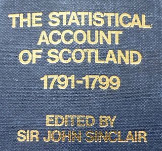
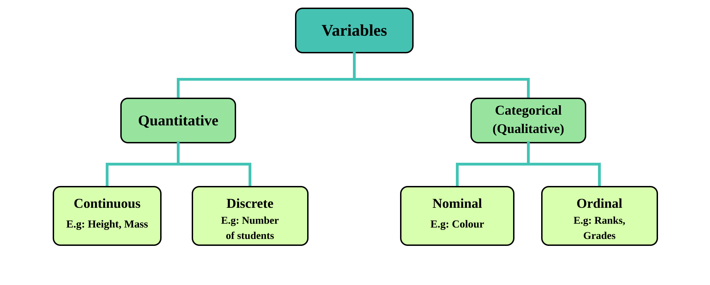
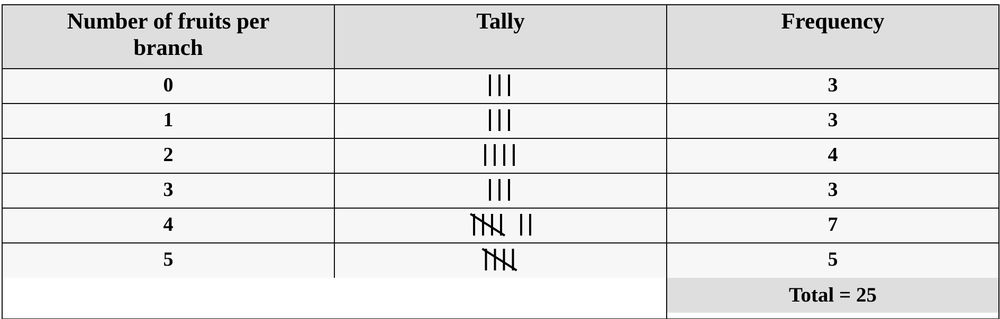
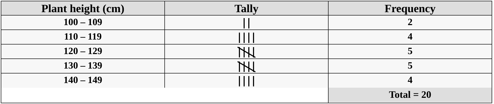
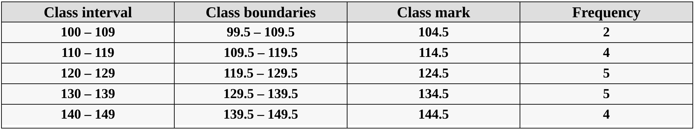

# Basics of statistics

Statistics is the science of understanding, analysing, and interpreting data. It plays a crucial role in making informed decisions across various fields, from agriculture to medicine, economics to environmental studies. This chapter serves as an entry point into the fascinating world of statistics, introducing you to its basic concepts and practical applications.

We begin by exploring the origins and definitions of statistics, emphasizing its relationship with mathematics and its distinct role in solving real-world problems. Further, we focus on the importance of data (the raw material of statistics), examining its types and how it is collected, organized, and analysed.

The chapter also covers essential concepts such as population and sample, variables and constants, and the different types of variables. These concepts form the building blocks for understanding how statistical studies are designed and conducted.

Finally, we introduce frequency distributions, an indispensable tool for summarizing and interpreting data. Topics such as construction of frequency distributions, grouped and cumulative frequency distributions, and relative frequency will help you make sense of data and uncover underlying patterns.

By the end of this chapter, you will have a comprehensive understanding of the core principles of statistics, setting the stage for deeper exploration and advanced applications in later chapters. The concepts presented here are largely based on the works of @goon and @gupta.

## The word "statistics"

The term `statistics` is associated with words concerning the state, including the Italian `statista`, meaning “statesman”, and the German `Statistik`. The German term `Statistik` emerged in the early 18th century and initially referred to the “collection and classification of data,” particularly data used by governments and administrative bodies. This usage was introduced by the German scholar Gottfried Achenwall in 1749.

In 1791, Sir John Sinclair helped establish the term `statistics` in English through his publication of the "Statistical Account of Scotland"[@ball], a comprehensive 21-volume work. The work appeared in 21 volumes between 1791 and 1799 and helped establish the systematic description of social and economic conditions. Later, in 1845, Francis G.P. Neison, an actuary[^intro-1] to the Medical Invalid and General Life Office, published Contributions to Vital Statistics, a work focusing on actuarial and demographic data. These developments laid the foundation for statistics as a discipline, evolving from statecraft to a broader scientific approach to data analysis and interpretation.

[^intro-1]: actuary: A person who compiles and analyses statistics and uses them to calculate insurance risks and premiums.

{#fig-stataccount fig-alt="Statistical Account of Scotland by Sir John Sinclair (1791)" fig-align="center" style="text-align:center;" width="30%"}  

## Foundations of modern statistics

The development of statistics as a scientific discipline has been shaped by the pioneering work of several eminent statisticians. Their contributions established many of the fundamental concepts, methods, and principles that form the foundation of modern statistics. Among these, Sir Ronald Aylmer Fisher (R.A. Fisher) holds a particularly prominent place. 

**Sir Ronald A. Fisher** (1890–1962) is widely regarded as the Father of Modern Statistics because of his pioneering contributions to statistical theory and methodology. He developed and advanced several fundamental ideas, including analysis of variance (ANOVA), experimental design, maximum likelihood estimation, and statistical inference. His principles of randomization, replication, and local control laid the foundation for modern experimental research, particularly in agriculture. His work continues to influence the way experiments are designed, analysed, and interpreted today.

The history of statistics is closely intertwined with the contributions of many eminent statisticians who shaped and advanced the discipline. A brief overview of some of the most influential personalities and their major contributions is provided in @sec-appendix-personalities.

## Statistics and mathematics

Mathematics and statistics, while closely related, serve distinct purposes and operate on fundamentally different principles. Mathematics can be thought of as a well-organized library, where everything follows strict rules and logical paths. Once a theorem is proven in mathematics, it remains universally true, leaving little room for ambiguity or change. It is a deductive science, relying on precise axioms and logical reasoning to arrive at exact and unchanging results.

Statistics, however, operates in a different realm. It deals with real-world data, which is often messy, unpredictable, and influenced by numerous uncontrolled factors. Statistics is more like an open field, where methods and approaches must adapt to the variability of data. Unlike the certainty of mathematics, statistics uses inductive reasoning to analyse data, account for randomness, and make decisions or predictions under uncertainty. This flexibility is essential because real-world phenomena, especially in fields like biology, are rarely as neat and predictable as mathematical constructs.

In biological sciences, we study complex systems such as plants, animals, and ecosystems, where exact outcomes are rarely achievable. These systems are influenced by a multitude of factors, many of which cannot be precisely measured or controlled. This is where the concept of the error term becomes important. The error term represents the difference between an observation and its true model mean; a residual is the difference between an observation and its fitted value, accounting for the inherent variability and uncertainty in biological phenomena.

Statisticians embrace this uncertainty, developing mathematical models that approximate reality as closely as possible. Unlike mathematicians, whose focus is on achieving perfect precision, statisticians aim to draw meaningful insights from imperfect and variable data. In the study of biological systems, the goal is not to eliminate uncertainty but to understand patterns, relationships, and trends within the data.

Thus, while mathematics seeks absolute certainty, statistics accepts variability and uncertainty as fundamental characteristics of the real world. By acknowledging and incorporating these uncertainties, statisticians provide valuable tools to study and explain complex biological phenomena, making statistics an indispensable discipline for understanding the complexities of nature.

## Definition of statistics

Statistics is the science which deals with the

-   Collection of data

-   Organization of data or classification of data

-   Presentation of data

-   Analysis of data

-   Interpretation of data

::: {.callout-tip title="Just for Fun"}
Let’s give a definition to statistics using the words themselves:\
**S**trengthening **T**echnological **A**dvancement **T**hrough **I**mplementing **S**ystematic **T**echniques in **C**ontemporary **S**ciences
:::

Two main branches of statistics are:

**Descriptive statistics**, which deals with summarizing data from a sample or a population using indexes or measures such as the mean or standard deviation etc.

**Inferential statistics**, use a random sample of data taken from a population to describe and make inferences about the population parameters.

## Data

Data can be defined as individual pieces of factual information that are recorded and used to draw meaningful insights through the science of **statistics**. Think of data as the building blocks that form the foundation for understanding the world around us. It’s the raw material from which we extract patterns, trends, and conclusions that help us make better decisions.

In today’s fast-paced world, data is more important than ever. From predicting weather patterns to optimizing business strategies, data is at the heart of nearly every advancement. Without data, we’re left with guesswork, making it impossible to understand complex systems or make informed decisions.

Here are some examples of data in action:

-   **Number of farmers in a village**: Understanding this helps policymakers make decisions about agricultural development and rural economics.
-   **Rainfall over a period of time**: This data is crucial for predicting crop yields, planning irrigation, and managing water resources.
-   **Area under paddy crop in a state**: This informs agricultural policies, resource allocation, and even global food supply chains.

As you can see, data isn’t just a collection of numbers; it’s the key to solving real-world problems and shaping the future. In the hands of skilled statisticians, data has the power to unlock insights that can improve lives, drive innovation, and guide decisions at every level.

## Scope and limits

**Functions of statistics**: Statistics plays a crucial role in simplifying complex data, transforming it into clear and meaningful information. It supports decision-making by presenting facts in an organized manner, aids in the formulation of effective policies, facilitates comparisons, and assists in making forecasts. By applying appropriate statistical methods, researchers can draw valid conclusions from experiments.

**Applications of statistics**: Statistics has become an integral part of almost every field of human activity. It is indispensable in areas such as administration, business, economics, research, banking, insurance, and more. Its ability to quantify and analyse data makes it an essential tool across industries.

**Common limitations of statistics**: Many statistical methods study variability, but data with no observed variation can also be summarized. Statistical models can describe groups and can also be used to predict individual outcomes, with appropriate uncertainty. The results derived from statistical analysis are often approximate and subject to uncertainty. Statistics is sometimes misapplied or misinterpreted, leading to erroneous conclusions.

As statisticians, we believe that the power of statistics knows no bounds. It is a tool that, when applied correctly, can unlock insights from almost any dataset. While the limitations listed above are commonly found in textbooks and curricula across SAUs (State Agricultural Universities), it can be said that these are more about guiding students on the appropriate use of statistics than presenting true constraints. The conclusions still depend on the quality of the data, the design of the study and the assumptions of the method. A large dataset cannot by itself correct biased selection or poor measurement.

## Population and sample

Consider the following example. Suppose we wish to study the height of all students in a college. It will take us a long time to measure the height of all students of the college, so we may select 20 of the students and measure their height (in cm). Suppose we obtain the measurements like this :

149, 156, 148, 161, 159, 143, 158, 152, 164, 171, 157, 152, 163,\
158, 151, 147, 157, 146, 153, 159.

In this study, we are interested in the height of all students in the college. The set of heights of all students in the college is called the **population** of this study. The set of heights of the 20 selected students, *H* = {149, 156, 148, ..., 153, 159}, is a **sample** from this population.

**Population**\
In statistics, a *population* refers to the entire collection of elements, individuals, or objects that possess a particular characteristic and are the subject of a statistical study. It encompasses all possible observations or measurements that could be included in the analysis. For example, a population could be all the students in a university, all the trees in a forest, or all the farms in a region. The population provides the complete set of data from which conclusions can be drawn.

**Sample**\
A *sample* is a subset of a population selected for the purpose of conducting a statistical analysis. It represents a smaller group drawn from the population, ideally chosen to reflect its characteristics. Samples are used to estimate population parameters when it is impractical or impossible to collect data from the entire population. The key to a good sample is that it should be representative of the population to allow valid inferences to be made.

**Population parameter**\
A *population parameter* is a numerical characteristic or a value that describes an aspect of an entire population. It is a fixed (constant), often unknown value that summarises a specified characteristic of the population. Common population parameters include the population mean, population variance, and population proportion. Since it is usually impractical or impossible to measure the entire population, parameters are often estimated using sample data.

## Variables and constants

**Variables**\
A *variable* is a characteristic or attribute that can take different values for different individuals, at different times, or in different locations. In other words, variables are subject to change. Examples of variables include:

-   The number of fruits on a branch, the number of plots in a field, or the number of schools in a country.
-   Plant height, crop yield, panicle length, or temperature.

Variables can be classified into two broad categories: **quantitative** variables, which are measured on a numerical scale (such as height or yield), and **qualitative** (or categorical) variables, which describe categories or characteristics (such as plant species or colour).

**Constants**\
A *constant* is a value that remains fixed within the study or mathematical context. Unlike variables, constants retain the same value throughout the study. Examples of constants include:

-   Mathematical values such as pi ($\pi$), which is the ratio of the circumference of a circle to its diameter ($\pi$ = 3.14159...), and *e*, the base of the natural logarithm (*e* = 2.71828).

## Types of variables

**Quantitative variables**\
A *quantitative variable* is one that can be expressed in numerical terms and takes values that are measurable. Examples of quantitative variables include the number of fruits on a branch, the number of plots in a field, the number of schools in a country, plant height, crop yield, panicle length, and temperature. Quantitative variables can be further classified into two categories: **discrete** and **continuous**.

**Discrete variables**\
*Discrete variables* are variables that can only take a finite or countable number of distinct values. They are often whole numbers and can be counted. For instance, the number of fruits on a branch, the number of plots in a field, or the number of schools in a country are all discrete variables.

Since discrete variables represent countable quantities, they can only take specific, separate values, such as 0, 1, 2, etc. For example, the number of daily hospital admissions, the number of doctors in a hospital, family size etc are discrete variables because it can only take whole number values like 0, 1, or 2, but not fractional values like 1.8 or 3.96.

**Continuous variables**\
*Continuous variables*, on the other hand, are variables that can take any value within a given range or interval and can be measured. These variables do not have distinct gaps or interruptions in their possible values. For example, plant height, yield, temperature, and panicle length are continuous variables because they can be measured to a high degree of precision, such as 5.5 cm, 5.8 cm, or any value within a relevant range. Continuous variables can assume an infinite number of possible values within a given range, making them different from discrete variables.

**Categorical variables**\
A *categorical variable* is a type of variable where the data is divided into distinct categories that do not have a numerical value. For example, marital status (single, married, widowed), employment status (employed, unemployed), or religious affiliation (Protestant, Catholic, Jewish, Muslim, others) are examples of categorical variables. These variables are often referred to as *qualitative variables*, as they describe qualities or characteristics rather than measurable quantities.

Categorical variables classify observations into groups. Although the category labels are not numerical measurements, the number of observations in each category can be counted.

## Measurement scales

Variables can be classified into four distinct levels of measurement scales each representing a different way of organizing and interpreting data. These four levels are **nominal**, **ordinal**, **interval**, and **ratio**.

**Nominal scale**\
The **nominal scale** is the most basic level of measurement and applies to categorical (qualitative) variables. Data measured on the nominal scale consist of categories that are distinct but have no inherent order or ranking. The categories are simply used for labeling or naming objects or groups. For example, gender (male, female), blood group (A, B, AB, O), and marital status (single, married, divorced) are all nominal variables. In the nominal scale, arithmetic operations, such as addition or subtraction, cannot be performed on the data, although percentages can be calculated.

**Ordinal scale**\
The **ordinal scale** also applies to qualitative data, but with an important distinction: the data on the ordinal scale are ordered. This means that the categories have a specific rank or order, but the differences between the categories are not necessarily uniform or meaningful. For example, the grades given in a class (excellent, good, fair, poor) are ordinal, where "excellent" is ranked higher than "good," and "good" is ranked higher than "fair," and so on. However, the difference between "excellent," and "good" is not numerically defined, making the exact magnitude of the difference unclear. Ordinal data allows us to say that one value is greater or lesser than another, but it does not allow for the measurement of exact differences.

**Interval scale**\
The **interval scale** is used for quantitative (numerical) data, and it provides more information than the nominal or ordinal scales. On the interval scale, the data points are ordered, and the differences between them are meaningful and measurable. However, the interval scale does not have a true zero point. This means that while we can measure the difference between values, we cannot make statements about ratios between them. An example of an interval scale is temperature measured in Celsius or Fahrenheit. For instance, if the temperature in two cities is 20°C and 40°C, we can say that the temperature in the second city is 20°C higher. However, we cannot say that the second city is "twice as hot" as the first city, because the zero point (0°C) does not represent the absence of temperature.

**Ratio scale**\
The **ratio scale** is the highest level of measurement and applies to quantitative data. It shares the properties of the interval scale (ordered data with measurable differences between values), but it also has a meaningful zero point. This true zero point represents the total absence of the quantity being measured. With the ratio scale, not only can we measure differences between values, but we can also compute meaningful ratios. For example, weight is measured on the ratio scale. A weight of 60 kg is twice as much as a weight of 30 kg, and a weight of 0 kg indicates the complete absence of weight. Similarly, temperature measured on the Kelvin scale is an example of a ratio scale, with absolute zero as its zero point. A ratio of Kelvin temperatures is meaningful; it should not be interpreted as a ratio of the heat contained in two objects.

In summary, the key distinctions between these measurement scales are:

-   **Nominal**: Categories without any order.
-   **Ordinal**: Ordered categories without consistent differences.
-   **Interval**: Ordered data with meaningful differences, but no true zero.
-   **Ratio**: Ordered data with meaningful differences and a true zero point, allowing for meaningful ratios.

{#fig-classvariable out-width="100%" fig-alt="Classification of variables" fig-align="center" style="text-align:center;"}

## Collection of data

The process of collecting data is the foundational step in any statistical investigation or research study. Data can be gathered for an entire population or for a sample drawn from it. Typically, data collection is performed on a sample basis, especially when studying large populations. Collecting data is a challenging task, requiring skill and precision. The person responsible for gathering the data, known as the **enumerator** or **investigator**, must be well-trained to ensure the accuracy and reliability of the data collected. The individuals or groups providing the information are referred to as the **respondents**.

### Types of data

Data collection can be categorized into two main types based on the source from which the data is derived:

1.  **Primary Data**
2.  **Secondary Data**

**Primary data**\
Primary data refer to first-hand, original data that are collected directly by the researcher or an organization for a specific purpose. These data have not been processed or analysed previously and are considered the most authentic form of data. Primary data are typically gathered through surveys, interviews, experiments, or observations, and they represent a direct reflection of the phenomena being studied.

**Example**: Population census data collected by the government are considered primary data. These are collected directly from individuals by government authorities for the purpose of census enumeration and demographic analysis.

**Secondary data**\
Secondary data refer to data that have already been collected, processed, and published by other organizations or researchers for a different purpose. These data may have undergone some degree of analysis or treatment before being made available for new studies. Secondary data are often more convenient to use, as they are readily accessible, but they may not always perfectly suit the specific needs of the researcher.

**Example**: An economic survey of a country, reports from the Ministry of Statistics or other governmental agencies, is an example of secondary data. These data were originally collected for purposes such as policy analysis or economic planning, and now can be used for additional research.

The distinction between primary and secondary data lies primarily in their origin and the process of collection. Primary data are first-hand, original data collected directly from a single source by the researcher for a specific purpose. These data are considered pure as they have not undergone any prior statistical treatment. In contrast, secondary data are obtained from existing sources or agencies and have been previously collected and processed for different purposes. They are not considered pure as they have undergone some form of statistical treatment. While primary data are original and collected for the first time, secondary data are pre-existing and gathered from other sources. Both types of data have their respective advantages and limitations, and the choice between them depends on the research objectives, availability of resources, and the nature of the study.

## Collecting primary data

Primary data can be collected using various methods, depending on the research requirements and resources available:

**Personal investigation**\
In this method, the researcher directly conducts the survey and collects the data themselves. This approach often results in highly accurate and reliable data. It is best suited for small-scale research projects where direct involvement of the researcher is feasible.

**Investigation by trained enumerators**\
In this method, trained investigators are employed to collect data. These investigators engage with individuals, asking questions and filling out questionnaires based on the responses. This method is widely used by organizations for larger data collection efforts.

**From correspondents**\
Researchers distribute questionnaires to local representatives or agents who collect data based on their own experience and observations. While this method is relatively quick, it typically provides only a rough estimate of the information.

**Through the phone or mailed questionnaire**\
Data is gathered by contacting individuals by telephone or by sending a questionnaire through the post. Telephone interviews can be completed quickly, whereas postal questionnaires may take longer and can have low response. Accuracy depends on the questions, coverage and quality of the responses; the method alone does not guarantee reliable information.

**Online surveys and Google forms**\
With advancements in technology, data collection through online tools like Google Forms, Microsoft Forms, SurveyMonkey, and Typeform has become common. Researchers can design digital questionnaires, share them via email or social media, and receive real-time responses. This method is cost-effective, scalable to large samples and efficient in time and data organization.

**Mobile Apps, digital platforms and social media polls**\
Custom mobile applications or survey platforms can be used for data entry, especially in field studies. These apps often work offline and sync with cloud storage when internet access is available. Platforms like Instagram, Twitter, Facebook, and LinkedIn offer polling tools and audience engagement features that can be leveraged for quick, informal data collection. Though limited in depth, these are useful for gauging public opinion.

Open online forms and social-media polls generally collect voluntary responses. They may describe the respondents, but do not automatically provide representative estimates for all farmers or the general public. The sampling frame, selection method and nonresponse must be considered.

## Collecting secondary data

Secondary data are collected through various established channels:

**Official**\
Official sources include publications from government bodies such as the Reserve Bank of India, Ministry of Finance, Ministry of Statistics, and various ministries (e.g., Agriculture, Food, Industry, Labor). These sources provide comprehensive and authoritative data.

**Institutional and other published sources**\
Institutional sources include reports from universities, research institutes, trade associations and chambers of commerce. Check who produced the data, how they were collected and the reference period. Government ministries, the NSO, State Directorates of Economics and Statistics and the Agricultural Census are official sources, even when their publications concern a specialised sector. Current data portals are listed in @sec-appendix-1.

## Frequency distribution

The data presented below shows the number of fruits per branch in a mango tree selected from a particular plot. The data, presented in this form in which it was collected, is called *raw data*.

0, 1, 0, 5, 2, 3, 2, 3, 1, 5,\
5, 2, 3, 4, 4, 5, 4, 0, 5, 4,\
2, 4, 4, 4, 1

It can be seen that, the minimum and the maximum numbers of fruits per branch are 0 and 5, respectively. Apart from these numbers, it is impossible, without further careful study, to extract any exact information from the data. But by breaking down the data into the form below

{fig-alt="Frequency distribution table" fig-align="center" out-width="100%" style="text-align:center;"}

Now certain features of the data become apparent. For instance, it can easily be seen that, most of the branches selected have four fruits because number of branches having 4 fruits is 7. This information cannot easily be obtained from the raw data. The above table is called a **frequency table** or a **frequency distribution**. It is so called because it gives the frequency or number of times each observation occurs. Thus, by finding the frequency of each observation, a more intelligible picture is obtained.

### Constructing an ungrouped frequency distribution

In this section, we will discuss the process of constructing a frequency distribution. Follow the steps below. This method helps to clearly visualize the frequency of each observation, ensuring that the total frequency adds up to the total number of observations.

1.  List all values of the variable in ascending order of magnitude.

2.  Form a tally column, that is, for each value in the data, record a stroke in the tally column next to that value. In the tally, each fifth stroke is made across the first four. This makes it easy to count the entries and enter the frequency of each observation.

3.  Check that the frequencies sum to the total number of observations.

## Grouped frequency distribution

Data below gives the plant height of 20 paddy varieties, measured to the nearest centimeters.

109, 107, 129, 122, 118, 110, 124, 146, 138, 121,\
115, 132, 131, 139, 142, 134, 143, 144, 127, 116

It can be seen that the minimum and the maximum plant height are 107 cm and 146 cm, respectively. A frequency distribution giving each of the plant height between 107 cm and 146 cm would be very long and would not be very informative. This problem can be addressed by grouping the data into class intervals.\
If we choose the classes\
100 -- 109\
110 -- 119\
120 -- 129\
130 -- 139\
140 -- 149\
we obtain the frequency distribution given below:

{fig-alt="Grouped Frequency distribution table" fig-align="center" out-width="100%" style="text-align:center;"}

Above table gives the frequency of each group or class; it is therefore called a grouped frequency table or a grouped frequency distribution. Using this grouped frequency distribution, it is easier to obtain information about the data than using the raw data. For instance, it can be seen that 14 of the 20 paddy varieties have plant height between 110 cm and 139 cm (both inclusive). This information cannot easily be obtained from the raw data.\
It should be noted that, even though above table is concise, some information is lost. For example, the grouped frequency distribution does not give us the exact plant height of the paddy varieties. Thus the individual plant height of the paddy varieties are lost in our effort to obtain an overall picture.

### Terminologies

**Class limits**\
The intervals into which the observations are put are called [class intervals]{.underline}. The end points of the class intervals are called [class limits]{.underline}. For example, the class interval 100 -- 109, has lower class limit 100 and upper class limit 109.

**Continuous classes**\
Continuous classes are intervals where the class limits represent a continuous range of values, with no gaps between the intervals.

Example: If the class intervals are 10 − 20, 20−30, 30−40, and so on, use a consistent rule such as $10\leq x<20$, $20\leq x<30$ and $30\leq x<40$. This ensures that an observation at a common endpoint belongs to only one class.

**Discontinuous classes**\
Discontinuous classes are intervals where gaps exist between the class limits. In such cases, class boundaries are used to close the gaps and ensure continuity.

Example:\
If the class intervals are 10 - 19, 20 - 29, 30 - 39, and so on, there is a gap between the end of one interval and the start of the next. The actual range of each interval is defined using class boundaries, which is explained below.

**Class boundaries**\
The raw data in the above example were recorded to the nearest centimeters. Thus, a plant height of 109.5cm would have been recorded as 110cm, a plant height of 119.4 cm would have been recorded as 119cm, while a plant height of 119.5 cm would have been recorded as 120 cm. It can therefore be seen that, the class interval 110 -- 119, consists of measurements greater than or equal to 109.5 cm and less than 119.5 cm. The numbers 109.5 and 119.5 are called the lower and upper boundaries of the class interval 110 -- 119. The class boundaries of the other class intervals are given below:

{fig-alt="Class boundary and class limits" fig-align="center" out-width="100%" style="text-align:center;"}

[Note:]{.underline}\
Notice that the lower class boundary of the i^th^ class interval is the mean of the lower class limit of the class interval and the upper class limit of the (i-1)^th^ class interval (i = 2, 3, 4, ...). For example, in the table above the lower class boundaries of the second and the fourth class intervals are (110 + 109) /2 = 109.5 and (130 + 129)/2 = 129.5 respectively.\
It can also be seen that the upper class boundary of the i^th^ class interval is the mean of the upper class limit of the class interval and the lower class limit of the (i+1)^th^ class interval (i = 1, 2, 3, ...). Thus, in the above table the upper class boundary of the fourth class interval is (139 + 140)/2 = 139.5.

::: {.callout-important title="Note"}
For continuous classes, class limits and boundaries are the same because there are no gaps between intervals. However, for discontinuous classes, boundaries are important as they close gaps and ensure every value belongs to one class.
:::

**Class mark**\
The mid-point of a class interval is called the class mark. It is the arithmetic mean of the upper and lower class limits of the class interval. It is also the arithmetic mean of the upper and lower class boundaries of the class interval. For example, in the table, the class mark of the third class interval was found as follows: class mark = (120+129)/2 = (119.5 + 129.5)/2 = 124.5.

**Class width**\
For continuous classes:\
The class width is the difference between the upper and lower class limits of a class interval. Since the class limits and boundaries are the same for continuous classes, the width can be determined by subtracting two consecutive lower or upper class boundaries.

For discontinuous classes:\
The class width is the difference between the upper and lower class boundaries of a class interval. For discontinuous classes, class boundaries will account for gaps, and the width can also be determined by subtracting two consecutive lower or upper class boundaries.

[Note:]{.underline} 

In the grouped frequency table above with discontinuous classes, the width of the second class interval is calculated as \|109.5 - 119.5\| = 10. It can be observed that the width is the same for all classes. This result can also be obtained by taking the numerical difference between the lower class boundaries of the second and third class intervals.

### Constructing a grouped frequency distribution

**Step 1**. Decide the number of classes you wish to construct\
**Step 2**. Determine the class width\
**Step 3**. Set up the individual class limits\
**Step 4**. Tally the items into the classes\
**Step 5**. Count the number of items in each class

Consider the example where an agricultural student measured the lengths of leaves on an oak tree (to the nearest cm). Measurements on 38 leaves are as follows\
9, 16, 13, 7, 8, 4, 18, 10, 17, 18,\
9, 12, 5, 9, 9, 16, 1, 8, 17, 1, 10, 5, 9, 11, 15, 6, 14, 9, 1, 12,\
5, 16, 4, 16, 8, 15, 14, 17

**Step 1.** Decide the number of classes you wish to construct

H.A. Sturges provides a rule for the approximate number of classes:

$$k=1+3.322\log_{10}N.$$

This is a guide, not a compulsory number. In our example $N=38$, so $k\approx6.25$. We may use six classes of width 3 cm to cover the recorded values from 1 to 18 cm. The choice should give a clear summary without hiding important features of the data.

**Step 2.** Determine the class width

For equal-width classes, divide the range by the chosen number of classes and round to a convenient width that covers all observations. Here, $(18-1)/6\approx2.83$, so a width of 3 cm is convenient.

**Step 3.** Set up the individual class limits

Since lengths were recorded to the nearest cm, use the inclusive classes 1--3, 4--6, 7--9, 10--12, 13--15 and 16--18. Their continuous boundaries are 0.5--3.5, 3.5--6.5, 6.5--9.5, 9.5--12.5, 12.5--15.5 and 15.5--18.5 cm. Use the lower boundary and exclude the upper boundary in each class. The frequencies are shown in @tbl-freq.

```{r tbl-freq,echo=FALSE,warning=FALSE,results='asis'}
#| tbl-cap: "Frequency distribution table"
#| fig-cap: "Frequency distribution table" 
#| filters: 
#| - parse-latex   

library(knitr)
library(kableExtra)
dt<-read.csv("csv/c1e1.csv")
dt %>%
  kbl(booktabs = TRUE, align = "c") %>%
   kable_classic(full_width = F, html_font = "Georgia") %>%
kable_styling(
    # latex_options = "HOLD_position", 
    full_width = FALSE,
    position = "center", 
    bootstrap_options = "bordered"
  )%>% 
  column_spec(1, width = "7em") %>%  
  column_spec(2, width = "7em")
```

Even though the student only measured in whole numbers, the data is continuous, so "4 cm" means the actual value could have been anywhere from 3.5 cm to 4.5 cm.

## Cumulative frequency

In many situations, we are not interested in the number of observations in a given class interval, but in the number of observations which are less than (or greater than) a specified value. For example, in the above table, it can be seen that 3 leaves have length less than 3.5 cm and 9 leaves (*i.e.* 3 + 6) have length less than 6.5 cm. These frequencies are called cumulative frequencies. A table of such cumulative frequencies is called a **cumulative frequency table** or **cumulative frequency distribution**.

Cumulative frequency is defined as a running total of frequencies. Cumulative frequency can also be defined as the sum of all previous frequencies up to the current point. Notice that the last cumulative frequency is equal to the sum of all the frequencies. Two types of cumulative frequencies are **Less than Cumulative Frequency (LCF)** and **Greater than Cumulative Frequency (GCF)**. LCF is the number of values less than a specified value. GCF is the number of observations greater than a specified value.

For grouped continuous measurements, calculate LCF at the upper class boundaries and GCF at the lower class boundaries. The convention used in @tbl-cf counts values below each upper boundary and values at or above each lower boundary. LCF's are obtained by adding frequencies in the successive classes and GCF are obtained by subtracting the successive class frequencies from the total frequency. See calculated LCF and GCF in @tbl-cf below.

## Relative frequency

It is sometimes useful to know the proportion, rather than the number, of values falling within a particular class interval. We obtain this information by dividing the frequency of the particular class interval by the total number of observations. **Relative frequency** of a class is the frequency of class divided by total observations. Relative frequencies all add up to 1. See relative frequency calculated in @tbl-cf .

```{r tbl-cf,echo=FALSE,warning=FALSE,results='asis'}
#| tbl-cap: "LCF, GCF and Relative frequency"
#| fig-cap: "LCF, GCF and Relative frequency"  
#| filters: 
#| - parse-latex  

library(kableExtra)
library(knitr) 

dt <- read.csv("csv/c1e2.csv")

dt %>%
  kbl(booktabs = FALSE, align = "c",escape = FALSE) %>%
  kable_classic(full_width = FALSE, html_font = "Georgia") %>%
kable_styling(
    # latex_options = "HOLD_position", 
    full_width = FALSE,
    position = "center", 
    bootstrap_options = "bordered"
  ) %>%
  column_spec(1, width = "7em") %>%  
  column_spec(2, width = "7em") %>% 
  column_spec(3, width = "7em") %>% 
  column_spec(4, width = "7em") %>% 
  column_spec(5, width = "7em")  

```

## Chapter Summary

### Fill in the blanks {.unnumbered}

Answers are given at the end of the chapter.

1. The branch of statistics concerned with summarizing data is called __________ statistics.

2. The branch of statistics concerned with drawing conclusions about a population from a sample is called __________ statistics.

3. A numerical constant describing a population is termed a __________.

4. A subset of a population selected for study is called a __________.

5. A characteristic that can take different values is called a __________.

6. A quantitative variable with a finite or countable set of possible values is called __________.

7. A measurement scale with ordered categories is called an __________ scale.

8. A measurement scale with unordered categories is called a __________ scale.

9. A measurement scale with a meaningful absolute zero is called a __________ scale.

10. Data collected first-hand for a specific study are called __________ data.

11. Data obtained from existing sources are called __________ data.

12. The number of times a value occurs is called its __________.

13. The midpoint of a class interval is called the class __________.

14. The running total of frequencies is called __________ frequency.

15. The proportion of observations in a class is called its __________ frequency.

### Short-answer questions {.unnumbered}

1. Define statistics and state its main functions.

2. Distinguish between descriptive and inferential statistics.

3. Explain the difference between population and sample.

4. What is a population parameter? Give examples.

5. Explain the classification of variables.

6. Differentiate between discrete and continuous variables with examples.

7. Explain the four levels of measurement.

8. Differentiate between nominal, ordinal, interval, and ratio scales.

9. Distinguish between primary and secondary data.

10. Explain the different methods of collecting primary data.

11. What are the main sources of secondary data?

12. What is a frequency distribution? State its advantages.

13. Explain class limits, class boundaries, class mark, and class width.

14. Differentiate between continuous and discontinuous class intervals.

15. Explain the steps involved in constructing a grouped frequency distribution.

16. What is cumulative frequency? Explain LCF and GCF.

17. What is relative frequency? How is it calculated?

18. Explain the difference between raw data and grouped data.

19. Why are class boundaries required for discontinuous classes?

20. Explain the contribution of R.A. Fisher to modern statistics.  

### Numerical and conceptual questions {.unnumbered}

Answers are given at the end of the chapter.

1. For the observations 2, 3, 3, 5, 7, prepare a frequency distribution and find the relative frequency of 3.

2. Plant heights are recorded to the nearest centimetre. Find the boundaries, class mark and width of the class 20–24 cm.

3. Use Sturges' formula to suggest the number of classes for 100 observations.

4. Disease severity is recorded as low, moderate and high. Identify its measurement scale.

5. A sample has frequencies 4, 7, 6 and 3. Find its size and the cumulative frequencies.

### Important formulae {.unnumbered}

Number of classes using Sturges' formula:

$$
k = 1 + 3.322\log_{10}N
$$

Approximate class width:

$$
C = \frac{|\max-\min|}{k}
$$

A possible centring rule for a preliminary lower endpoint:

$$
L = \min - \frac{C'k'-(\max-\min)}{2}
$$

This is an optional starting value, not a necessary rule. Final limits and boundaries must respect the measurement precision, cover the data and avoid overlapping classes.

Lower class boundary of the $i$th class:

$$
L_i = \frac{\text{Lower class limit of }i+\text{Upper class limit of }(i-1)}{2},\quad i=2,3,4,\ldots
$$

Upper class boundary of the $i$th class:

$$
U_i = \frac{\text{Upper class limit of }i+\text{Lower class limit of }(i+1)}{2},\quad i=1,2,3,\ldots
$$

Class mark:

$$
\text{Class mark} = \frac{\text{Lower class limit}+\text{Upper class limit}}{2}
$$

Class width:

$$
C = \text{Upper class boundary}-\text{Lower class boundary}
$$

Relative frequency:

$$
\text{Relative frequency} = \frac{f}{N}
$$

Sum of frequencies:

$$
\sum f = N
$$

Sum of relative frequencies:

$$
\sum\frac{f}{N}=1
$$


### Quick revision {.unnumbered}

* A population is the complete group of interest; a sample is a part selected for study.
* A parameter describes a population, while a statistic is calculated from sample observations.
* The measurement scale determines which numerical comparisons are meaningful.
* Class intervals must cover the data without overlap; boundaries depend on the recording precision.
* Frequencies sum to the number of observations, and relative frequencies sum to one.
* The source, selection method and reference period must be checked before interpreting data.

### Answers to fill in the blanks {.unnumbered}  

::: {.answer-key}

`1.` Descriptive `2.` Inferential `3.` Parameter `4.` Sample `5.` Variable `6.` Discrete `7.` Ordinal `8.` Nominal `9.` Ratio `10.` Primary `11.` Secondary `12.` Frequency `13.` Mark `14.` Cumulative `15.` Relative
:::

### Solutions to numerical and conceptual questions {.unnumbered}

1. The values 2, 3, 5 and 7 have frequencies 1, 2, 1 and 1. The relative frequency of 3 is $2/5=0.40$.

2. The boundaries are 19.5 and 24.5 cm, the class mark is $(20+24)/2=22$ cm and the width is 5 cm.

3. $k=1+3.322\log_{10}100=7.644$, so about 8 classes are suggested. This is a guide, not a compulsory choice.

4. Ordinal: the categories have an order, but their numerical differences are not measured.

5. The sample size is $4+7+6+3=20$, and the cumulative frequencies are 4, 11, 17 and 20.

::: {.callout-caution title="Historical Insights"}
**“The power of statistics: A wartime story”**

During World War II, the United States military faced a daunting challenge: how to better protect their planes and crews during missions. When the bombers returned from combat, they were covered in bullet holes. Naturally, the first instinct was to add armour to the most heavily damaged areas to make the planes more resilient. It seemed like common sense, but then came a surprising twist. Abraham Wald, a brilliant statistician working with the Statistical Research Group at Columbia University, noticed something others had missed. The planes being studied were only the ones that had survived and made it back. The missing data, the planes that never returned, held the key to solving the puzzle. Wald reasoned that the areas showing little or no damage on the returning planes, such as the engines, were in fact the most critical: a plane hit there would have gone down, leaving no data behind. The armour, he argued, belonged not where the holes were, but where they were absent.

Wald's insight is a classic illustration of what is now called **survivorship bias**, the error of drawing conclusions only from the cases that "survive" a selection process while ignoring those that did not. His reasoning is a powerful reminder of the importance of statistics not just in analysing what is visible, but in thinking carefully about what is missing. It is a fine example of how data, combined with critical thinking, can uncover hidden truths and guide better decisions in fields far beyond wartime aviation, from clinical research to finance.
:::

::: {.callout-tip title="Quotes to Inspire"}
**"Data is the sword of the 21st century, those who wield it well, the Samurai."**\
**- Jonathan Rosenberg, former Google SVP**
:::  
