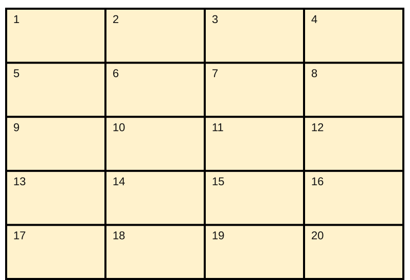
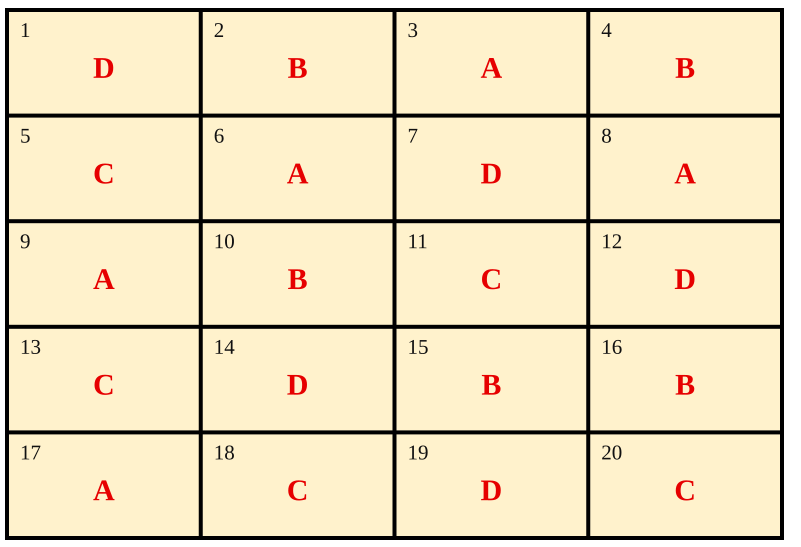
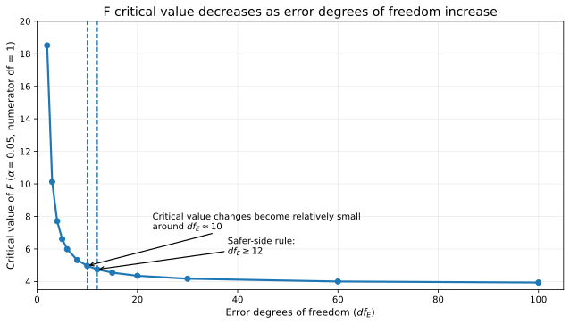
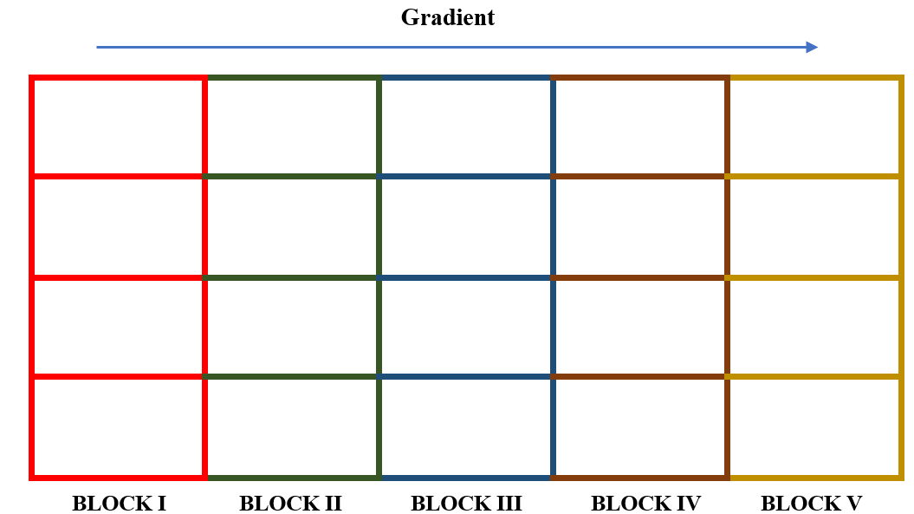
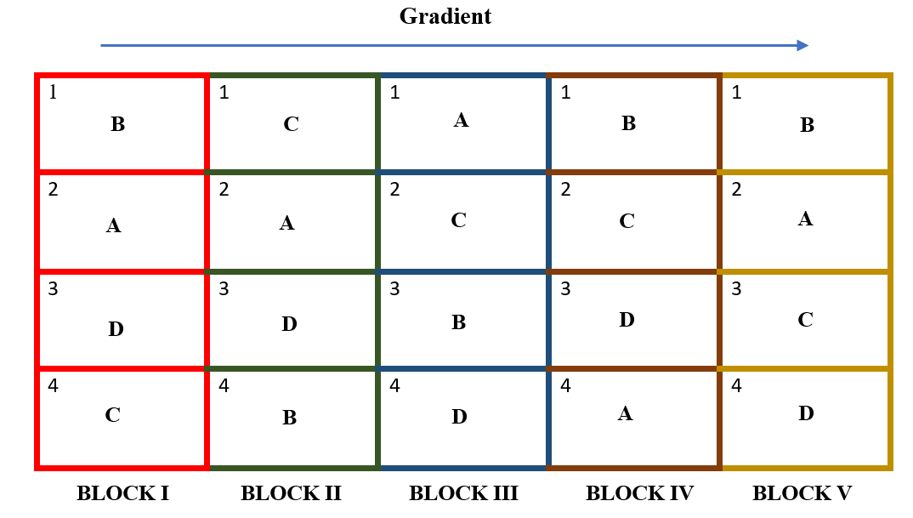
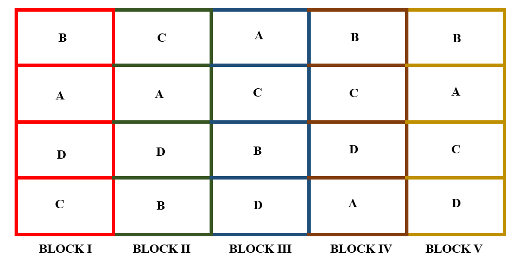
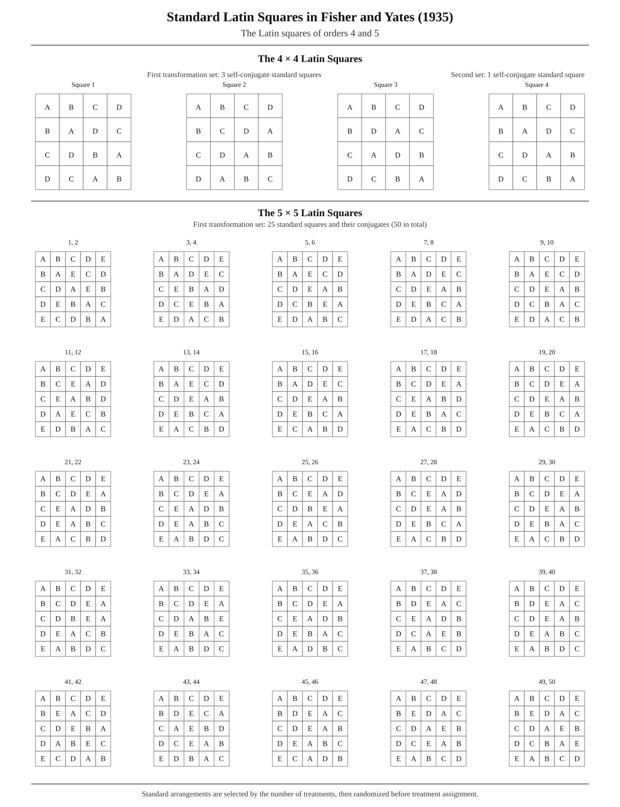
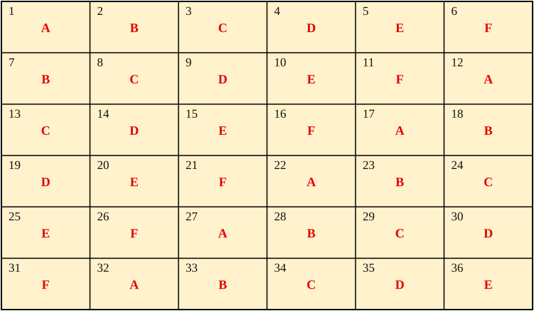
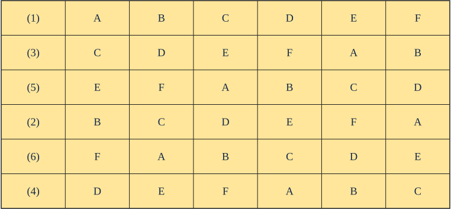
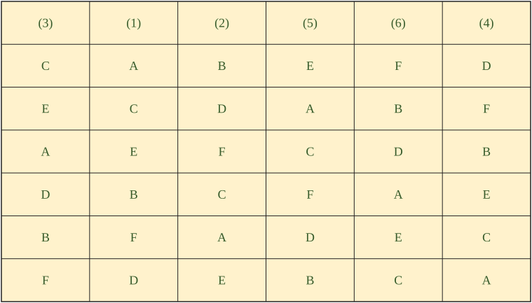

# Single factor experiments

Experiments in which treatments represent the levels of one factor of interest are called single-factor experiments. Other management practices are kept as uniform as practicable, while remaining differences among units may be controlled by blocking or included in experimental error.

**Examples:**

1.  An experiment to find the best nitrogen level for getting a high yield, where 5 different nitrogen levels are tested. Here, nitrogen levels are the treatments and plots are the experimental units. Irrigation and other management are kept uniform; a fertility gradient, if present, can be controlled by blocking.

2.  An experiment to find the best feed formulation for milk yield in cows from 4 feed formulas. Here, the feed formula is the only factor that varies, with 4 levels. All other factors like breed of cow, age, and so on are kept constant.

## Completely Randomized Design (CRD){#sec-crd}  

Completely Randomized Design is the basic single factor design. In this
design the treatments are assigned completely at random, subject to the
planned treatment counts. With equal replication, every unit has the same
probability of receiving each treatment; with unequal replication, the
probability for treatment $i$ is $r_i/n$.
CRD is most appropriate for experiments with homogeneous experimental
units, such as laboratory and green house experiments, where
environmental effects are relatively easy to control. For field
experiments, where there is generally large variation among experimental
plots, CRD is rarely used.

CRD provides a layout for conducting experiments, when experimental
units are homogeneous. Only two basic principles of design,
randomization @sec-rand and replication @sec-rep are followed in
CRD. Blocking is not used. Treatments can have unequal replications in CRD.

### Randomization procedure {#sec-random1}

Consider an experiment involving four treatments A, B, C, D in CRD. Each treatment is replicated 5 times. Randomization procedure is as explained below.   

1.  Determine the total number of experimental units ($n$) as the product of the number of treatments ($v$) and the number of replications ($r$); that is, $n = r\ \times v$. For our example, $n = 5 \times 4 = 20$

2.  Assign a unit number to each experimental units in any convenient manner; for example, consecutively from 1 to n. For our example, the unit numbers 1, 2,\... , 20 are assigned to the 20 experimental units as shown in @fig-crdnumbered  

3.  Assign the treatments to the experimental plots by using any randomization schemes. Here we explain a simple randomization scheme in @sec-random.  

```{r echo=FALSE, out.width="60%", fig.align='center'}
#| label: fig-crdnumbered
#| fig-cap: "Numbered experimental units"

```

#### Randomization by drawing lots {#sec-random}

1.  Prepare $n$ identical pieces of paper and divide them into $v$ groups, each group with $r$ pieces of paper. Label each piece of paper of the same group with the same letter (or number) corresponding to a treatment. Uniformly fold each of the $n$ labeled pieces of paper, mix them thoroughly, and place them in a container. For our example, there should be 20 pieces of paper, five each with treatments A, B, C, and D appearing on them.

2.  Draw one piece of paper at a time without replacement, mixing the remaining lots after each draw. Record the treatment label and its draw number. The draw number identifies the experimental unit receiving that treatment. Continue until all 20 units have been allocated; the treatment counts remain five each.

```{r echo=FALSE, warning=FALSE, message=FALSE, results='asis'}
#| label: tbl-sequence
#| fig-cap: "Sequence in which labelled lots are drawn"
#| tbl-cap: "Sequence in which labelled lots are drawn"
#| filters:
#| - parse-latex
library(knitr)
library(kableExtra)
dt <- read.csv("csv/crd_sequence.csv", header = FALSE, check.names = FALSE)
kbl(dt, col.names = NULL, booktabs = TRUE, align = "c") %>%
  kable_classic(full_width = FALSE, html_font = "Georgia") %>%
  kable_styling(
    full_width = FALSE,
    position = "center",
    bootstrap_options = "bordered",
    font_size = 12
  ) %>%
  column_spec(1, bold = TRUE, width = "2.8cm") %>%
  row_spec(c(1, 3), bold = TRUE)
```

### Layout of CRD

After allotting the treatment according to the randomization procedure explained in @sec-random1. The final layout will look like in the @fig-layout.  

```{r echo=FALSE, out.width="60%", fig.align='center'}
#| label: fig-layout
#| fig-cap: "Layout of Completely Randomized Design"

```  

### Statistical model for CRD  

Consider a CRD with *v* treatments and $r_i$ replications for treatment $i$, with $n=\sum_{i=1}^v r_i$. Its statistical model is the same as that of one-way ANOVA (@sec-onewaymodel).
$$Y_{\text{ij}} = \mu + \tau_{i} + e_{\text{ij}}$$  
Where *i* = 1,2, ..., *v* and *j* =1,2, ..., *r*~i~. $Y_{\text{ij}}$ is the observed value of $i^{\text{th}}$
treatment from $j^{\text{th}}$ replication, $\tau_{i}$ is the effect of $i^{\text{th}}$ treatment. $\mu$ is the general
effect which is common for all treatments. $e_{\text{ij}}$ is the error
effects.$e_{ij}$ $\sim iid\ N(0,\sigma^{2})$  

### Analysis of CRD  

Analysis of CRD is same as that explained in @sec-onewaycalc of one-way ANOVA.   

::: {.callout-note title="Note"}
Unequal replication (*i*.*e*. each treatment can have a different number of replications) is possible in CRD. So while calculating the treatment sum of squares, each treatment total is squared and divided by its corresponding replication, and then the sum is taken. If the replication is the same for all treatments, the treatment sum of squares is obtained by taking the sum of the squares of the treatment totals and dividing by the common replication number.
:::

```{r tbl-crdanova, echo=FALSE, warning=FALSE, message=FALSE, results='asis'}
#| fig-cap: "ANOVA table of CRD"
#| tbl-cap: "ANOVA table of CRD"
#| filters: 
#| - parse-latex

library(knitr)
library(kableExtra)

dt <- data.frame(
  Source = c("Treatments", "Error", "Total"),
  
  df = c(
    "$v-1$",
    "$n-v$",
    "$n-1$"
  ),
  
  SS = c(
    "$\\text{SST} = \\sum_{i=1}^{v}\\dfrac{T_i^2}{r_i} - \\text{C.F.}$",
    "$\\text{Total SS} - \\text{SST}$",
    "$\\sum_{i=1}^{v}\\sum_{j=1}^{r_i} y_{ij}^2 - \\text{C.F.}$"
  ),
  
  MSS = c(
    "$\\text{MST}=\\dfrac{\\text{SST}}{v-1}$",
    "$\\text{MSE}=\\dfrac{\\text{SSE}}{n-v}$",
    ""
  ),
  
  F = c(
    "$F = \\dfrac{\\text{MST}}{\\text{MSE}}$",
    "",
    ""
  )
)

colnames(dt) <- c("Source", "D.F.", "S.S", "M.S.S", "F")

kbl(
  dt,
  booktabs = TRUE,
  align = "c",
  escape = FALSE
) %>%
  kable_classic(
    full_width = FALSE,
    html_font = "Georgia"
  ) %>%
  kable_styling(
    full_width = FALSE,
    position = "center",
    bootstrap_options = "bordered"
  ) %>%
  row_spec(0, bold = TRUE) %>%
  column_spec(
    3,
    width = "5.5cm",
    extra_css = "padding-right: 22px;"
  ) %>%
  column_spec(
    4,
    width = "4cm",
    extra_css = "padding-left: 22px;"
  )
```  

#Here **Latin Square Design** is a design, whereas **least significant difference** is a pairwise comparison procedure. To avoid confusing the two uses of LSD, the comparison threshold below is called the **critical difference (CD)**.

### Pairwise comparison using the critical difference (CD) {#sec-postcrd}  
If the null hypothesis is rejected in ANOVA; we proceed to post-hoc test explained in @sec-lsd. Fisher's Least significant difference (LSD) test explained in @sec-lsd is the commonly employed test in agricultural experiments.  
Arrange the treatment means in descending order. Critical difference (CD) is calculated for each treatment pair $T_{i},\ T_{j}$ using the following formula.

$$C.D. = t_{\left( \frac{\alpha}{2},\ error\ df \right)}\sqrt{\text{MSE}\left( \frac{1}{r_{i}} + \frac{1}{r_{j}} \right)}$$

(for CRD with unequal replication)

$$C.D. = t_{\left( \frac{\alpha}{2},\ error\ df \right)}\sqrt{\frac{2\,MSE}{r}}$$

(for CRD with equal replication)

Here $t_{\left( \frac{\alpha}{2},\ \ \ error\ df \right)}$ denotes the critical value of Student's t for a two tailed test at α level of significance and error degrees of freedom. $r_{i}$ and $r_{j}$ are replications of $T_{i},\ T_{j}$ respectively. If the difference of any two treatment means is greater
than the critical difference, they are significantly different. If the difference of any two treatment means is less than $\text{C.D}$. they are said to be on par. (*i*.*e*., there is no statistically significant difference). Treatments that are at par are given common
symbols or letters, such that treatment means without any common letters or symbols are significantly different at corresponding level of significance ($\alpha$).  

### Replications in CRD {#sec-replical}

Replication is chosen before the experiment, balancing precision and cost. It should be planned using the smallest important treatment difference, an estimate of error variance, the significance level, and the required power. A traditional rule of thumb is to aim for at least 12 error degrees of freedom. This is a planning guideline, not a condition for a valid design or a guarantee of adequate power.

If this guideline is adopted for an equally replicated CRD, it gives

$$n - v = rv - v = v\left( r - 1 \right) \geq 12$$ {#eq-crdrep}  

where $v$ is the number of treatments, $r$ is the replication and $n$ is the total number of experimental units, $n = vr$.  

::: {#exm-ct42}
You have 5 treatments and are planning a CRD. Using the guideline of at least 12 error degrees of freedom, find the minimum equal replication.

**Solution**

from @eq-crdrep, since v = 5, *edf* $= 5\left( r - 1 \right) \geq 12$

$r \geq 3.4$, since $r$ cannot be a fraction, $r =$ 4

Four replications meet this guideline; a power calculation may require more.
:::

::: {.callout-note title="Interpreting the 12 error-df guideline"}
More error degrees of freedom generally improve estimation of error variance. Under normal independent errors, the relative standard error of MSE is $\sqrt{2/edf}$, about 41% even at $edf=12$. For fixed numerator df, the upper critical F value decreases as denominator df increases, but there is no universal threshold at 12. Power also depends on treatment differences, error variance and allocation. Designs with fewer error df can be analysed when the model is estimable; their uncertainty may be large.

{#fig-fcritical fig-align="center" width="80%" style="text-align:center;"}
:::  

::: {#exm-ct43}
In order to find the yielding abilities of five varieties of sesame an experiment was conducted in the green house using a CRD with four pots per variety. The results are given in the following table below.

```{r echo=FALSE, warning=FALSE, message=FALSE, results='asis'}
#| label: tbl-crdex
#| fig-cap: "Yield data of five varieties of sesame under CRD"
#| tbl-cap: "Yield data of five varieties of sesame under CRD"
#| filters:
#| - parse-latex
library(knitr)
library(kableExtra)
dt <- read.csv("csv/crd_data.csv", check.names = FALSE)
kbl(dt, booktabs = TRUE, align = "c") %>%
  kable_classic(full_width = FALSE, html_font = "Georgia") %>%
  kable_styling(
    full_width = FALSE,
    position = "center",
    bootstrap_options = "bordered"
  ) %>%
  add_header_above(c(" " = 1, "Variety" = 5), bold = TRUE) %>%
  row_spec(0, bold = TRUE) %>%
  row_spec(5:6, bold = TRUE) %>%
  column_spec(1, bold = TRUE)
```

**Solution**

**Correction Factor**:

$= \frac{G^{2}}{n} = \frac{\left( 397 \right)^{2}}{20}$=7880.45

**Total Sum of squares**:

$= \left( 25^{2} + 21^{2} + .... + 11^{2} \right) - CF$

$= 8307 - CF = 426.55$

**Treatment Sum of Squares**:

$\frac{1}{4}(85^{2} + 102^{2} + ... + 53^{2}) - CF$
$= 8211.75 - CF = 331.30$

**Error Sum of Square**:
$426.55 - 331.30 = 95.25$

```{r echo=FALSE, warning=FALSE, message=FALSE, results='asis'}
#| label: tbl-crdanovaex
#| fig-cap: "ANOVA table for the sesame variety trial"
#| tbl-cap: "ANOVA table for the sesame variety trial"
#| filters:
#| - parse-latex
library(knitr)
library(kableExtra)
dt <- read.csv("csv/crd_anova.csv", check.names = FALSE)
dt[is.na(dt)] <- ""

kbl(dt, booktabs = TRUE, align = "c", escape = FALSE) %>%
  kable_classic(full_width = FALSE, html_font = "Georgia") %>%
  kable_styling(
    full_width = FALSE,
    position = "center",
    bootstrap_options = "bordered"
  ) %>%
  row_spec(0, bold = TRUE) %>%
  column_spec(1, bold = TRUE)
```

Since the F value calculated is greater than table value of F, we can reject the null hypothesis and conclude that there is a significant difference between at least a pair of treatments. So in order to find which treatments are significantly different, we perform Fisher's LSD test.

$$\text{CD} = t_{\frac{\alpha}{2}}\sqrt{\frac{2 \times \text{MSE}}{r}} = 2.131\sqrt{\frac{2(6.350)}{4}} = 2.131 \times 1.7819 \approx 3.7972$$

$t_{0.025\text{ at }15 \text{ edf}} = 2.131$ (Just look for the critical value of *t* for a two tailed test at α = 0.05 in the statistical table, see @tbl-ttable in @sec-appendix-4.

It is shown as $t_{\frac{\alpha}{2}}$, since it is a two tailed test in the one side of the t-distribution curve the probability will be $\frac{\alpha}{2}$, so that combined probability is α.)

Treatment means arranged in descending order. Those treatment pairs whose difference in means is greater than C.D. is labelled with a different letters.

| Treatments | means | Grouping using alphabets |
|:----------:|:-----:|:-------------------------:|
| $V_{2}$ | 25.5 | a |
| $V_{1}$ | 21.25 | b |
| $V_{3}$ | 21.25 | b |
| $V_{4}$ | 18 | b |
| $V_{5}$ | 13.25 | c |

: Grouping of treatment means using letters {#tbl-crdgroupletters .bordered}

In the above table we can see that the difference between the means of $V_{2}$ and $V_{1}$ is 4.25, which is greater than the C.D. value. So $V_{2}$ and $V_{1}$ are significantly different, and different letters are assigned to each of them. Instead of letters one can also use symbols as shown below. Those treatments with the same letters/symbols are not significantly different.

| Treatments | means | Grouping using symbols |
|:----------:|:-----:|:-----------------------:|
| $V_{2}$ | 25.5 | @ |
| $V_{1}$ | 21.25 | \* |
| $V_{3}$ | 21.25 | \* |
| $V_{4}$ | 18 | \* |
| $V_{5}$ | 13.25 | & |

: Grouping of treatment means using symbols {#tbl-crdgroupsymbols .bordered}

In this experiment, $V_2$ has the highest mean and exceeds the other varieties under protected LSD. This conclusion concerns the response and conditions studied; it does not establish universal superiority.

::: {.callout-important title="Note"}
In some cases, more than one alphabet can appear against a treatment mean, see the hypothetical example below.
:::

| Treatments | Grouping |
|:----------:|:--------:|
| $V_2$ | a |
| $V_1$ | ab |
| $V_3$ | bc |
| $V_4$ | c |
| $V_5$ | d |

: A hypothetical example of treatment grouping {#tbl-groupingcrd .bordered}

Here $V_1$ carries two letters (ab), meaning it is not significantly different from $V_2$ (they share **a**) and also not significantly different from $V_3$ (they share **b**), while $V_2$ and $V_3$ do not share a letter and so are significantly different from each other.

::: {.callout-important title="Note"}
When a lettering like this appears, treatments having common alphabets are not significantly different. In the above table $V_{2}$ and $V_{1}$ are not significantly different, as both of them have the common letter *a*. At the same time you can see $V_{5}$ and $V_{4}$ are significantly different, as they don't have any common letters.
:::
:::  

### Advantages of a CRD

1.  Its layout is very easy.

2.  There is complete flexibility in this design *i*.*e*. any number of
    treatments and replications for each treatment can be tried.

3.  Whole experimental material can be utilized in this design.

4.  This design yields maximum degrees of freedom for experimental
    error.

5.  The analysis of data is simplest as compared to any other design.

6.  Even if some values are missing the analysis can be done.

### Disadvantages of a CRD

1.  Often inefficient for heterogeneous fields; it can be used when experimental units are sufficiently homogeneous.

2.  Relatively low accuracy due to lack of local control. Completely homogeneous experimental units are practically difficult in many situations.  


## Randomized Complete Block Designs (RCBD)

In field experiments, the plots on which treatments are applied may not be uniform and there may be difference in plot-to-plot fertility. In such cases CRD cannot be
recommended. If there is only one source constituting the difference between the plots then we can recommend randomized block design.

The randomized complete block design (RCBD) is one of the most widely used experimental designs in agricultural research. The design is especially suited for field experiments where the number of treatments is not large and the experimental area has a predictable fertility gradient. It is also termed as RBD (Randomized Block Design) in some textbooks.  

When the experimental material is heterogeneous, the experimental material is grouped into homogeneous sub-groups called **blocks**. As each block consists of the entire set of treatments a block is equivalent to a replication. For example, in a field with known fertility gradient in one direction, plots perpendicular to this gradient will be considered as a block. In RCBD blocks are of equal size and contains all the treatments. Since the block contains all the treatments, the term 'complete block design' is used. See @fig-rcbd1 to see how blocks are formed in a field.

::: {.callout-important title="Note"}
In RCBD, number of replications, $r$ = number of blocks. Number of plots within a block = number of treatments, $v$.
:::

### Blocking technique

Blocking or local control, one of the basic principles of design is effectively implemented in RCBD. The primary purpose of blocking is to reduce experimental error by eliminating the contribution of known sources of variation among experimental units. This is achieved by grouping homogeneous units together, so that variability with in blocks is minimized, between blocks is maximized.  

Two important factors to be considered for blocking

-   The selection of the source of variability to be used as the basis for blocking, in field experiments usually fertility gradient or productivity gradient is used as the identified source of variability.

-   Proper selection of block shape and orientation. With a unidirectional gradient, narrow blocks with their long axis perpendicular to the gradient often keep within-block variation small. With variation in two directions, examine the field map and consider compact blocks or a row-column design. A square block alone does not control two separate gradients.

### Randomization in RCBD {#sec-rcbdrandom}

Consider an experiment involving four treatments A, B, C, D in RCBD. Each treatment is replicated 5 times. Randomization procedure is as explained below. The randomization process for a RCB design is applied separately and independently to each of the blocks.

STEP 1. Divide the experimental area into $r$ equal blocks, where $r$ is the number of replications. In our example $r =$ 5.  

```{r echo=FALSE, out.width="60%", fig.align='center'}
#| label: fig-rcbd1
#| fig-cap: "Division of an experimental field into five blocks, each consisting of four plots, for a RCBD with four treatments and five replications. Blocking is done such that blocks are rectangular and perpendicular to the direction of the unidirectional fertility gradient"

``` 

STEP 2. Subdivide each block into $v$ experimental plots, where $v$ is the number of treatments. Number the $v$ plots consecutively from 1 to $v$, and assign $v$ treatments at random to the $v$ plots following the randomization scheme for the CRD described in @sec-random. In our example each of the 5 blocks are divided into 4 plots. Plots are numbered 1 to 4 in each block. Now for each block, paper lots of 1 to 4 is prepared. Treatment names are written in order and plot number from each lot is recorded in order as shown below.

| Treatments | A | B | C | D |
|:----------:|:-:|:-:|:-:|:-:|
| Plot number from lot | 2 | 1 | 4 | 3 |

: Plot numbers drawn for each treatment in a single block {#tbl-crdlotdraw .bordered}

STEP 3. All treatments are allotted to the selected plots. Repeat Step 2 with a fresh, independent draw in every block. Do not copy the first block's treatment order into the other blocks.

```{r echo=FALSE, out.width="60%", fig.align='center'}
#| label: fig-rcbd2
#| fig-cap: "Allotment of treatments in all blocks. In RCBD each block will have all the treatments and each treatment appear in a block exactly once. "

```  



### Layout of RCBD

In RCBD each block will have all the treatments and each treatment appear in a block exactly once. After allotting the treatment according to the randomization procedure explained in @sec-rcbdrandom. The final layout will look like in the @fig-rcbd3.  

::: {.callout-important title="Note"}
In RCBD every treatment will have the same number of replications (all treatments are equally replicated, say, $r$ times). So we need a total of $v \times r$ plots for conducting that experiment. Each of $r$ blocks will contain $v$ plots. So in this design, the number of blocks = number of replications of the treatments = $r$, and number of plots within a block = number of treatments = $v$.
:::


```{r echo=FALSE, out.width="60%", fig.align='center'}
#| label: fig-rcbd3
#| fig-cap: "Layout of RCBD with four treatments and five replications"

``` 

### Statistical Model for RCBD

Consider a RCBD with $v$ treatments with $r$ replications (Blocks). Statistical model for RCBD is same as that of two-way ANOVA described in @sec-twowaymodel.  

$$Y_{\text{ij}} = \mu + \tau_{i} +  \gamma_{j}+ e_{\text{ij}}$$  
where, *i* = 1,2, ..., *v* and *j* =1,2, ..., *r*. $Y_{\text{ij}}$ is the observed value of response under $i^{\text{th}}$ treatment and $j^{\text{th}}$ block, $\tau_{i}$ is the effect of $i^{\text{th}}$ factor,$\gamma_{j}$ is the effect of $j^{\text{th}}$ block . $\mu$ is the general
effect which is common for all treatments. $e_{\text{ij}}$ is the error
effects.$e_{ij}$ $\sim iid\ N(0,\sigma^{2})$  

The RCBD model assumes additive treatment and block effects. With one observation per treatment in each block, treatment-by-block interaction cannot be estimated separately from error. Residual plots should be examined for unequal variance, outliers, trends and departures from the assumed model.

### Analysis of RCBD  
Analysis of RCBD is same as that explained in @sec-twowaycalc of two-way ANOVA.

Observation from $v$ treatments in $r$ blocks is arranged as shown below.  

| Treatment | Block 1 | Block 2 | Block 3 | $\cdots$ | Block $r$ | Total |
|:---------:|:-------:|:-------:|:-------:|:--------:|:---------:|:-----:|
| 1 | $Y_{11}$ | $Y_{12}$ | $Y_{13}$ | $\cdots$ | $Y_{1r}$ | $T_1$ |
| 2 | $Y_{21}$ | $Y_{22}$ | $Y_{23}$ | $\cdots$ | $Y_{2r}$ | $T_2$ |
| 3 | $Y_{31}$ | $Y_{32}$ | $Y_{33}$ | $\cdots$ | $Y_{3r}$ | $T_3$ |
| $\vdots$ | | | | | | $\vdots$ |
| $v$ | $Y_{v1}$ | $Y_{v2}$ | $Y_{v3}$ | $\cdots$ | $Y_{vr}$ | $T_v$ |
| Total | $B_1$ | $B_2$ | $B_3$ | $\cdots$ | $B_r$ | $G$ |

: Two-way arrangement of observations in RCBD {#tbl-rcbd4}

The ANOVA table, following the calculations as in @sec-twowaycalc, is

```{r tbl-rcbd5,echo=FALSE, warning=FALSE, message=FALSE, results='asis'}
#| tbl-cap: "ANOVA table of RCBD"
#| fig-cap: "ANOVA table of RCBD"
#| filters:
#| - parse-latex

library(knitr)
library(kableExtra)

dt <- data.frame(
  Source = c("Treatments", "Blocks", "Error", "Total"),
  
  df = c(
    "$v-1$",
    "$r-1$",
    "$(v-1)(r-1)$",
    "$vr-1$"
  ),
  
  SS = c(
    "$\\text{SST} = \\dfrac{\\sum_{i=1}^{v} T_i^2}{r} - \\text{C.F.}$",
    "$\\text{SSB} = \\dfrac{\\sum_{j=1}^{r} B_j^2}{v} - \\text{C.F.}$",
    "$\\text{ESS} = \\text{Total SS} - \\text{SST} - \\text{SSB}$",
    "$\\sum_{i=1}^{v}\\sum_{j=1}^{r} Y_{ij}^2 - \\text{C.F.}$"
  ),
  
  MSS = c(
    "$\\dfrac{\\text{SST}}{v-1} = \\text{MST}$",
    "$\\dfrac{\\text{SSB}}{r-1} = \\text{MSR}$",
    "$\\dfrac{\\text{ESS}}{(v-1)(r-1)} = \\text{MSE}$",
    ""
  ),
  
  F = c(
    "$F_1 = \\dfrac{\\text{MST}}{\\text{MSE}}$",
    "$F_2 = \\dfrac{\\text{MSR}}{\\text{MSE}}$",
    "",
    ""
  )
)

colnames(dt) <- c("Source", "d.f", "S.S", "M.S.S", "F")

kbl(
  dt,
  escape = FALSE,
  booktabs = TRUE,
  align = "c"
) %>%
  kable_classic(
    full_width = FALSE,
    html_font = "Georgia"
  ) %>%
  kable_styling(
    full_width = FALSE,
    position = "center",
    bootstrap_options = "bordered"
  ) %>%
  row_spec(0, bold = TRUE) %>%
  column_spec(3, width = "5cm") %>%
  column_spec(4, width = "3.2cm")
```

where $\text{C.F} = \dfrac{G^2}{rv}$.

$F_{1} \sim F_{(v-1),\ (v-1)(r-1)}$ and $F_{2} \sim F_{(r-1),\ (v-1)(r-1)}$ are two F values, one for treatment and one for blocks respectively. Decisions on the null hypothesis are made by comparing the corresponding F value to the table value given in @tbl-ftable of @sec-appendix-5.

::: {.callout-important title="Note"}
What if $F_{2}$ is not significant? A non-significant block F-test means that the data provide insufficient evidence of differences between blocks; it does not prove that blocking was ineffective. Blocking should be chosen from prior knowledge of the experimental material. Its gain in precision depends on the variation removed and the error degrees of freedom used, rather than solely on the significance of the block test.
:::  

### Post-hoc test in RCBD  

If the null hypothesis for treatments is rejected in ANOVA; we proceed to post-hoc test explained in @sec-lsd. Arrange the treatment means in descending order. Critical difference (CD) or LSD (Least Significant Difference) is calculated for each treatment pair $T_{i},\ T_{j}$ using the following formula.  

$$CD = \ t_{\frac{\alpha}{2},edf}.\sqrt{\frac{2\ MSE}{r}}$$
where, $\text{MSE}$ is the Mean Square Error from ANOVA.
$t_{\frac{\alpha}{2},edf}$ is the critical value of two tailed student's t distribution at $\alpha$ level of significance and error degrees of
freedom. $r$ is the number of blocks/replication.  
Procedure for grouping using symbols is same as that of CRD explained in @sec-postcrd.  

### Replications in RCBD  

As explained in @sec-replical, power and precision should guide replication. If the traditional guideline of at least 12 error degrees of freedom is used, an RCBD satisfies

$$(v - 1) (r-1) \geq 12$$ {#eq-rcbdrep}  

where $v$ is the number of treatments and $r$ is the replication. 

::: {#exm-ct44}
You have 4 treatments and are planning an RCBD. Using the guideline of at least 12 error degrees of freedom, find the minimum number of blocks.

**Solution**

from @eq-rcbdrep

Since $v$ = 4, *edf* $= 3\left( r - 1 \right) \geq 12$

$\implies r \geq 5$, minimum replication required is 5

Five blocks meet this error-df guideline. This does not establish adequate power for a particular treatment difference.
:::

::: {#exm-ct46}
The yield of paddy (kg per plot) under four fertilizer treatments A, B, C, and D was studied using an RCBD with 5 blocks. The results are given below.

```{r echo=FALSE, warning=FALSE, message=FALSE, results='asis'}
#| label: tbl-rcbdex
#| tbl-cap: "Yield data (kg per plot) of four fertilizer treatments under RCBD"
#| fig-cap: "Yield data (kg per plot) of four fertilizer treatments under RCBD"
#| filters:
#| - parse-latex

library(knitr)
library(kableExtra)
dt <- data.frame(
  Block = c("Block 1", "Block 2", "Block 3", "Block 4", "Block 5", "**Total**"),
  A = c("41", "42", "40", "42", "41", "**206**"),
  B = c("44", "51", "43", "51", "47", "**236**"),
  C = c("52", "51", "49", "53", "51", "**256**"),
  D = c("43", "48", "40", "50", "45", "**226**"),
  Total = c("180", "192", "172", "196", "184", "**924**")
)
colnames(dt) <- c("Block", "A", "B", "C", "D", "Total")
kbl(dt, escape = FALSE, booktabs = TRUE, align = "c") %>%
  kable_classic(full_width = FALSE, html_font = "Georgia") %>%
  kable_styling(
    full_width = FALSE,
    position = "center",
    bootstrap_options = "bordered"
  ) %>%
  row_spec(0, bold = TRUE) %>%
  row_spec(6, bold = TRUE) %>%
  column_spec(1, bold = TRUE)
```

**Solution**

**Grand Total (G)** = 924

**Correction Factor** $= \dfrac{G^{2}}{n} = \dfrac{(924)^{2}}{20}$ = 42688.80

**Total Sum of Squares (TSS)** $= (41^2+44^2+52^2+...+45^2) - CF$
$= 43080 - 42688.80 = 391.20$

**Treatment Sum of Squares (SST)** $= \dfrac{1}{5}(206^{2} + 236^{2} + 256^{2} + 226^{2}) - CF$
$= 42948.80 - 42688.80 = 260.00$

**Block Sum of Squares (SSB)** $= \dfrac{1}{4}(180^{2} + 192^{2} + 172^{2} + 196^{2} + 184^{2}) - CF$
$= 42780.00 - 42688.80 = 91.20$

**Error Sum of Squares** $= 391.20 - 260.00 - 91.20 = 40.00$

```{r echo=FALSE, warning=FALSE, message=FALSE, results='asis'}
#| label: tbl-rcbdanovaex
#| tbl-cap: "ANOVA table for the fertilizer trial"
#| fig-cap: "ANOVA table for the fertilizer trial"
#| filters:
#| - parse-latex

library(knitr)
library(kableExtra)
dt <- data.frame(
  Source = c("Treatments", "Blocks", "Error", "Total"),
  df = c("3", "4", "12", "19"),
  SS = c("260.00", "91.20", "40.00", "391.20"),
  MSS = c("86.67", "22.80", "3.33", ""),
  FCal = c("26.00", "6.84", "", ""),
  FTab = c("3.49", "3.26", "", "")
)
colnames(dt) <- c("Source of variation", "df", "Sum of squares",
                  "Mean Sum of squares", "F Cal", "F tab")
kbl(dt, escape = FALSE, booktabs = TRUE, align = "c") %>%
  kable_classic(full_width = FALSE, html_font = "Georgia") %>%
  kable_styling(
    full_width = FALSE,
    position = "center",
    bootstrap_options = "bordered"
  ) %>%
  row_spec(0, bold = TRUE) %>%
  column_spec(1, bold = TRUE)
```

Both treatment and block F values exceed their critical values. The treatment means differ significantly. There is evidence of block differences; the efficiency of blocking also depends on the residual variation and degrees of freedom, as discussed above.

$$CD = t_{\frac{\alpha}{2},edf}\sqrt{\frac{2\,MSE}{r}} = 2.179\sqrt{\frac{2 \times 3.33}{5}} = 2.516$$

Treatment means, in descending order, are C = 51.2, B = 47.2, D = 45.2, A = 41.2.

| Treatments | Means | Grouping |
|:----------:|:-----:|:--------:|
| C | 51.2 | a |
| B | 47.2 | b |
| D | 45.2 | b |
| A | 41.2 | c |

: Grouping of treatment means for the fertilizer trial {#tbl-rcbdgrouping .bordered}

Since $C-B = 4.0$ and $D-A = 4.0$, both exceed the CD of 2.516, so C is significantly superior to all other treatments, and A gives the significantly lowest yield. B and D do not differ significantly from each other ($B-D = 2.0 < CD$), so C has the highest mean yield and exceeds the other treatments in this trial under protected LSD. A practical recommendation also needs costs, relevant responses and performance across the intended environments.
:::


### Advantages of RCBD

1.  Accuracy: RCB design has been shown to be more efficient or accurate than C.R.D. for most types of experimental work.  

2.  Flexibility: In RCBD no restrictions are placed on the number of treatments or
the number of replicates.

3.  Even if some values are missing, still the analysis can be done by using missing plot 
technique.

4.  Ease of analysis: Statistical analysis is simple, rapid and straight forward.  

### Disadvantages of RCBD

1.  Blocks that fail to capture important variation may provide little precision gain. Valid inference still depends on the randomization and error-model assumptions.

2.  RCBD is not suitable for large number of treatments because in that case the block size will increase and it may not be possible to keep large blocks
homogeneous.  

3. Missing plots remove the simple orthogonal structure. A model fitted to the observed data is preferable to extending complete-data formulas without adjustment.

## Latin Square Design (LSD) 

In this design, variations in the field in two different directions (or  variations 
due to two different factors)  are controlled simultaneously from affecting the 
treatment comparisons.  A layout in RBD controls only one source of external 
variation affecting the treatment comparisons by the construction of homogeneous
blocks. Sometimes when blocks were laid out in a field the environmental conditions 
within each block need not be the same. For example, soil variability in a North South 
direction and an environmental gradient in an East West Direction then the conditions 
within each block will vary. In such situations the variability can be controlled by a 
Latin Square design (LSD). The blocks in a LSD are called rows and columns; they 
represent two external factors. The entire experimental area can be divided into small 
plots arranged in the form of a square. The number of plots in each row and each 
column are equal, both equal to the number of treatments to be compared.

### Randomization {#sec-lsdrandom}

A Latin square of $v$ treatments (usually called side $v$) is an arrangement of $v$ treatments into $v$ rows and $v$ columns such that every treatment is replicated in each row and each column exactly once.

Latin squares of different orders are provided in standard statistical tables for use in experimental design. When $v$ treatments are to be compared, a Latin square of order $v$, that is, a $v\times v$ square, is required. The order of the square is therefore determined directly by the number of treatments in the experiment. For example, an experiment involving four treatments requires a $4\times4$ Latin square, whereas an experiment involving five treatments requires a $5\times5$ Latin square.

Standard Latin squares suitable for experimental use are given in the tables of [@fisher1938statistical]. In these tables, the Latin squares are presented in a standard form, with the treatment symbols arranged in a specified order, usually alphabetically, in the first row. Several standard squares may be available for a particular order, as illustrated in @fig-strdlattice. These standard arrangements serve only as the starting point for constructing the experimental layout; they should not be used directly without randomization.

For a given number of treatments ($v$), select an appropriate standard Latin square of order ($v$) from the statistical tables. The selected square is then randomized so that the treatment allocation is not influenced by the initial systematic arrangement of the standard square. Randomization is carried out by independently permuting the rows, columns, and treatment symbols according to the prescribed procedure. The resulting randomized Latin square provides the treatment allocation to the experimental units, with each treatment occurring exactly once in every row and once in every column. The randomization procedure is described in the following steps.

{#fig-strdlattice width="500px" height="600px"}

Let $v = 6$. A Latin square for 6 treatments, denoted by *A*, *B*, *C*, *D*, *E* and *F*, can be constructed by placing the symbols in alphabetical order in the first row and generating each subsequent row by a symmetric cyclic shift of the one above it.  

```{r echo=FALSE, out.width="90%", fig.align='center'}
#| label: fig-lsdlayout
#| fig-cap: "Standard (unrandomized) Latin square with six treatments"

```

@fig-lsdlayout shows this standard, systematically-arranged Latin square for $v = 6$ treatments before randomization. The blocking is applied in two directions, as rows and as columns, and the number of rows and columns each equals the number of treatments, $v$. A standard Latin square of 6 treatments can also be directly obtained from the tables.

Randomization of a Latin square design involves three steps:

1. Row randomization  
2. Column randomization  
3. Treatment randomization  

For $v$ treatments, select a Latin square of order $v$ at random from the statistical tables, and then randomize it through the following steps.

*Row randomization*: Number the rows of the selected square from 1 to $v$ and randomly permute all row positions. The first row is eligible to move like any other row. A permutation may happen to leave it in place, as in the illustrated arrangement in @fig-lsdlayout1.

```{r echo=FALSE, out.width="90%", fig.align='center'}
#| label: fig-lsdlayout1
#| fig-cap: "Randomization of the rows of the Latin square"

```

*Column randomization*: Once the rows have been randomized, rearrange the columns in a random order in the same manner to obtain a further randomized square, as shown in @fig-lsdlayout2.

```{r echo=FALSE, out.width="90%", fig.align='center'}
#| label: fig-lsdlayout2
#| fig-cap: "Randomization of the columns of the Latin square"

```

*Treatment randomization*: Finally, assign the $v$ treatments at random to the $v$ letters (*A*, *B*, …, *F*). The resulting square gives the field layout of the design.  

### Layout

After the row and column permutations illustrated in @fig-lsdlayout2, randomly assign the actual treatments to the letters. Record that mapping with the field layout. Each row and column corresponds to a physical row and column of plots; each cell receives the treatment mapped to its letter. Do not shuffle cells independently, because that would destroy the Latin-square restriction.

### Statistical model for LSD

The data collected from experiments in LSD are classified according to the levels of three factors. So it is called a three-way classified design. The two types of blocking (rows and columns) and treatments make up the three factors. The linear model for analysis is:

$$Y_{\text{ijk}} = \mu + \tau_{i} + R_{j}+ C_{k}+e_{\text{ijk}}$$ {#eq-lsdmodel}

where $i,j,k = 1,2,3,...\ v$

*i.e.,* the response (yield $Y_{ijk}$) of each plot = a general mean effect ($\mu$) + effect due to the $i^{th}$ treatment ($\tau_{i}$) + effect of the $j^{th}$ row ($R_{j}$) + effect due to the $k^{th}$ column ($C_{k}$) + random error term associated with each plot ($e_{ijk}$).

There are $v^2$ observed plots, not $v^3$ independent observations: the square determines which treatment occurs at each row-column intersection. The model assumes additive treatment, row and column effects, with independent normal errors of common variance for the usual exact F tests. Treatment-by-row, treatment-by-column and row-by-column interactions cannot be estimated separately in a single square.

### Analysis

The effect of the general mean is subtracted from each sum of squares (by subtracting the correction factor $C.F. = \dfrac{(\sum{y_{ijk}})^2} {v^2}$). The total sum of squares is split into four components: (i) variation between the treatments as treatment sum of squares, (ii) variation between the rows, (iii) variation between the columns, and (iv) variation within the factors, *i.e.,* error sum of squares.

To calculate the sum of squares, arrange the data according to the rows, columns and treatments and obtain the respective totals. Let the treatment totals be $T_{1}$, $T_{2}$, ...., $T_{v}$; row totals be $R_{1}$, $R_{2}$, $R_{3}$, ..., $R_{v}$ and column totals be $C_{1}$, $C_{2}$, $C_{3}$, ..., $C_{v}$.

```{r tbl-lsdanova,echo=FALSE, warning=FALSE, message=FALSE, results='asis'}
#| fig-cap: "ANOVA of Latin Square Design"
#| tbl-cap: "ANOVA of Latin Square Design"
#| filters:
#| - parse-latex

library(knitr)
library(kableExtra)

dt <- data.frame(
  Source = c(
    "Between treatments",
    "Between rows",
    "Between columns",
    "Error",
    "Total"
  ),
  
  df = c(
    "$v-1$",
    "$v-1$",
    "$v-1$",
    "$(v-1)(v-2)$",
    "$v^2-1$"
  ),
  
  SS = c(
    "$\\dfrac{\\sum T_i^2}{v} - CF$",
    "$\\dfrac{\\sum R_j^2}{v} - CF$",
    "$\\dfrac{\\sum C_k^2}{v} - CF$",
    "By subtraction",
    "$\\sum Y_{ijk}^2 - CF$"
  ),
  
  MSS = c(
    "$MST$",
    "$MSR$",
    "$MSC$",
    "$MSE$",
    ""
  ),
  
  F = c(
    "$\\dfrac{\\text{MST}}{\\text{MSE}}$",
    "$\\dfrac{\\text{MSR}}{\\text{MSE}}$",
    "$\\dfrac{\\text{MSC}}{\\text{MSE}}$",
    "",
    ""
  )
)

colnames(dt) <- c(
  "Source of Variation",
  "d.f",
  "Sum of Squares",
  "M.S.S",
  "F value"
)

kbl(
  dt,
  escape = FALSE,
  booktabs = TRUE,
  align = "c"
) %>%
  kable_classic(
    full_width = FALSE,
    html_font = "Georgia"
  ) %>%
  kable_styling(
    full_width = FALSE,
    position = "center",
    bootstrap_options = "bordered"
  ) %>%
  row_spec(0, bold = TRUE) %>%
  column_spec(1, width = "3.2cm") %>%
  column_spec(3, width = "3cm")
```

All these computed F values are compared with the F table values for $(v-1)$ and $(v-1)(v-2)$ degrees of freedom.

### Pairwise comparison using the critical difference (CD)

If the treatments turn out to be significant, then the means are compared pairwise using Fisher's Least Significant Difference (LSD) test, as explained in @sec-lsd.

$$C.D. = t_{\left( \frac{\alpha}{2},\ error\ df \right)}\sqrt{\frac{2\,MSE}{v}}$$ {#eq-lsdcd}

Here $t_{\left( \frac{\alpha}{2},\ error\ df \right)}$ denotes the critical value of Student's *t* for a two tailed test at $\alpha$ level of significance and error degrees of freedom. If the difference between any two treatment means is greater than the critical difference, they are significantly different; otherwise they are said to be on par. Procedure for grouping using letters or symbols is the same as that of CRD, explained in @sec-postcrd.

### Replications in LSD

In a single Latin square, each of the $v$ treatments is replicated $v$ times. The treatment set is determined by the scientific question and should not be enlarged merely to obtain more error degrees of freedom. If the traditional 12 error-df guideline is applied to one square, it gives

$$(v-1)(v-2) \geq 12$$ {#eq-lsdrep}

::: {#exm-lsdrep}
Find the smallest order $v$ of a single Latin square that meets the guideline of at least 12 error degrees of freedom.

**Solution**

from @eq-lsdrep, $(v-1)(v-2) \geq 12$

Trying $v = 4$: $(3)(2) = 6 < 12$, not sufficient.

Trying $v = 5$: $(4)(3) = 12 \geq 12$, sufficient.

The smallest order meeting this guideline is 5. Squares of orders 3 and 4 are valid but have only 2 and 6 error df. If more replication is needed for a fixed treatment set, consider replicated squares or another suitable design.
:::  

::: {#exm-ct45}
Consider a 5x5 LSD experimental setup as follows

```{r echo=FALSE, warning=FALSE, message=FALSE, results='asis'}
#| label: tbl-LSDE1
#| tbl-cap: "A 5x5 Latin square experimental layout, showing the treatment (A-E) and the response recorded on each plot"
#| fig-cap: "A 5x5 Latin square experimental layout, showing the treatment (A-E) and the response recorded on each plot"
#| filters:
#| - parse-latex

library(knitr)
library(kableExtra)
dt <- data.frame(
  RowCol = c("R~1~", "R~2~", "R~3~", "R~4~", "R~5~"),
  C1 = c("C 28", "E 27", "B 40", "D 41", "A 41"),
  C2 = c("B 36", "D 43", "A 44", "C 26", "E 16"),
  C3 = c("E 18", "B 27", "D 39", "A 34", "C 20"),
  C4 = c("D 42", "A 34", "C 36", "E 19", "B 31"),
  C5 = c("A 35", "C 32", "E 38", "B 37", "D 45")
)
colnames(dt) <- c("Row/Column", "C~1~", "C~2~", "C~3~", "C~4~", "C~5~")
kbl(dt, escape = FALSE, booktabs = TRUE, align = "c") %>%
  kable_classic(full_width = FALSE, html_font = "Georgia") %>%
  kable_styling(
    full_width = FALSE,
    position = "center",
    bootstrap_options = "bordered"
  ) %>%
  row_spec(0, bold = TRUE) %>%
  column_spec(1, bold = TRUE)
```

**Solution**

The three null hypotheses (one each for treatments, rows, and columns) are

$H_{01}$: $\mu_{11} = \mu_{12} = \mu_{13} = \mu_{14} = \mu_{15}$ (treatment means are equal)

$H_{11}$: at least two of the treatment means are different

$H_{02}$: $\mu_{21} = \mu_{22} = \mu_{23} = \mu_{24} = \mu_{25}$ (row means are equal)

$H_{12}$: at least two of the row means are different

$H_{03}$: $\mu_{31} = \mu_{32} = \mu_{33} = \mu_{34} = \mu_{35}$ (column means are equal)

$H_{13}$: at least two of the column means are different

```{r echo=FALSE, warning=FALSE, message=FALSE, results='asis'}
#| label: tbl-LSDE2
#| tbl-cap: "The 5x5 Latin square layout with row, column, and grand totals and means"
#| fig-cap: "The 5x5 Latin square layout with row, column, and grand totals and means"
#| filters:
#| - parse-latex

library(knitr)
library(kableExtra)
dt <- data.frame(
  RowCol = c("R~1~", "R~2~", "R~3~", "R~4~", "R~5~", "**Total**", "**Mean**"),
  C1 = c("C 28", "E 27", "B 40", "D 41", "A 41", "**177**", "**35.4**"),
  C2 = c("B 36", "D 43", "A 44", "C 26", "E 16", "**165**", "**33**"),
  C3 = c("E 18", "B 27", "D 39", "A 34", "C 20", "**138**", "**27.6**"),
  C4 = c("D 42", "A 34", "C 36", "E 19", "B 31", "**162**", "**32.4**"),
  C5 = c("A 35", "C 32", "E 38", "B 37", "D 45", "**187**", "**37.4**"),
  Total = c("159", "163", "197", "157", "153", "**829**", ""),
  Mean = c("31.8", "32.6", "39.4", "31.4", "30.6", "", "")
)
colnames(dt) <- c("Row/Column", "C~1~", "C~2~", "C~3~", "C~4~", "C~5~", "Total", "Mean")
kbl(dt, escape = FALSE, booktabs = TRUE, align = "c") %>%
  kable_classic(full_width = FALSE, html_font = "Georgia") %>%
  kable_styling(
    full_width = FALSE,
    position = "center",
    bootstrap_options = "bordered"
  ) %>%
  row_spec(0, bold = TRUE) %>%
  row_spec(c(6, 7), bold = TRUE) %>%
  column_spec(1, bold = TRUE)
```

**Grand Total (G)**= 829

**Correction Factor(C.F)**
$= \frac{G^{2}}{n} = \frac{\left( 829 \right)^{2}}{25}$= 27489.64

**Total Sum of Squares(TSS)**= $(28^2+36^2+18^2+...+31^2)-27489.64$
$=29243-27489.64 = 1753.36$

**Row Sum of Squares(RSS)**=$\frac{1}{5}(159^{2} + 163^{2} + 197^{2}+157^{2}+153^{2}) - CF$
$=27743.4-27489.64 = 253.76$

**Column Sum of Squares(CSS)**=$\frac{1}{5}(177^{2} + 165^{2} + 138^{2}+162^{2}+187^{2}) - CF$
$= 27762.2-27489.64 = 272.56$

**Treatment Sum of Squares(SSt)**=$\frac{1}{5}(188^{2} + 171^{2} + 142^{2}+210^{2}+118^{2}) - CF$
$= 28554.6 - 27489.64 = 1064.96$

**Error Sum of Squares** $= 1753.36 - 253.76- 272.56-1064.96 = 162.08$

```{r echo=FALSE, warning=FALSE, message=FALSE, results='asis'}
#| label: tbl-lsdanovaex
#| fig-cap: "ANOVA table for the Latin Square example"
#| tbl-cap: "ANOVA table for the Latin Square example"
#| filters:
#| - parse-latex
library(knitr)
library(kableExtra)
dt <- data.frame(
  Source = c("Row", "Column", "Treatment", "Error", "Total"),
  df = c("4", "4", "4", "12", "24"),
  SS = c("253.76", "272.56", "1064.96", "162.08", "1753.36"),
  MSS = c("63.44", "68.14", "266.24", "13.51", ""),
  FCal = c("4.70", "5.04", "19.71", "", ""),
  FTab = c("3.26", "3.26", "3.26", "", "")
)
colnames(dt) <- c("Source of variation", "df", "Sum of squares",
                  "Mean Sum of squares", "F Cal", "F tab")
kbl(dt, escape = FALSE, booktabs = TRUE, align = "c") %>%
  kable_classic(full_width = FALSE, html_font = "Georgia") %>%
  kable_styling(
    full_width = FALSE,
    position = "center",
    bootstrap_options = "bordered"
  ) %>%
  row_spec(0, bold = TRUE) %>%
  column_spec(1, bold = TRUE)
```

Since the F cal is greater than the F table value, all the null hypotheses are rejected.

$$C.D. = t_{\left( \frac{\alpha}{2},\ error\ df \right)}\sqrt{\frac{2\,MSE}{v}} = 2.18\sqrt{\frac{2 \times 13.51}{5}} = 5.07$$

The grouping below uses CD = 5.07. Treatments sharing a letter do not differ significantly under this comparison; those with no letter in common do.

| Treatment | Mean | Grouping |
|:---:|:---:|:---:|
| D | 42.0 | a |
| A | 37.6 | ab |
| B | 34.2 | b |
| C | 28.4 | c |
| E | 23.6 | c |

: Treatment grouping for the Latin-square example {.bordered}

D has the highest sample mean but does not differ significantly from A; A and B also share a letter, although D and B differ. Non-significance is not transitive.
:::  

### Advantages of LSD

LSD is efficient when there are trends in fertility in two perpendicular directions or when there are two factors contributing to experimental error.

### Disadvantages of LSD

In a Latin square, the number of replications per treatment is fixed to equal the number of treatments $v$. In an RCBD, the number of complete blocks can be chosen independently of the number of treatments. The error degrees of freedom in this design is $(v-1)(v-2)$. For a number of treatments like $v$ = 2, 3 and 4, this value is 0, 2 and 6 respectively (*i.e.,* zero or small). A single square of order 2 has no error degrees of freedom; squares of orders 3 and 4 can be analysed but provide limited precision for estimating error.

Similarly when $v>10$ the total number of plots required is $v^2 > 100$. So there will be difficulty in getting a large number of homogeneous plots. So LSD is commonly used for 5 to 10 treatments only.


The designs in this chapter provide alternative ways of assigning a single set of treatments. In the next chapter, treatments are formed by combining levels of two or more factors. A factorial treatment structure can be used within a CRD or an RCBD; it is not a replacement for the randomization design.

## Chapter Summary

### Fill in the blanks {.unnumbered}

Answers are given at the end of the chapter.

1. The full form of CRD is Completely Randomized __________.

2. CRD is most suitable when experimental units are relatively __________.

3. The error degrees of freedom in a CRD with $N$ observations and $v$ treatments are __________.

4. In an RCBD, each block contains every treatment exactly __________.

5. In an RCBD, treatments are randomized independently within each __________.

6. In an RCBD, the number of complete blocks equals the number of __________ per treatment.

7. The error degrees of freedom in an RCBD with $v$ treatments and $r$ blocks are __________.

8. A Latin square controls variation in two blocking directions called rows and __________.

9. In a Latin square, each treatment occurs once in every row and every __________.

10. A Latin square with $v$ treatments requires __________ experimental units.

11. The error degrees of freedom in a Latin square are __________.

12. The correction factor is the square of the grand total divided by the total number of __________.

13. Treatment comparisons use the experimental error mean __________.

### Short-answer questions {.unnumbered}

1.  Define a single factor experiment.

2.  What is a Completely Randomized Design?

3.  Explain why CRD is rarely used for field experiments.

4.  Which basic principles of design are followed in CRD, and which is not required?

5.  Explain the randomization procedure used in CRD.

6.  Write the statistical model for CRD and explain each term.

7.  Explain how the treatment sum of squares is calculated in CRD when replications are unequal.

8.  Explain Fisher's Least Significant Difference (LSD) test.

9.  Distinguish between "significantly different" and "at par" treatments.

10. Explain how letters or symbols are used to group treatment means.

11. State the advantages of CRD.

12. State the disadvantages of CRD.

13. Explain the limitations of using 12 error degrees of freedom as a replication guideline.

14. Explain how the minimum number of replications required for a CRD is determined.

15. Explain the concept of blocking in RCBD.

16. What two factors should be considered while forming blocks in a field experiment?

17. Describe the randomization procedure followed in RCBD.

18. Explain the layout of an RCBD.

19. Write the statistical model for RCBD and explain each term.

20. Explain how the number of replications required for an RCBD is determined.

21. Explain what it means when the F value for blocks is not significant in an RCBD ANOVA.

22. State the advantages of RCBD over CRD.

23. State the disadvantages of RCBD.

24. Explain why a Latin Square Design is used instead of RCBD in certain situations.

25. Explain the layout of a Latin Square Design.

26. Describe the randomization procedure followed in LSD.

27. Write the statistical model for LSD and explain each term.

28. Explain why the error degrees of freedom in an LSD is $(v-1)(v-2)$.

29. Explain why LSD is not commonly used for a very small or very large number of treatments.

30. State the advantages and disadvantages of LSD.

### Numerical and conceptual questions {.unnumbered}

Answers are given at the end of the chapter.

1.  An experimenter has 6 treatments and plans a CRD. Using the guideline of at least 12 error df, find the minimum equal replication.

2.  An experimenter has 5 treatments and plans an RCBD. Using the guideline of at least 12 error df, find the minimum number of blocks.

3.  A CRD has 4 treatments with 6 replications each. Write down the degrees of freedom for treatments, error, and total.

4.  An RCBD has 5 treatments and 4 blocks. Write down the degrees of freedom for treatments, blocks, error, and total.

5.  A Latin Square Design has $v=6$ treatments. Write down the degrees of freedom for rows, columns, treatments, error, and total.

6.  In a CRD, the treatment sum of squares is 210.40 and the total sum of squares is 285.60, with 4 treatments and 4 replications each. Find the error sum of squares and the degrees of freedom for treatments and error.

7.  In an RCBD with $v=5$ treatments and $r=4$ blocks, the total SS is 500, treatment SS is 300, and block SS is 120. Find the error SS and the error degrees of freedom.

8.  In a Latin square with $v=5$, the row SS is 253.76, column SS is 272.56, treatment SS is 1064.96, and total SS is 1753.36. Find the error SS.

9.  Why is CRD generally preferred over RCBD when experimental units are known to be homogeneous?

10. Two treatments in a CRD have means 40 and 35, and the calculated critical difference is 4. Are the two treatments significantly different? Explain.

11. Two treatments in an RCBD have means 28 and 30, and the calculated critical difference is 3. Are the two treatments significantly different? Explain.

12. Explain, with reasons, whether CRD, RCBD, or LSD would be most appropriate for a greenhouse pot experiment with homogeneous potting mixture.

13. Explain, with reasons, whether CRD, RCBD, or LSD would be most appropriate for a field experiment with a fertility gradient running in one direction only.

14. Explain, with reasons, whether CRD, RCBD, or LSD would be most appropriate for a field experiment with fertility gradients running in two perpendicular directions.

15. In a treatment-grouping table, treatment P is labelled "a", treatment Q is labelled "ab", and treatment R is labelled "b". Explain the relationships among P, Q, and R.

### Important formulae {.unnumbered}

Total number of experimental units in an equally replicated CRD:

$$
n=rv
$$

Error degrees of freedom in an equally replicated CRD:

$$
edf=n-v=v(r-1)
$$

Error degrees of freedom in RCBD:

$$
edf=(v-1)(r-1)
$$

Error degrees of freedom in LSD:

$$
edf=(v-1)(v-2)
$$

Critical difference for CRD with equal replication:

$$
C.D.=t_{\left(\frac{\alpha}{2},\,error\,df\right)}\sqrt{\frac{2\,MSE}{r}}
$$

Critical difference for CRD with unequal replication:

$$
C.D.=t_{\left(\frac{\alpha}{2},\,error\,df\right)}\sqrt{MSE\left(\frac{1}{r_i}+\frac{1}{r_j}\right)}
$$

Critical difference for RCBD:

$$
CD=t_{\frac{\alpha}{2},edf}\sqrt{\frac{2\,MSE}{r}}
$$

Critical difference for LSD:

$$
C.D.=t_{\left(\frac{\alpha}{2},\,error\,df\right)}\sqrt{\frac{2\,MSE}{v}}
$$

Correction factor for LSD:

$$
C.F.=\frac{\left(\sum y_{ijk}\right)^2}{v^2}
$$

### Quick revision {.unnumbered}

* A single factor experiment varies only one factor, the treatments, while all other conditions are kept uniform.

* CRD uses randomization and replication without blocking. It is most useful when units are relatively homogeneous.

* CRD is best suited to laboratory and greenhouse experiments; it is rarely used for field experiments because field plots are usually not homogeneous.

* RCBD adds local control (blocking) to randomization and replication, grouping heterogeneous experimental material into homogeneous blocks along a single known source of variation, most often a fertility gradient.

* In RCBD, number of blocks = number of replications, and number of plots per block = number of treatments.

* LSD controls variation in two perpendicular directions at once, using rows and columns as two separate blocking factors, so the number of rows, columns, and treatments are all equal.

* The statistical model of CRD matches one-way ANOVA; the model of RCBD matches two-way ANOVA; LSD requires a three-way classification (rows, columns, treatments).

* An error-df target such as 12 is a practical planning guide, not a universal requirement. Replication should also reflect the desired power, precision, anticipated variability, and available resources.

* When the overall F test for treatments is significant, Fisher's Least Significant Difference (LSD) test is used to compare treatment pairs.

* Treatment means that share a common letter or symbol in a grouping table are not significantly different from each other.

* Among CRD, RCBD, and LSD (for the same number of treatments and replications), CRD gives the largest error degrees of freedom, since none of the variation is set aside for blocking.

* Latin squares are often used for a modest number of treatments, for practical reasons rather than a mathematical restriction: too few treatments leave almost no error degrees of freedom, and too many require an impractically large number of homogeneous plots.  


### Answers to fill in the blanks {.unnumbered}  

::: {.answer-key}

`1.` Design `2.` Homogeneous `3.` $N-v$ `4.` Once `5.` Block `6.` Replications `7.` $(v-1)(r-1)$ `8.` Columns `9.` Column `10.` $v^2$ `11.` $(v-1)(v-2)$ `12.` Observations `13.` Square
:::

### Solutions to numerical and conceptual questions {.unnumbered}

1.  For CRD, $edf=v(r-1)\geq12$. With $v=6$, $6(r-1)\geq12 \Rightarrow r-1\geq2 \Rightarrow r\geq3$. Three replications meet the stated error-df guideline; power may require more.

2.  For RCBD, $edf=(v-1)(r-1)\geq12$. With $v=5$, $4(r-1)\geq12 \Rightarrow r-1\geq3 \Rightarrow r\geq4$. Four blocks meet the stated error-df guideline; power may require more.

3.  With $t=4$ treatments and $r=6$ replications, $n=24$. Treatment df $=t-1=3$; Error df $=n-t=20$; Total df $=n-1=23$.

4.  With $v=5$ treatments and $r=4$ blocks, $n=20$. Treatment df $=v-1=4$; Block df $=r-1=3$; Error df $=(v-1)(r-1)=12$; Total df $=n-1=19$.

5.  With $v=6$, Row df $=v-1=5$; Column df $=v-1=5$; Treatment df $=v-1=5$; Error df $=(v-1)(v-2)=20$; Total df $=v^2-1=35$.

6.  Error SS $=285.60-210.40=75.20$. Treatment df $=4-1=3$; Error df $=n-t=16-4=12$.

7.  Error SS $=500-300-120=80$. Error df $=(v-1)(r-1)=(5-1)(4-1)=12$.

8.  Error SS $=1753.36-253.76-272.56-1064.96=162.08$.

9.  CRD makes full use of the experimental material without setting aside any degrees of freedom for blocking, so when units are genuinely homogeneous, CRD gives the maximum possible error degrees of freedom and the simplest analysis, without the loss of information that blocking causes when it is not actually needed.

10. The difference between the means is $40-35=5$, which is greater than the critical difference of 4, so the two treatments are significantly different.

11. The difference between the means is $30-28=2$, which is less than the critical difference of 3, so the two treatments are not significantly different; they are said to be at par.

12. CRD is appropriate if the whole set of experimental units is sufficiently homogeneous. A uniform potting mixture alone does not exclude gradients in light or temperature; block on these when necessary. Under the stated homogeneous-unit assumption, and CRD gives the simplest analysis with the maximum error degrees of freedom.

13. RCBD would be most appropriate, since the fertility gradient runs in a single direction and can be controlled by forming blocks perpendicular to that gradient, leaving randomization and replication within each block to handle the remaining variation.

14. LSD would be most appropriate, since it controls variation in two perpendicular directions simultaneously using rows and columns, which a single blocking factor in RCBD cannot do.

15. P (labelled "a") and Q (labelled "ab") share the letter "a", so they are not significantly different. Q (labelled "ab") and R (labelled "b") share the letter "b", so they are also not significantly different. However, P (labelled "a") and R (labelled "b") share no common letter, so they are significantly different from each other.

::: {.callout-caution title="Historical Insights"}
**From a soldiers' puzzle to the experimental field**

The Latin square has a history far older than the science of experimental design. The great mathematician **Leonhard Euler** studied such squares in the eighteenth century, most famously through his “problem of the 36 officers”: can six regiments, each with six officers of six different ranks, be arranged in a 6 x 6 square so that every row and every column contains one officer of each rank and one from each regiment? Euler conjectured that no such arrangement exists for a 6 x 6 square, and he was eventually proved right. He called the arrangements *Latin squares* because he used Latin letters to fill them.

For more than a century the Latin square remained a mathematical curiosity. Its transformation into a tool of science came in the 1920s at the **Rothamsted Experimental Station**, where **Ronald A. Fisher** recognised that the same combinatorial structure could solve a very practical agricultural problem: how to remove soil fertility variation running in *two* perpendicular directions at once. By assigning treatments so that each appears exactly once in every row and every column, the row and column effects (the two fertility gradients) can be separated out and removed from the experimental error. Fisher introduced the Latin square design in his 1925 book *Statistical Methods for Research Workers* and developed it further in *The Design of Experiments* (1935). What began as a puzzle about arranging officers thus became one of the most elegant designs in agricultural research, and a fine example of how pure mathematics can find unexpected use in the service of science. [@Fisher1925]
:::

::: {.callout-tip title="Quotes to Inspire"}
**“The object of statistical methods is the reduction of data.”**\
**- R. A. Fisher**
:::
