# Uniformity trials

A research worker would perform experiments under identical conditions to obtain valid results, but even with the most uniform land that can be selected, there will still be inherent variations in the soil. So, in order to maintain homogeneity, the experimenter should have a good idea of the nature and extent of fertility variation in the land. This can be obtained from the results of what are known as **uniformity trials**.

Uniformity trials can also be planned to determine the suitable size and shape of the plot and the number of plots in a block. Uniformity trials enable us to have an idea about the fertility variation of the field.

## How a uniformity trial is performed

A uniformity trial is conducted to know the nature of the soil fertility gradient. In a uniformity trial, a particular variety of a crop is sown over the entire experimental field and uniformly managed throughout the growing season. Any fertilizer and other management inputs must be applied uniformly; fertilizer omission is not a defining requirement. At the time of harvest, a substantial border is removed from all sides of the field. The remainder of the field is divided into small plots, which are termed **basic units**. The size of the basic unit is decided by judgement, depending on the crop. Smaller basic units reveal finer spatial detail, but their size must also allow reliable harvesting and weighing at a practical cost. Very small units are not automatically more accurate. The produce from each basic unit is harvested and recorded separately. The yield differences between the basic units are taken as the measure of soil heterogeneity of the study area.

Several types of analysis are available to evaluate the pattern of soil heterogeneity based on uniformity trial data. We will discuss some of these procedures in detail.

## Fertility contour map

An approach to describe the heterogeneity of land is to construct a fertility contour map. It is a simple but informative presentation of soil heterogeneity. It is constructed by taking the moving averages of the yields of unit plots and demarcating the regions of the same fertility by grouping together those areas which have yields of the same magnitude. Taking the moving average reduces the large random variation expected on small plots.

## Serial correlation

Serial correlation describes association between neighbouring yields. Positive values indicate similarity between nearby units, but do not by themselves establish a directional fertility gradient. The sequence and treatment of boundaries must be stated. The following formula is for a circular sequence:

$$r_{s} = \frac{\sum_{i=1}^{n} X_{i}X_{i+1} - \dfrac{\left( \sum_{i=1}^{n} X_{i} \right)^{2}}{n}}{\sum_{i=1}^{n} X_{i}^{2} - \dfrac{\left( \sum_{i=1}^{n} X_{i} \right)^{2}}{n}}$$ {#eq-serialcorr}

where $X_{i}$ is the yield at position $i$ in the chosen sequence, $n$ is the number of units, and $X_{n+1}=X_1$. In the worked example, successive columns or rows are traversed in alternating directions to form a serpentine sequence. The closing pair and turns between strips affect the coefficient, so it is a descriptive sequence statistic rather than a pure directional neighbour correlation.

## Mean square between strips

This method is simpler to compute and has the same objective as the serial correlation. The units are first combined as horizontal and vertical strips. The variability between strips is measured in each direction by the mean square between strips. A mean square between vertical strips measures changes across columns, along the horizontal direction. A mean square between horizontal strips measures changes across rows, along the vertical direction. The strip orientation and the direction across which its totals vary must be distinguished; these are descriptive comparisons, not proof of a monotonic gradient.

$$\text{Sum of squares (Vertical)} = \frac{\sum_{i=1}^{c} V_{i}^{2}}{r} - \frac{G^{2}}{n}$$ {#eq-ssvertical}

$$\text{Sum of squares (Horizontal)} = \frac{\sum_{i=1}^{r} H_{i}^{2}}{c} - \frac{G^{2}}{n}$$ {#eq-sshorizontal}

$$\text{Mean square (Vertical)} = \frac{\text{Sum of squares (Vertical)}}{c - 1}$$ {#eq-msvertical}

$$\text{Mean square (Horizontal)} = \frac{\text{Sum of squares (Horizontal)}}{r - 1}$$ {#eq-mshorizontal}

where $V_{i}$ and $H_{i}$ are the sum totals of the basic units in the vertical and horizontal strips respectively; $r$ is the number of rows and $c$ is the number of columns. $n$ is the total number of basic units, $n = r \times c$. $G$ is the total of all the basic units.

## Fairfield Smith's variance law

Smith (1938) gave an empirical relationship between variance and plot size [@Smith1938]. He developed an empirical model representing the relationship between plot size and the variance of the mean per plot. This model is given by the equation

$$V_{x} = \frac{V_{1}}{x^{b}}$$ {#eq-smithlaw}

Taking logarithms on both sides,

$$\log V_{x} = \log V_{1} - b\log x$$ {#eq-smithlog}

where $x$ is the number of basic units in a plot, $V_{x}$ is the variance of the mean per plot of $x$ units, $V_{1}$ is the variance of the mean per plot of one unit, and $b$ is the negative of the slope in the log–log regression. The value of $b$ is determined by the principle of least squares. $b$ is called **Smith's index of soil heterogeneity**. The index gives a single value as a quantitative measure of heterogeneity in the area.

### Smith's index of soil heterogeneity {#sec-smith}

**Step 1.** Combine the basic units to simulate plots of different sizes and shapes. Use only combinations that fit exactly into the whole area, *i*.*e*. the product of the number of simulated plots and the number of basic units per plot must equal the total number of basic units.

**Step 2.** For each of the simulated plots constructed in Step 1, compute the yield total $T$ as the sum of the basic units that make up that plot, and compute the between-plot sum of squares $Q_x$:

$$Q_x = \sum_{i=1}^{w}\frac{T_{i}^{2}}{x} - \frac{G^{2}}{rc}$$ {#eq-betweenplotvar}

where $w = \dfrac{rc}{x}$ is the total number of simulated plots of size $x$ basic units. $r$ is the number of rows and $c$ is the number of columns. $G$ is the total of all the basic units.

**Step 3.** Compute the sample variance of the simulated plot means, which is the variance per basic unit area used here. Put $N=rc$, $z_i=T_i/x$ and $\bar z=G/N$. Then

$$V_x=\frac{Q_x}{N-x}=\frac{Q_x}{rc-x}$$ {#eq-varperunit}

To see why the divisor is $N-x$, note that there are $w=N/x$ plot means and

$$Q_x=x\sum_{i=1}^{w}(z_i-\bar z)^2.$$

Therefore,

$$V_x=\frac{\sum_{i=1}^{w}(z_i-\bar z)^2}{w-1}
     =\frac{Q_x}{x(w-1)}.$$

This is equivalent to calculating the sample variance of the plot totals and dividing it by $x^2$, as in Gomez and Gomez (1984, pp. 489–491). [@gomez] The sum of squares $Q_x$ is an intermediate quantity, not a variance. At least two simulated plots are needed, so exclude $x=N$ from variance calculations.

Some software uses a different field-scaled quantity, $Q_x/(N-1)$. It agrees with $V_x$ when $x=1$ but differs for larger plots. Do not substitute that quantity into this calculation or combine its fitted index with the adjustment table below.

**Step 4.** Compare the variation for different shapes of the same size descriptively. The shapes are alternative partitions of the same observations, so their variance estimates are dependent. An ordinary two-sample F test or a chi-square variance test cannot automatically be applied to these values. Either retain the shapes separately, as in this example, or specify a descriptive averaging rule in advance. Formal inference requires a justified spatial model or independent replication.

For example, compare 2 × 1 m and 1 × 2 m plots of size 2 m² using the same definition of $V_x$. A difference may be useful for choosing an orientation, but a non-significant test would not establish equality, even if a valid test were available.

**Step 5.** Using the values of the variance per unit area $V_{x}$ computed in Steps 3 and 4, estimate the slope relating $\log V_x-\log V_1$ to $\log x$.

Using Fairfield Smith's variance law, @eq-smithlog can be written as

$$\log V_{x} - \log V_{1} = -b\log x$$ {#eq-smithlogdiff}

Consider $Y = \log V_{x} - \log V_{1}$. Then @eq-smithlogdiff can be written in the form

$$Y = cX \quad \text{where} \quad c = -b, \ X = \log x$$

$b$ is estimated by fitting a regression between $Y$ and $X$.

**Step 6.** Convert the fitted index $b_{\text{cal}}$ to the table-adjusted index.

**Why is an adjustment made?** The fitted index describes the relationship between plot size and variance within the particular, finite area used for the uniformity trial. Smith introduced an adjustment to express this relationship for a theoretically unlimited field, so that the index is less tied to the size of the area observed. Here, an unlimited field is a mathematical reference for generalising the relationship; it does not mean that the trial must cover an unlimited area. [@Smith1938]

The adjustment therefore accounts for the finite area of the trial. Its size depends on the fitted index and on the area of a basic unit relative to the whole trial. It changes the index used in this generalisation; it does not change the observed yields or the variances already calculated. It is also separate from the degrees-of-freedom correction used to calculate a sample variance. The fitted index and the adjusted index should consequently be labelled separately when reporting the results.

@tbl-adjb reproduces Table 12.5 of Gomez and Gomez (1984, p. 493); their interpolation procedure is on p. 494. [@gomez] The two adjusted-value columns refer to ranges of $x_1/A$, where $x_1$ is the physical area of one basic unit and $A$ is the area of the whole trial, expressed in the same units. This dimensionless ratio equals $1/N$ when all $N$ basic units have equal area. It is not the size $x$ of each simulated plot.

Use the table as follows:

1. Calculate $x_1/A$ and choose the adjusted-value column whose heading contains that ratio.
2. In the first column, find the two computed-index values $L_1$ and $L_2$ that bracket $b_{\text{cal}}$.
3. In the selected adjusted-value column, read $y_1$ opposite $L_1$ and $y_2$ opposite $L_2$.
4. Interpolate between those two entries:

$$b_{\text{adj}}=y_1+(b_{\text{cal}}-L_1)
                 \frac{y_2-y_1}{L_2-L_1}.$$ {#eq-adjb}

The fraction $(b_{\text{cal}}-L_1)/(L_2-L_1)$ locates the fitted index between the two rows. Apply the same fraction to the change $y_2-y_1$ in adjusted values. If the fitted index is exactly a tabulated value, read its adjusted value directly. The table gives an approximate adjustment within the stated ranges; do not extrapolate beyond its rows or columns without a justified method.

```{r echo=FALSE, warning=FALSE, results='asis'}
#| label: tbl-adjb
#| tbl-cap: "Adjusted values of Smith's soil heterogeneity index"
library(knitr)
library(kableExtra)
dt<-read.csv("csv/b.csv")
dt %>%
 kbl(col.names = NULL, align = "c", booktabs = TRUE) %>%
   kable_classic(full_width = FALSE, html_font = "Georgia") %>%
kable_styling(
    full_width = FALSE,
    position = "center",
    bootstrap_options = "bordered"
  )
```

::: {.callout-note title="Note"}
A relatively low Smith's index is consistent with a slower reduction in variation as plot size increases, often associated with positive correlation between nearby units. Values between 0 and 1 are common under Smith's empirical model; an unconstrained fitted slope need not give a value in this range. The index alone does not identify the spatial pattern.
:::

## Maximum curvature method {#sec-mcm}

This method is used to find the optimal plot size for the experiment. In this method, the basic units of the uniformity trial are combined to form new units. The new units are formed by combining columns, rows, or both. The combination of columns and rows is done in such a way that no column or row is left out. For each set of units, the coefficient of variation (CV) is computed. A curve is plotted by taking the plot size (in terms of basic units) on the X-axis and the CV values on the Y-axis of a graph sheet. The point at which the curve takes a turn, *i*.*e*. an apparent bend, is located by inspection. Its horizontal coordinate provides a traditional graphical guide to plot size. The result depends on axis scales, the range of sizes examined and the objective; it is not a universal economic optimum.

## Uniformity trial explained

Let us discuss in detail the procedures explained above using an example. Consider a rice crop field of 12 m × 17 m, uniformly managed throughout the growing season. Any fertilizer and other management inputs must be applied uniformly; fertilizer omission is not a defining requirement. At the time of harvest, a border of 1 m is removed from all sides of the field. The resultant effective area is now 10 m × 15 m. The entire field is divided into basic units of size 1 m × 1 m, and the yield (in grams) is noted from each basic unit. There are 150 basic units.

```{r echo=FALSE, out.width="90%", fig.align='center'}
#| label: fig-u1
#| fig-cap: "Yield observed from the plots of 1 × 1 m size"
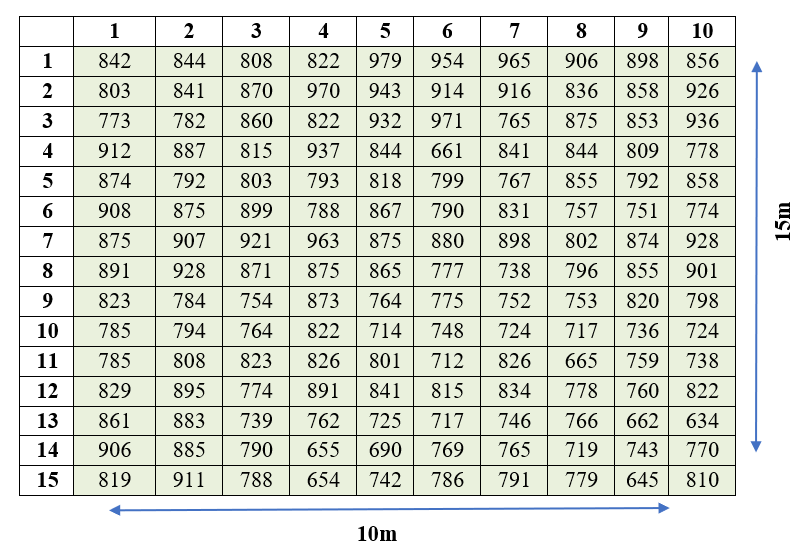
```

::: {.callout-note title="Note"}
Here $r = 15$, $c = 10$, and the total number of basic units $n = r \times c = 150$.
:::

### Fertility contour map

Also known as a soil productivity contour map. The construction of a fertility contour map is explained using the above example.

**Step 1.** Calculate the moving averages of 3 × 3 basic units, *i*.*e*. including three basic units in the rows and three basic units in the columns.

```{r echo=FALSE, out.width="90%", fig.align='center'}
#| label: fig-u2
#| fig-cap: "Calculation of moving averages of 3 × 3 basic units"
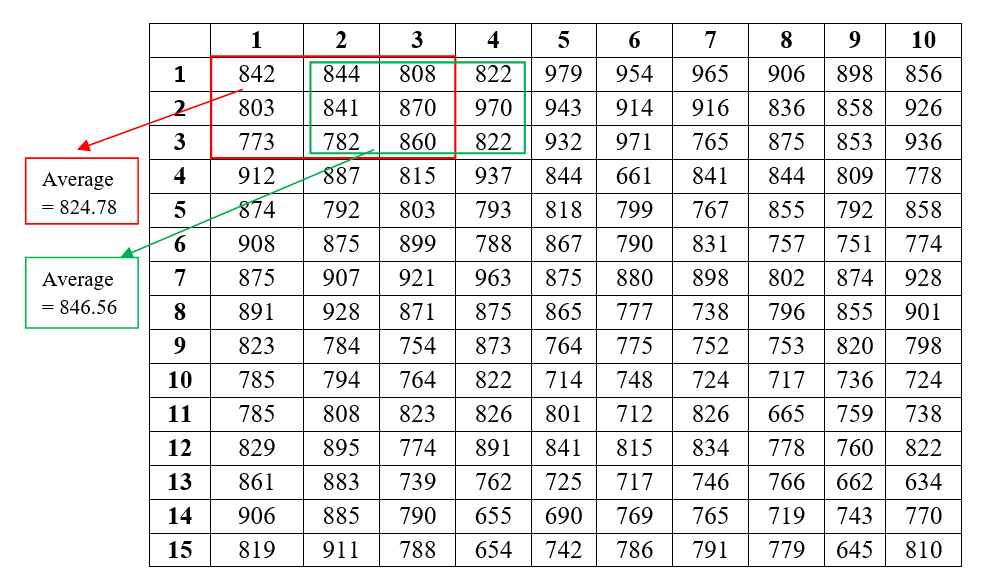
```

**Step 2.** The moving averages are labelled as shown below. After the calculation of moving averages, there are now 8 values in a row and 13 values in a column. Each moving average summarises a 3 m × 3 m window. Adjacent window centres remain 1 m apart; overlapping windows do not create new physical plots of size $10/8$ by $15/13$.

```{r echo=FALSE, out.width="90%", fig.align='center'}
#| label: fig-u3
#| fig-cap: "Moving averages recorded for all 3 × 3 basic units"
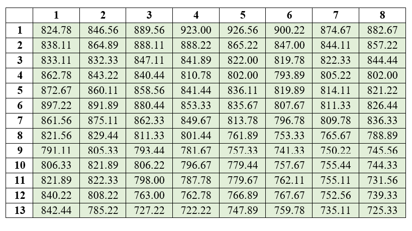
```

**Step 3.** Similar areas are given the same colour to get a fertility contour map.

```{r echo=FALSE, out.width="20%", fig.align='center'}
#| label: fig-u4
#| fig-cap: "Colouring scheme based on the range of moving averages. This can be decided by the experimenter."
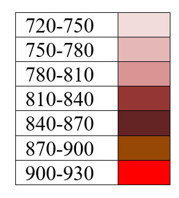
```

```{r echo=FALSE, out.width="90%", fig.align='center'}
#| label: fig-u5
#| fig-cap: "Coloured plot labelled with moving averages"
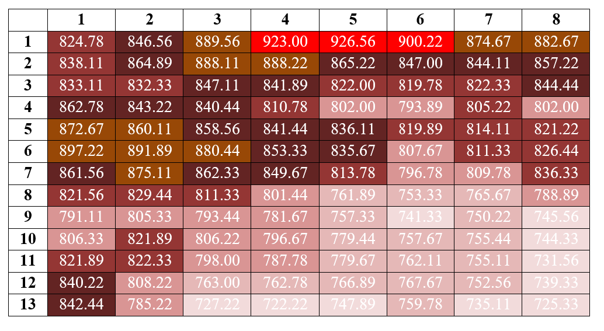
```

The final fertility contour map is obtained as shown in @fig-u6. Now you can get an idea of the fertility gradient of the field and plan how to create blocks in the field.

```{r echo=FALSE, out.width="90%", fig.align='center'}
#| label: fig-u6
#| fig-cap: "Final fertility contour map"
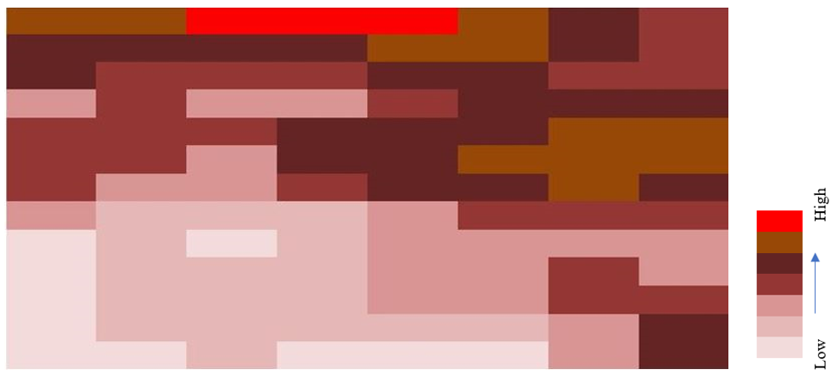
```

The fertility contour map gives only a vague idea of the fertility gradient. Other procedures may give a better idea.

### Serial correlation

The pairwise calculation of vertical values from the experimental observations shown in @fig-u1 is illustrated below.

```{r echo=FALSE, out.width="90%", fig.align='center'}
#| label: fig-serial1
#| fig-cap: "Pairwise calculation of vertical values"
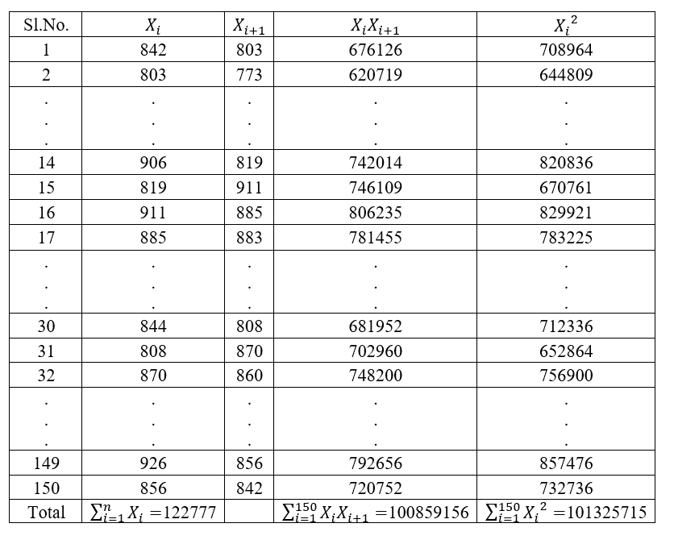
```

Using @eq-serialcorr,

Vertical $r_{s} = \dfrac{100859156 - \dfrac{(122777)^{2}}{150}}{101325715 - \dfrac{(122777)^{2}}{150}} = 0.438627$

The pairwise calculation of horizontal values is shown in @fig-serial2.

```{r echo=FALSE, out.width="90%", fig.align='center'}
#| label: fig-serial2
#| fig-cap: "Pairwise calculation of horizontal values"
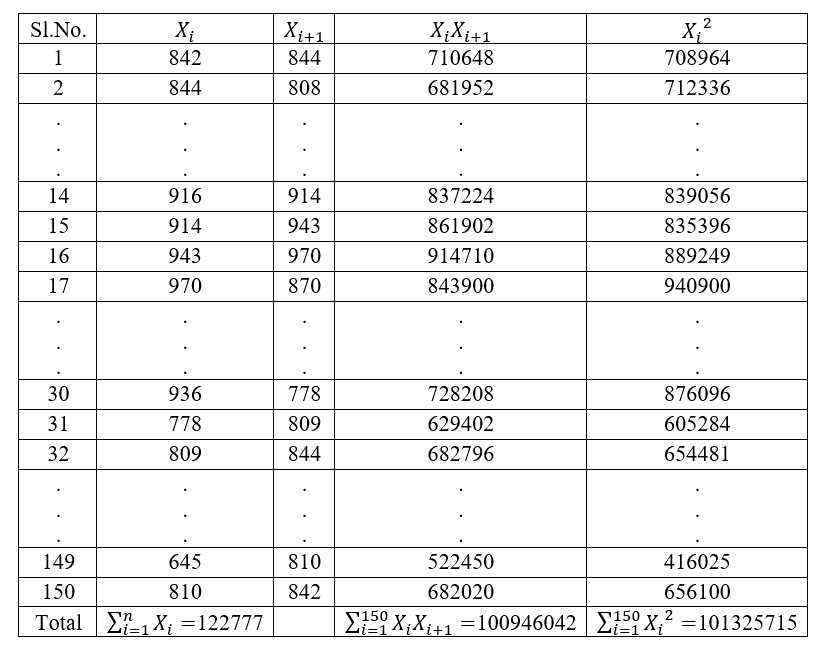
```

Using @eq-serialcorr,

Horizontal $r_{s} = \dfrac{100946042 - \dfrac{(122777)^{2}}{150}}{101325715 - \dfrac{(122777)^{2}}{150}} = 0.54317$

The coefficients show positive association along the two serpentine sequences. The horizontal value is somewhat higher, but these statistics alone do not establish spots, patches or a directional gradient. Use the contour map and strip analysis to investigate the spatial pattern.

### Mean square between strips

```{r echo=FALSE, out.width="90%", fig.align='center'}
#| label: fig-meansq
#| fig-cap: "Mean square between strips from uniformity trial data"
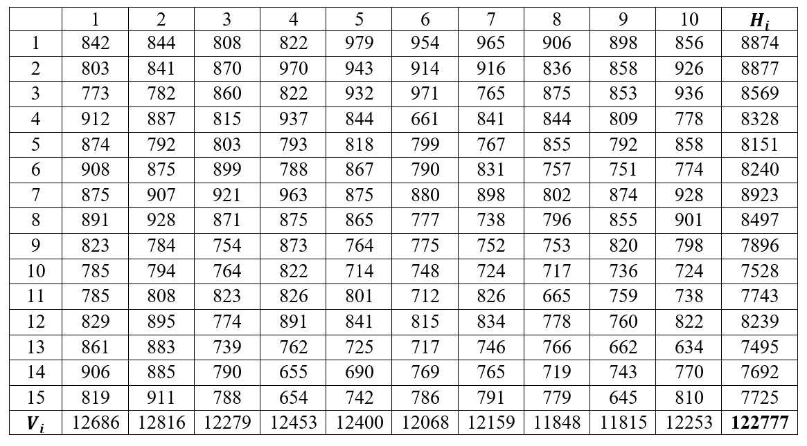
```

$G = 122777$, $n = 150$.

$$
\begin{aligned}
\text{Sum of squares (Vertical)} &= \frac{\sum_{i=1}^{c} V_{i}^{2}}{r} - \frac{G^{2}}{n}\\
&= \frac{12686^{2} + 12816^{2} + \ldots + 12253^{2}}{15} - \frac{122777^{2}}{150}\\
&= 63971.47
\end{aligned}
$$

$$
\begin{aligned}
\text{Sum of squares (Horizontal)} &= \frac{\sum_{i=1}^{r} H_{i}^{2}}{c} - \frac{G^{2}}{n}\\
&= \frac{8874^{2} + 8877^{2} + \ldots + 7692^{2}}{10} - \frac{122777^{2}}{150}\\
&= 341185.77
\end{aligned}
$$

$$\text{Mean square (Vertical)} = \frac{63971.47}{9} = 7107.94$$

$$\text{Mean square (Horizontal)} = \frac{341185.77}{14} = 24370.41$$

::: {.callout-note title="Note"}
The horizontal-strip mean square is about 3.43 times the vertical-strip mean square. This indicates a stronger component of yield variation across rows, along the length of this field. It does not by itself prove a monotonic fertility gradient or provide a significance test.
:::

### Smith's index of soil heterogeneity

::: {#exm-smith}
Smith's method describes how variance changes with plot size. Selecting a practical plot size also requires the available area, replication, precision and costs. @tbl-plotsizes shows nine plot-size and shape arrangements created from the uniformity trial data in @fig-u1.

**Solution**

```{r echo=FALSE, warning=FALSE, results='asis'}
#| label: tbl-plotsizes
#| tbl-cap: "Nine plot-size and shape arrangements from the uniformity trial data"
library(knitr)
library(kableExtra)
dt<-read.csv("csv/Book20.csv", check.names = FALSE)
kbl(dt, escape = FALSE, booktabs = TRUE, align = "c") %>%
  kable_classic(full_width = FALSE, html_font = "Georgia") %>%
  kable_styling(
    full_width = FALSE,
    position = "center",
    bootstrap_options = "bordered"
  ) %>%
  row_spec(0, bold = TRUE, align = "c") %>%
  column_spec(1:5, width = "3cm", extra_css = "text-align: center;")
```

It is recommended that the reader first read @sec-smith and then read this example. Here, we illustrate how the variance per unit area for a plot of size 25 m² (denoted as $V_{25}$) is calculated. The width and length of the plot are 5 m × 5 m. The entire plot area in @fig-u1 is divided into six plots of size 25 m² as shown in @fig-smith1.

```{r echo=FALSE, out.width="70%", fig.align='center'}
#| label: fig-smith1
#| fig-cap: "The uniformity trial plot is divided into six plots"
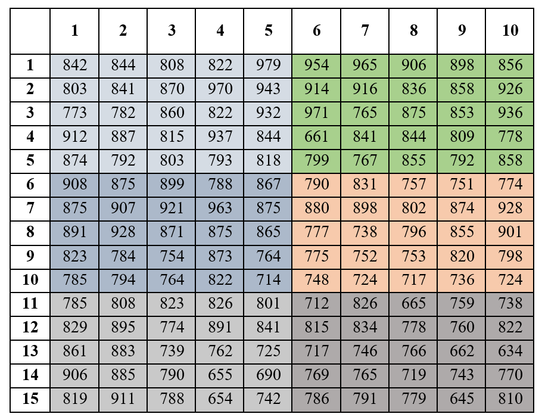
```

Now consider the between-plot sum of squares in @eq-betweenplotvar, where $w = \dfrac{rc}{x}$ is the total number of simulated plots of size $x$ basic units. $r$ is the number of rows and $c$ is the number of columns. $G$ is the total of all the basic units. The totals of each of the six plots are shown in @fig-smith2.

```{r echo=FALSE, out.width="30%", fig.align='center'}
#| label: fig-smith2
#| fig-cap: "Totals of each of the six plots"
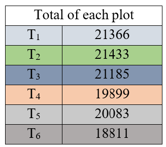
```

$$Q_{25} = \frac{21366^{2} + 21433^{2} + \ldots + 18811^{2}}{25} - \frac{(122777)^{2}}{150} = 218767.71$$

The variance per unit area is given by @eq-varperunit,

$$V_{25}=\frac{Q_{25}}{150-25}=\frac{218767.71}{125}=1750.14.$$

There are $150/25=6$ plot means. Their sample standard deviation is $\sqrt{1750.141707}=41.8347$, and their mean is $818.5133$. Hence $CV=100(41.8347/818.5133)=5.11\%$, or 5.1% to one decimal place. The corresponding variances and CV values for all plot sizes and shapes are summarized in @tbl-vxcv.

```{r echo=FALSE, warning=FALSE, results='asis'}
#| label: tbl-vxcv
#| tbl-cap: "Variance per unit area and C.V for all plot sizes"
library(knitr)
library(kableExtra)
dt<-read.csv("csv/Book21.csv", check.names = FALSE)
kbl(dt, escape = FALSE, booktabs = TRUE, align = "c") %>%
  kable_classic(full_width = FALSE, html_font = "Georgia") %>%
  kable_styling(
    full_width = FALSE,
    position = "center",
    bootstrap_options = "bordered",
    font_size = 9
  ) %>%
  row_spec(0, bold = TRUE, align = "c") %>%
  column_spec(1:7, width = "2cm", extra_css = "text-align: center;")
```

For size 5, the two orientations give the following between-plot sums of squares. Retain both orientations separately in the regression; do not treat them as independent samples for a variance test.

$Q_x$ calculated for both plot shapes:

| Plot shape | $Q_x$ |
|:----------:|:---------:|
| 1 × 5      | 329859.5  |
| 5 × 1      | 456895.9  |

: Between-plot sums of squares for size-5 plot shapes {#tbl-plotshapevar .bordered}

The descriptive ratio is $456895.9/329859.5=1.39$. Thus the 5 × 1 orientation has about 39% more variation than the 1 × 5 orientation under the same scaling. Because both partitions use the same field observations, comparison with an ordinary $F_{29,29}$ critical value is not justified. This ratio provides no valid significance test of orientation.

Now Smith's index of soil heterogeneity is estimated as follows.

```{r echo=FALSE, warning=FALSE, results='asis'}
#| label: tbl-smithindex
#| tbl-cap: "Estimation of Smith's index of soil heterogeneity"
library(knitr)
library(kableExtra)
dt<-read.csv("csv/Book22.csv")
colnames(dt) <- c("Size of plot x","$V_x$","$\\log V_x$","$Y=\\log V_x-\\log V_1$","$X=\\log x$")
kbl(dt, escape = FALSE, booktabs = TRUE, align = "c") %>%
  kable_classic(full_width = FALSE, html_font = "Georgia") %>%
  kable_styling(
    full_width = FALSE,
    position = "center",
    bootstrap_options = "bordered"
  ) %>%
  row_spec(0, bold = TRUE, align = "c") %>%
  column_spec(1:5, width = "3cm", extra_css = "text-align: center;")
```

Fit a linear regression $Y = cX$ and estimate the value of $c$, where $c = -b$.

Using the nine plot-size and shape arrangements separately and the sample variances defined in Step 3, the regression through the origin gives $c=-0.360686601$, so $b_{\text{cal}}=0.360686601\approx0.3607$. This is a descriptive fit: the alternative partitions reuse the same field observations. We retain both size-5 shapes rather than selecting one after a significance test.

If both the intercept and slope are estimated freely in $\log V_x=a-b\log x$, the same nine arrangements give $b=0.3468$. That is a different fit. The calculation above fixes the intercept at the observed $\log V_1$, as specified by $Y=cX$, and gives $b=0.3607$. State which fitting method is used; the two estimates should not be substituted for one another without changing the model.

One basic unit has area $x_1=1\text{ m}^2$ and the whole trial has area $A=150\text{ m}^2$. Thus $x_1/A=1/150=0.006667$, which selects the **0.001 to 0.01** column. The computed index 0.3607 lies between $L_1=0.35$ and $L_2=0.40$. In that column, the corresponding adjusted entries are $y_1=0.403$ and $y_2=0.443$.

$$b_{\text{adj}}=0.403+(0.3607-0.35)\frac{0.443-0.403}{0.40-0.35}=0.41156.$$

The fitted index is 21.4% of the way from 0.35 to 0.40, so the adjusted value is 21.4% of the way from 0.403 to 0.443. The result 0.41156 uses the rounded fitted index; retaining full precision gives 0.4115493, or 0.41155. Report which rounding convention is used. Thus, 0.3607 describes the fitted relationship within this trial, whereas approximately 0.41156 is the index after the finite-area adjustment prescribed by the table. The increase does not mean that the field has physically become more heterogeneous. Neither value is a percentage of soil heterogeneity. This adjusted index is a summary of variance reduction with increasing plot size; it does not establish a gradient direction or distinguish gradients from patches.
:::

### Maximum curvature method

This method (see @sec-mcm) is used to find the optimum plot size. A curve is plotted by taking the plot size (in terms of basic units) on the X-axis and the CV values on the Y-axis.

```{r echo=FALSE, out.width="60%", fig.align='center'}
#| label: fig-mcm1
#| fig-cap: "Relationship between CV and plot size"
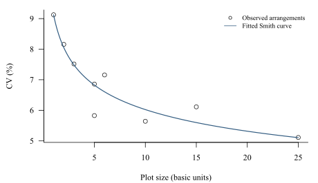
```

@fig-mcm1 shows that the 5 m × 5 m plot has the lowest CV among the arrangements examined. This does not establish a point of maximum curvature or prove that this plot size is optimal: the curve must include enough sizes beyond the apparent bend, and the result depends on the axis scales and practical costs. Treat the figure as an illustration of variation reduction.

```{r echo=FALSE, out.width="60%", fig.align='center'}
#| label: fig-mcm2
#| fig-cap: "Relationship between variance per basic unit area and plot size"
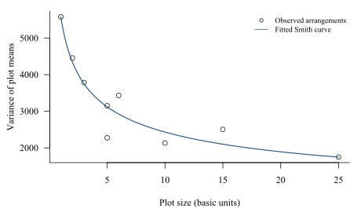
```

@fig-mcm2 shows the relationship between the variance per basic unit area $V_{x}$ and the plot size $x$.  

## Chapter Summary

### Fill in the blanks {.unnumbered}

Answers are given at the end of the chapter.

1. A field trial conducted under uniform treatment to study field variability is called a __________ trial.

2. The smallest harvested subdivision in a uniformity trial is called a __________ unit.

3. A map showing spatial patterns in yield is called a fertility __________ map.

4. The correlation between yields of neighbouring units is a form of __________ correlation.

5. The relationship $V_x=V_1/x^b$ is known as Smith's __________ law.

6. The parameter $b$ in Smith's law is an index of soil __________.

7. Taking logarithms of Smith's variance law produces a __________ relationship.

8. The slope of the regression of $\log V_x$ on $\log x$ is __________.

9. The yield of a simulated plot is the __________ of the yields of its constituent basic units.

10. To convert the variance of plot totals to the variance of yield per basic unit, divide by the __________ of the number of basic units per plot.

11. In the maximum curvature method, plot size is plotted against the coefficient of __________.

12. For a fixed total experimental area, increasing plot size reduces the number of available __________.

### Short-answer questions {.unnumbered}

1. Define a uniformity trial.

2. State the objectives of a uniformity trial.

3. Explain how a uniformity trial is conducted.

4. What are basic units?

5. What factors determine a suitable basic-unit size?

6. How can a uniformity trial help in planning a field experiment?

7. What information about a field can be obtained from a uniformity trial?

8. Explain the construction of a fertility contour map.

9. What is the purpose of using moving averages in a fertility contour map?

10. What is serial correlation?

11. Why are horizontal and vertical serial correlations calculated separately?

12. Interpret a low serial correlation in a uniformity trial.

13. Interpret a high serial correlation in a uniformity trial.

14. What is the limitation of interpreting the relative magnitude of horizontal and vertical serial correlations?

15. Explain the mean square between strips method.

16. Distinguish between horizontal and vertical strips.

17. What do the mean squares between vertical and horizontal strips describe, and why do they not by themselves establish a monotonic fertility gradient?

18. What is Fairfield Smith's variance law?

19. Explain the meaning of $V_x$, $V_1$, $x$, and $b$ in Smith's variance law.

20. What is Smith's index of soil heterogeneity?

21. Explain the interpretation of a low value of Smith's index.

22. Explain the steps involved in estimating Smith's index of soil heterogeneity.

23. Why should all possible simulated plot sizes and shapes fit exactly within the field?

24. Explain the calculation of between-plot variance.

25. Explain how variance per unit area is calculated.

26. Why should different plot shapes of the same size be compared?

27. Why is an ordinary two-sample F test inappropriate for alternative partitions of the same field?

28. Explain the regression procedure used to estimate Smith's index.

29. Why is the calculated Smith's index adjusted?

30. Explain the interpolation method used to obtain adjusted $b$.

31. What is the maximum curvature method?

32. Explain how the optimum plot size is obtained by the maximum curvature method.

33. Why does coefficient of variation generally decrease with increase in plot size?

34. Compare Smith's method and the maximum curvature method for determining plot size.

35. Explain how the results of a uniformity trial can help in deciding block size.

36. Explain the importance of plot size and shape in agricultural experiments.

37. Explain the historical importance of the uniformity trial conducted at Rothamsted Experimental Station.

### Numerical and conceptual questions {.unnumbered}

Answers are given at the end of the chapter.

1. A field of 12 m × 17 m is used for a uniformity trial. A border of 1 m is removed from all sides. Find the effective area.

2. If the effective field in Question 1 is divided into 1 m × 1 m basic units, find the total number of basic units.

3. Explain why fertilizer and other management inputs must be applied uniformly in a uniformity trial.

4. A uniformity trial gives low horizontal and vertical serial correlation coefficients. What does this indicate about the distribution of fertility?

5. The horizontal serial correlation is 0.54 and the vertical serial correlation is 0.44. Explain the interpretation based on the chapter.

6. Use the strip totals in @fig-meansq to calculate the vertical and horizontal mean squares between strips.

7. The vertical mean square is 7107.94 and the horizontal mean square is 24370.41. Which direction shows greater fertility variation?

8. Explain why the relative magnitude of the two serial correlation coefficients should not be used to quantify the relative degree of fertility gradients.

9. A uniformity trial contains $r$ rows and $c$ columns of basic units. Find the total number of basic units.

10. A plot size contains $x$ basic units and the field contains $rc$ basic units. Find the number of simulated plots.

11. Use the six size-25 plot totals in @fig-smith2 to calculate the between-plot sum of squares $Q_{25}$ and then the sample variance of plot means $V_{25}$.

12. Explain the distinction between the between-plot sum of squares $Q_x$ and the variance per basic unit area $V_x$.

13. For a plot size having two orientations, the between-plot sums of squares are 456895.9 and 329859.5. Calculate their descriptive ratio.

14. A ratio of 1.39 is obtained from two alternative partitions of the same field. Can it be compared directly with an ordinary F-table value? Explain.

15. Given $b_{\text{cal}}=0.3607$, $L_1=0.35$, $L_2=0.40$, $y_1=0.403$, and $y_2=0.443$, calculate the adjusted Smith's index.

16. Explain the interpretation of an adjusted Smith's index of 0.41156.

17. A uniformity trial gives CV values for several plot sizes. Explain how the optimum plot size can be identified using the maximum curvature method.

18. If the CV decreases sharply up to a particular plot size and then changes only slightly, explain which plot size would be considered appropriate.

19. Explain why the optimum plot size obtained from the maximum curvature method may depend on the crop and field conditions.

20. A field has strong fertility variation in the horizontal direction. Explain how this information can be used while planning blocks.

### Important formulae {.unnumbered}

Serial correlation:

$$
r_s=\frac{\sum_{i=1}^{n}X_iX_{i+1}-\frac{\left(\sum_{i=1}^{n}X_i\right)^2}{n}}{\sum_{i=1}^{n}X_i^2-\frac{\left(\sum_{i=1}^{n}X_i\right)^2}{n}}
$$

Total number of basic units:

$$
n=r\times c
$$

Vertical sum of squares:

$$
SS_V=\frac{\sum_{i=1}^{c}V_i^2}{r}-\frac{G^2}{n}
$$

Horizontal sum of squares:

$$
SS_H=\frac{\sum_{i=1}^{r}H_i^2}{c}-\frac{G^2}{n}
$$

Vertical mean square:

$$
MS_V=\frac{SS_V}{c-1}
$$

Horizontal mean square:

$$
MS_H=\frac{SS_H}{r-1}
$$

Fairfield Smith's variance law:

$$
V_x=\frac{V_1}{x^b}
$$

Logarithmic form of Smith's variance law:

$$
\log V_x=\log V_1-b\log x
$$

Difference form:

$$
\log V_x-\log V_1=-b\log x
$$

Regression form:

$$
Y=cX
$$

where

$$
Y=\log V_x-\log V_1
$$

and

$$
X=\log x
$$

Relationship between regression coefficient and Smith's index:

$$
c=-b
$$

Number of simulated plots:

$$
w=\frac{rc}{x}
$$

Between-plot sum of squares:

$$
Q_x=\sum_{i=1}^{w}\frac{T_i^2}{x}-\frac{G^2}{rc}
$$

Variance per unit area:

$$
V_x=\frac{Q_x}{rc-x}
$$

Coefficient of variation:

$$
CV=\frac{\text{Standard deviation}}{\text{Mean}}\times100
$$

Standard deviation from variance:

$$
SD=\sqrt{V_x}
$$

Adjusted Smith's index:

$$
\text{Adjusted }b=y_1+(b_{\text{cal}}-L_1)\frac{y_2-y_1}{L_2-L_1}
$$

Descriptive ratio for two plot shapes (not an F test for dependent partitions):

$$
R=\frac{\text{Larger between-plot sum of squares}}{\text{Smaller between-plot sum of squares}}
$$

### Quick revision {.unnumbered}

- Uniformity trial → used to study the nature and extent of fertility variation in a field.

- A single crop variety is grown over the entire field.

- All management inputs, including fertilizer if used, are applied uniformly.

- A substantial border is removed before dividing the field into basic units.

- Basic unit → smallest unit from which yield is separately recorded.

- Yield differences among basic units → measure of soil heterogeneity.

- Smaller basic units → finer spatial detail, balanced against harvesting accuracy and cost.

- Uniformity trials can help determine → fertility variation, plot size, plot shape, and block size.

- Fertility contour map → graphical representation of soil heterogeneity.

- Moving averages → used to reduce random variation and identify areas of similar fertility.

- Similar fertility areas → grouped together in the contour map.

- Serial correlation → measures the relationship between neighbouring observations.

- Horizontal and vertical serial correlations → used to identify the direction of fertility variation.

- Low serial correlation → little linear association at the chosen lag; this alone does not establish patches.

- High serial correlation → neighbouring yields are associated; use the field map to assess gradients and patches.

- Mean square between strips → simpler method having the same objective as serial correlation.

- Between vertical strips → measures variation across columns, in the horizontal direction.

- Between horizontal strips → measures variation across rows, in the vertical direction.

- Larger strip mean square → indicates greater variation in that direction.

- Fairfield Smith's variance law → relates plot size to the variance of yield per basic unit area.

- Smith's law → $V_x=V_1/x^b$.

- Smith's index of soil heterogeneity → $b$.

- $b$ → quantitative measure of soil heterogeneity.

- Lower $b$ → slower fitted variance reduction, often associated with positive nearby correlation; a gradient is not established.

- Higher $b$ → a faster fitted reduction in variance as plot size increases; it does not establish a patch pattern.

- Values from 0 to 1 describe the usual idealised range of Smith's index; empirical fitted values can fall outside this range.

- Simulated plots → formed by combining basic units into different sizes and shapes.

- Only plot arrangements that fit exactly within the whole field are used.

- Between-plot sum of squares → calculated for each simulated plot size and shape.

- Variance per basic unit area $V_x$ → sample variance of plot means, equal to $Q_x/(rc-x)$.

- Alternative shapes partition the same field → their variance estimates are dependent.

- Retain shapes separately or state a descriptive averaging rule; an ordinary F test does not justify pooling dependent partitions.

- Smith's index → estimated by regression of $Y=\log V_x-\log V_1$ on $X=\log x$.

- In $Y=cX$, $c=-b$.

- Adjusted $b$ → obtained using interpolation from the adjusted $b$ table.

- Maximum curvature method → used to determine optimum plot size.

- In maximum curvature method → plot size is plotted on the X-axis and CV on the Y-axis.

- As plot size increases → CV generally decreases.

- Apparent bend → a traditional plot-size guide sensitive to axis scales and the available arrangements.

- In the rice example → the field was 12 m × 17 m.

- After removing a 1 m border from all sides → effective area was 10 m × 15 m.

- With 1 m × 1 m basic units → there were 150 basic units.

- In the example, vertical serial correlation → 0.438627.

- In the example, horizontal serial correlation → 0.54317.

- Positive sequence correlations describe nearby similarity; they do not by themselves establish patches or gradients.

- The higher horizontal sequence correlation alone does not establish a horizontal fertility gradient.

- In the example, the larger horizontal-strip mean square indicates greater yield variation across rows; a monotonic gradient is not established.

- For plot size 25 m² in the example → $V_{25}=1750.14$.

- The calculated Smith's index in the example was $b=0.3607$ before adjustment.

- The adjusted Smith's index in the example was approximately $0.41156$.

- The index summarises variance reduction with plot size; identifying gradients or patches also requires spatial information.

- Uniformity trials are important because field variability exists even when all management practices are kept uniform.

### Answers to fill in the blanks {.unnumbered}  

::: {.answer-key}

`1.` Uniformity `2.` Basic `3.` Contour `4.` Serial `5.` Variance `6.` Heterogeneity `7.` Linear `8.` $-b$ `9.` Sum `10.` Square `11.` Variation `12.` Plots
:::

### Solutions to numerical and conceptual questions {.unnumbered}

1.  Removing a 1 m border from all sides of a 12 m × 17 m field leaves an effective area of $(12-2)\times(17-2)=10\times15=150\text{ m}^2$.

2.  With 1 m × 1 m basic units, the number of basic units is $10\times15=150$.

3. Fertilizer need not be omitted. Apply it, and all other management inputs, uniformly so that treatment differences do not create artificial spatial variation. Yield variation can also include measurement error and other environmental effects.

4. Low neighbour correlations indicate little linear association at the chosen lag. They do not establish spots or patches; inspect the spatial map and other diagnostics.

5. There is positive association along both chosen sequences, somewhat stronger horizontally. The coefficients alone do not establish a directional gradient or classify the field as patchy.

6.  The vertical and horizontal sums of squares are 63971.47 and 341185.77. Their mean squares are $63971.47/9=7107.94$ and $341185.77/14=24370.41$, respectively. Using @eq-ssvertical and @eq-sshorizontal, compute $SS_V=\dfrac{\sum V_i^2}{r}-\dfrac{G^2}{n}$ and $SS_H=\dfrac{\sum H_i^2}{c}-\dfrac{G^2}{n}$ from the given vertical strip totals $V_i$, horizontal strip totals $H_i$, and grand total $G$; then divide each by its degrees of freedom, $(c-1)$ for vertical and $(r-1)$ for horizontal, using @eq-msvertical and @eq-mshorizontal.

7.  The greater mean square between horizontal strips indicates greater variation across rows, along the vertical length of the field. The strip names refer to their orientation, not to the direction perpendicular to them.

8. Serial correlation measures association between neighbouring yields at the chosen lag. It is not a calibrated measure of gradient steepness, and comparing two coefficients alone does not determine the direction or strength of a fertility gradient. Examine the field map and strip variation as well.

9.  The total number of basic units is $n=r\times c$.

10. The number of simulated plots of size $x$ basic units is $w=\dfrac{rc}{x}$.

11. The six plot totals give $Q_{25}=218767.71$. Using @eq-varperunit, $V_{25}=Q_{25}/(150-25)=1750.14$. The first quantity is a sum of squares; the second is a sample variance.


12. With $z_i=T_i/x$, $Q_x=x\sum(z_i-\bar z)^2$ and $w=rc/x$. Thus the sample variance of plot means is $V_x=Q_x/[x(w-1)]=Q_x/(rc-x)$. The alternative field-scaled quantity $Q_x/(rc-1)$ is different and is not used with this worked adjustment.

13. The descriptive ratio is $R=456895.9/329859.5=1.39$. It is not automatically an F statistic with a known reference distribution.

14. No. Alternative partitions reuse the same observations, so their variance estimates are dependent. The independent normal-sample assumptions of the ordinary variance-ratio F test are not met. No significance conclusion follows from this ratio alone.

15. Adjusted $b=0.403+(0.3607-0.35)\dfrac{0.443-0.403}{0.40-0.35}=0.41156$.

16. The value 0.41156 indicates an intermediate rate of variance reduction as plot size increases. Smith's index alone cannot establish whether the field has a gradient or patches; directional and spatial analyses are needed.

17. Plot size on the X-axis and CV on the Y-axis. Locate an apparent bend as a traditional graphical guide. State the axis scales and arrangements examined. Inspection alone does not establish a unique statistical or economic optimum.

18. The plot size near where the CV curve levels off, that is, near the point of maximum curvature, may be a candidate, provided the scale, precision, replication and cost considerations support it, since increasing the plot size beyond this point gives only a small further reduction in CV for a proportionally larger increase in plot size.

19. Different crops and fields have different patterns and magnitudes of inherent soil heterogeneity, so the plot size at which the CV curve stabilises will naturally differ from one crop or field to another.

20. Since the variation is strongest in the horizontal direction, blocks should be formed as long, narrow strips running perpendicular to the horizontal gradient (that is, oriented vertically), so that the units within each block are as homogeneous as possible.

::: {.callout-caution title="Historical Insights"}
**The wheat field that started it all**

In 1910, at the Rothamsted Experimental Station in England, two researchers named **W. B. Mercer** and **A. D. Hall** carried out a classic uniformity trial. They took a single one-acre field of wheat, grew it under completely uniform treatment, and then harvested it as 500 tiny separate plots, each approximately one five-hundredth of an acre, recording the grain and straw yield of every plot on its own. When they looked at the results, something important became clear: even though every plot had received identical treatment, the yields varied considerably from one plot to the next. The variation revealed spatial differences despite uniform treatment; measurement error and other environmental influences can also contribute.

Their 1911 paper, *The Experimental Error of Field Trials*, showed that neighbouring plots tended to resemble one another, and that combining small plots into larger ones reduced the variability per unit area, exactly the ideas behind the fertility contour map, the serial correlation, and Fairfield Smith's variance law that you have studied in this chapter. [@MercerHall1911] The experiment provided an influential measure of field variability, and it convinced a generation of researchers that the size and shape of a plot, and the way plots are grouped into blocks, must be chosen deliberately rather than by guesswork. The patiently subdivided acre remains an influential illustration of the importance of field variability.
:::

::: {.callout-tip title="Quotes to Inspire"}
**“The business of the statistician is to catalyze the scientific learning process.”**\
**- George Box**
:::  
